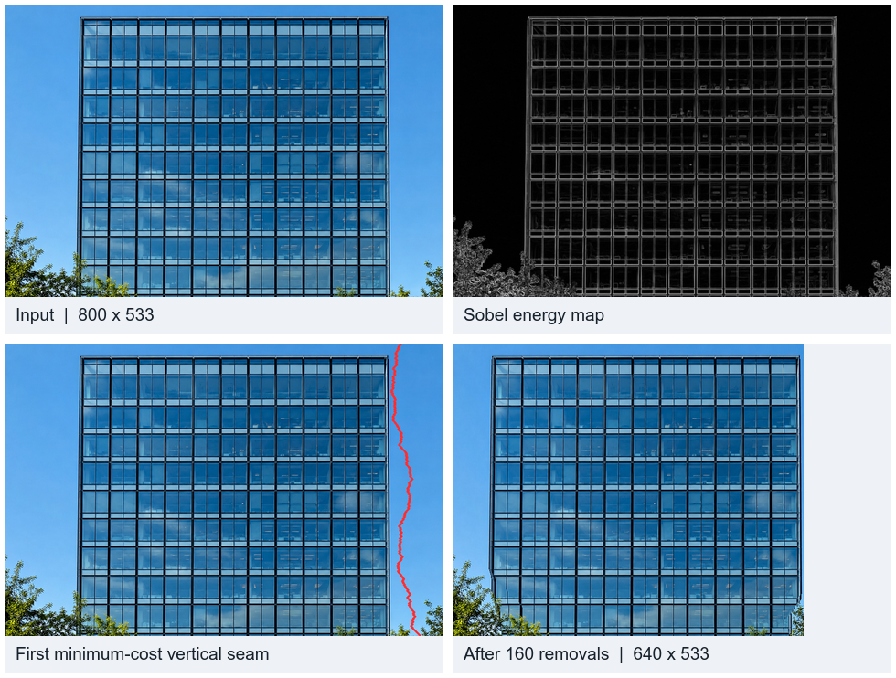

# R1: Q2a and the DP algorithm

**Owner:** Shee Yang  **Code partner:** C1 ([`docs/tasks/C1-core-dp.md`](../tasks/C1-core-dp.md))
**Assignment items:** 2a (i), 2a (ii), 1, 5b (DP part), 5a

## What to write

### 1. Q2a (i): the number of seams grows at least exponentially in m

Given an m x n image with n > 1, where a seam has one pixel per row and adjacent rows differ by at most one column.
- Prove the number of seams is at least exponential in m. A complete answer states the claim (give the explicit lower bound), proves it by induction on the rows or by counting choices per row, and says where `n > 1` is needed.
- Hint: count how many choices a seam has in the next row once it is at a given pixel, including at the left and right borders.
- Explain why this rules out brute force and motivates dynamic programming.

### 2. Q2a (ii): relating the seam problem to subproblems

- Define the subproblem precisely (the cheapest seam from the top row ending at pixel `(i, j)`), then write the recurrence **with the boundary cases** (first and last column, first row).
- Argue optimal substructure: why the best seam ending at `(i, j)` contains a best seam ending at one of its three parents.
- Give the answer extraction (minimum over the last row) and how the seam is recovered (backtracking).
- Give the running time and space of the table (feed section 5b below).

### 3. DP algorithm, design and implementation (item 1)

- The three steps from the brief: energy map, minimum seam by DP, remove and repeat. Include pseudocode and a small worked example (a 3x3 or 4x4 grid with the table filled in).
- Vertical and horizontal seams (the horizontal case runs the same code on the transposed image).
- The Sobel energy: the kernels, grayscale conversion, border clamping.
- The tie-breaking rule (leftmost), and why a fixed rule matters for comparing algorithms.
- **Alternatives considered** (rubric: "Consider alternative approaches"): e.g. forward energy, other energy functions, which ones you did not use and why.

### 4. Correctness and testing

Summarise C1's tests: hand-checked seams, the brute-force comparison on random maps, edge cases (width 1, ties, same-size resize). State exactly what was checked and the result.

### 5. Complexity (5b, DP part)

- Energy map: time and space.
- One seam by DP: time `O(mn)`, space for the full table versus rows only; seam removal cost.
- Whole resize to remove `k` seams: total time including recomputing the energy map every time. Say how it grows with `k`, `m` and `n`.
- Show your working, not only the final answer. These are the analysis marks.

## Needs from the code partner (C1)

- Recurrence and tie rule as implemented; list of edge cases found; brute-force test result.
- A few images of an energy map and a removed seam for the worked example (`figures/`).

## Figures and tables

- Worked DP table example. Energy map of a test image. Seam drawn on a test image.

## Draft

## Question 2a(i) — Number of vertical seams

Let the image have $m \ge 1$ rows and $n > 1$ columns, indexed from 1. A vertical seam is a sequence of columns $s_1,\ldots,s_m$ with $1 \le s_i \le n$ and $|s_i-s_{i-1}| \le 1$ for every $i \ge 2$.

There are $n$ choices for $s_1$. Every valid seam prefix ending before the last row has at least two extensions to the next row. It can stay in the same column or move to an adjacent column. Even at a border, there is an inward move because $n>1$. Extensions of different prefixes are distinct because they retain all earlier column choices. If $P_r$ counts prefixes of length $r$, then $P_1=n$ and $P_{r+1}\ge 2P_r$. Hence there are at least $n2^{m-1}$ vertical seams. At $n=2$ this bound is exact. At $n=1$ there is only one seam, regardless of $m$.

An exhaustive search that visits every seam therefore takes $\Omega(n2^{m-1})$ time even if it accumulates costs while extending prefixes. Dynamic programming uses only $mn$ states because prefixes ending at the same pixel have the same allowed continuations.

## Question 2a(ii) — Minimum-cost seam subproblems

Given the pixel energy $e[i,j]$, let $M[i,j]$ be the minimum cost of a seam prefix that starts anywhere in row 1 and ends at pixel $(i,j)$. The cost is the sum of the energies along that prefix, including both endpoints. The first row contains single-pixel prefixes, so $M[1,j]=e[1,j]$. For $i>1$, define the valid predecessor columns $P(j)=\{p \mid 1\le p\le n,\ |p-j|\le 1\}$. Then

$$
M[i,j] = e[i,j] + \min_{p\in P(j)} M[i-1,p].
$$

For an interior column, the candidates are $j-1,j,j+1$. The first column uses columns 1 and 2, and the last column uses $n-1$ and $n$, provided $n>1$. A single-column map always uses predecessor column 1.

Every prefix ending at $(i,j)$ arrives from some $(i-1,p)$ with $p\in P(j)$. Its cost is at least $M[i-1,p]+e[i,j]$. Conversely, extending a minimum-cost prefix to any such predecessor gives a valid prefix ending at $(i,j)$. In particular, extending the cheapest predecessor attains the recurrence. Together with the first-row base case, this proves by induction that each table entry is the minimum cost for its endpoint.

Every complete seam ends somewhere in row $m$, so its minimum possible cost is $\min_{1\le j\le n}M[m,j]$. Choose a column attaining this minimum and backtrack one row at a time to a valid predecessor with the smallest table value. Each step recovers a predecessor attaining the recurrence, and every recovered pair is connected by construction. The full table takes $\Theta(mn)$ time and space.

## Dynamic programming implementation

### Sobel energy

The implementation first evaluates grayscale intensity as $Y=0.299R+0.587G+0.114B$. The following two $3\times3$ Sobel kernels give the horizontal and vertical responses $G_x$ and $G_y$, respectively.

$$
K_x=\begin{bmatrix}-1&0&1\\-2&0&2\\-1&0&1\end{bmatrix},
\qquad
K_y=\begin{bmatrix}-1&-2&-1\\0&0&0\\1&2&1\end{bmatrix}.
$$

When a kernel tap falls outside the image, the row and column are clamped to the nearest valid coordinates. Each energy is $|G_x|+|G_y|$. This gives low energies to locally flat areas and high energies to strong grayscale transitions. Sobel supplies a fixed pixel cost for the recurrence and gives DP, greedy and graph cut the same seam cost to minimise. Avidan and Shamir also studied adding local entropy to the gradient, which incorporates texture information through a larger neighbourhood [1]. Forward energy estimates the new discontinuities that deletion creates [2]. Its costs depend on the direction of each step, which changes the objective and the predecessor terms. See [energy.cpp](../../src/energy.cpp).

### Finding and removing seams

The code stores $M$ as a full row-major array of `double` values. It fills the rows from top to bottom and backtracks through those same values. The last-row scan and each predecessor choice take the leftmost minimum. With exactly represented costs, tied seams are therefore ordered by column from the bottom row upward. For fractional energies, the code compares stored values directly, so rounding can affect which values compare equal. A fixed rule makes the output repeatable for a given energy map and helps explain differences between algorithms when equally cheap seams exist. See [seam_dp.cpp](../../src/seam_dp.cpp).

```text
FindVerticalSeam(I):
    e = SobelEnergy(I)
    M[1, *] = e[1, *]
    for each row i from 2 to height(I):
        for each column j from 1 to width(I):
            M[i, j] = e[i, j] + min(M[i-1, p] for p in P(j))
    s[height(I)] = leftmost minimum column in the last row of M
    for each row i from height(I) down to 2:
        s[i-1] = leftmost minimum column in M[i-1, *] among P(s[i])
    return s

Shrink(I, target_width, target_height):
    prefer vertical first
    while either dimension exceeds its target:
        choose the preferred direction if it still needs shrinking
        otherwise choose the other direction
        transpose I if the chosen direction is horizontal
        s = FindVerticalSeam(I)
        I = copy each row in order, omitting its pixel at s[row]
        transpose I back if the chosen direction was horizontal
        prefer the direction opposite to the one just used
    return I
```

Transposition turns the original columns into rows, so a vertical seam on the transposed image gives one removed pixel per original column. The two Sobel responses swap under transposition, and their absolute values are summed, so the energy is transposed as well in exact arithmetic. Energy is recomputed after every removal because the surviving pixels can have new neighbours. When both dimensions need shrinking, the implementation alternates directions, starting vertically. The optimality proof applies to one seam in its current image. The final image depends on the sequence of removals. See [resize.cpp](../../src/resize.cpp).

### Worked example

The table uses the 3-by-3 energy map in the hand-checked DP test. Rows and columns are numbered from 1.

| Row | $e[i,1]$ | $e[i,2]$ | $e[i,3]$ | $M[i,1]$ | $M[i,2]$ | $M[i,3]$ |
| --- | ---: | ---: | ---: | ---: | ---: | ---: |
| 1 | 5 | **1** | 0 | 5 | **1** | 0 |
| 2 | **1** | 9 | 9 | **2** | 9 | 9 |
| 3 | 5 | **1** | 9 | 7 | **3** | 18 |

At the left boundary, $M[2,1]=1+\min(5,1)=2$. The bottom-row minimum is $M[3,2]=3$. Backtracking goes through $M[2,1]=2$ and $M[1,2]=1$, giving seam $(2,1,2)$ with cost $1+1+1=3$. The zero-energy top-right pixel can reach only pixels of energy 9 in the second row. See [test_dp.cpp](../../tests/test_dp.cpp).

## DP correctness and results

| Check | Expected result and evidence |
| --- | --- |
| Exhaustive comparison | For each combination of width and height from 1 to 6, the test enumerated every seam on 50 fixed-seed integer energy maps. All 1,800 maps returned a valid seam with the minimum cost and the expected bottom-up tie choice. |
| Hand-checked seams | The 3-by-3 example, width-one, height-one, 1-by-1 and tie cases returned the expected seams. Empty or inconsistent maps raised `std::invalid_argument`. |
| Sobel energy | A flat image gave zero energy, the synthetic edges had their expected responses, and the 2-by-1 border case gave 400 at each pixel. The tests also checked the grayscale weights and transpose symmetry. |
| Resize | The tests covered unchanged targets, width-only, height-only, mixed and 1-by-1 targets, and invalid sizes. They also checked the callback count, removal order and equivalence of a horizontal seam to a vertical seam on the transpose. |

Both CTest targets passed in the Windows verification run (`ctest --test-dir build --output-on-failure`), including all 100 doctest cases and the CLI dimension checks. The DP-related cases are in [test_dp.cpp](../../tests/test_dp.cpp), [test_energy.cpp](../../tests/test_energy.cpp) and [test_resize.cpp](../../tests/test_resize.cpp).



**Figure R1.** The Sobel energy map for `edges-glass-building.png` is displayed in grayscale, with brighter pixels representing higher energy. The red line is widened for visibility and follows the first minimum-cost vertical seam, which runs through the sky to the right of the building and has a seam cost of 1,300.908. The last panel shows the output after 160 vertical removals. At 20% width reduction the sky margins are narrower and the window grid remains recognisable. The figure uses the baseline DP implementation and the team's generated [test image](../../testdata/README.md).

The benchmark below uses scaled copies of the same image and removes 20 vertical seams in each of three repeats per size. The table reports the run with the median total time. Seam finding includes the DP table fill and backtracking. Total time also includes the image copy, Sobel recomputation, seam cost calculation and pixel removal. At 800 by 533, seam finding accounted for about 8.2% of the measured total. The shared work around seam finding matters when interpreting whole-resize timings. See the [benchmark CSV](../../results/bench_edges-glass-building.csv) and [run log](../../results/bench_edges-glass-building.log).

| Starting width × height | Total time (ms) | Seam finding (ms) |
| --- | ---: | ---: |
| 100 × 67 | 5.078 | 0.589 |
| 200 × 133 | 15.191 | 1.405 |
| 400 × 267 | 61.117 | 3.208 |
| 800 × 533 | 264.001 | 21.551 |

## DP complexity

For one vertical seam on an $h\times w$ image:

| Operation | Time | Storage |
| --- | --- | --- |
| Compute Sobel energy | $\Theta(hw)$, with fixed-size kernels per pixel | $\Theta(hw)$ for the energy map |
| Fill the DP table | $\Theta(hw)$, with at most three predecessor costs per pixel | $\Theta(hw)$ for the cumulative costs |
| Pick the endpoint and backtrack | $\Theta(w+h)$, scanning the bottom row and recovering one pixel per row | $\Theta(h)$ for the seam |
| Remove the seam | $\Theta(hw)$, scanning rows and copying survivors | $\Theta(h(w-1))$ for the new image |

The minimum cost alone can be found in $\Theta(w)$ DP workspace by retaining two rows. The baseline keeps the full table so it can recover the seam in one upward pass. A horizontal step swaps $h$ and $w$ and adds two transposes. Each transpose costs at most $\Theta(hw)$ time and space, so the per-step bounds remain the same.

The implementation first copies the $m\times n$ input image in $\Theta(mn)$ time. If the current dimensions before removal $t$ are $h_t\times w_t$, the total runtime for $k$ removals is $\Theta(mn+\sum_{t=0}^{k-1}h_tw_t)$. For $k$ vertical removals, with $1\le k\le n-1$, the sum is

$$
\sum_{t=0}^{k-1}m(n-t) = m\left(kn-\frac{k(k-1)}{2}\right).
$$

The sum stays between $kmn/2$ and $kmn$ under this bound on $k$, so vertical-only resizing takes $\Theta(kmn)$ for $k\ge 1$. For mixed directions, $O((k+1)mn)$ follows because each current image fits inside the original dimensions. Peak storage is $\Theta(mn)$ for the baseline because each step holds a constant number of image-sized buffers and releases its temporary storage before the next step.

### References for report assembly

[1] S. Avidan and A. Shamir. 2007. *Seam Carving for Content-Aware Image Resizing*. ACM Transactions on Graphics 26(3), Article 10. [DOI 10.1145/1239451.1239461](https://doi.org/10.1145/1239451.1239461).

[2] M. Rubinstein, A. Shamir, and S. Avidan. 2008. *Improved Seam Carving for Video Retargeting*. ACM Transactions on Graphics 27(3), Article 16. [DOI 10.1145/1360612.1360615](https://doi.org/10.1145/1360612.1360615).
