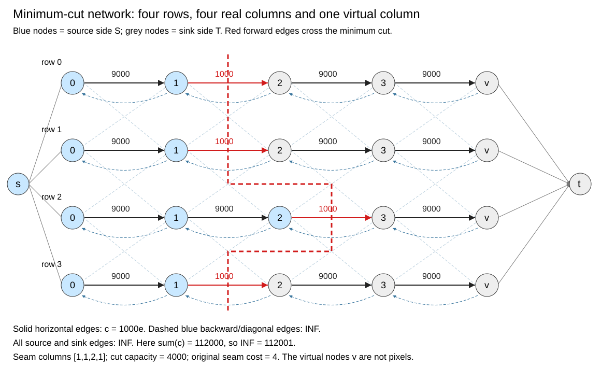
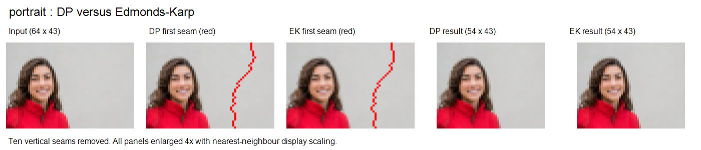
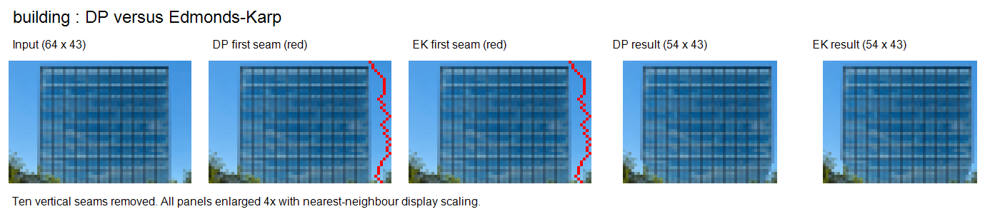

# R3: Graph cut formulation + Edmonds-Karp

**Owner:** Zhi Kai  **Code partner:** C3 ([`docs/tasks/C3-graph-cut.md`](../tasks/C3-graph-cut.md))
**Works with:** R4 (Dinic and the graph cut vs DP comparison), who builds on your formulation section
**Assignment items:** 4 (formulation and Edmonds-Karp), 5b (graph cut, EK part)

## What to write

### 1. The min-cut formulation (item 4)

- Describe the graph: nodes, source and sink, the finite edges with their capacities, and the infinite backward and diagonal edges. Draw a small example (e.g. 4 rows x 4 columns) with the minimum cut highlighted.
- Explain **why** every finite cut crosses each row exactly once and why the cut is a connected seam (what the infinite edges forbid). This is the core of the design marks.
- Explain how the seam is read from the cut: BFS/DFS from the source in the residual graph, then the rightmost source-side pixel per row.
- State the max-flow min-cut theorem and how it makes the cut capacity equal the seam cost, so the seam is optimal.
- Describe the **last-column issue and your fix** (see C3 task) and why it was needed. Say how you handled real-valued energies (scaling or tolerance) and ties.
- Horizontal seams: transposed image.
- Mention alternatives: forward-energy capacities, and that DP is a special structure of the same problem.

### 2. Edmonds-Karp and its complexity (5b, EK part)

- Edmonds-Karp: how it works (BFS shortest augmenting path), bound `O(V E^2)`, and what V and E are here (`V ~ mn`, `E ~ 5mn`, give the edge count). Give the reasoning behind the bound, not only the result.
- Space for the graph.
- Compare with DP's `O(mn)` time for one seam: say honestly why graph cut is slower, and what it offers in exchange (generality: the same machinery handles other constraints and energies).
- Mark clearly what is worst case and what is observed.
- Dinic is covered by R4. Agree with R4 who explains the shared parts (the network and the residual graph) so they are written once and referenced.

### 3. Correctness

- C3's test that EK graph-cut seam cost equals DP seam cost on random maps. Explain that the seams may differ in position when several cheapest seams tie.
- The max-flow tests on known graphs.

## Needs from the code partner (C3)

- Final network definition including the last-column fix; capacity choice; EK test results; seam images.

## Figures and tables

- Flow network example with the cut; DP vs graph-cut seam overlay.

## Draft

### Graph cut formulation

Seam carving removes a connected sequence of low-energy pixels to reduce an
image's dimensions [1]. Our graph-cut implementation finds one vertical seam
at a time. For width W and height H, a seam is a sequence s[y] containing one
column per row, with abs(s[y] - s[y-1]) <= 1. Its cost is the sum of the current
image's Sobel energies at those pixels. After removal, energies are recomputed.
Horizontal seams use the same finder on the transposed image.

The network contains nodes p(x,y), for 0 <= x <= W and 0 <= y < H, plus a
source and sink. Columns 0 to W-1 represent real pixels. Column W is virtual.
The capacities are c(x,y) = round(1000 * e(x,y)). Let C be their sum and set
INF = C + 1, using checked `long long` arithmetic.

| Directed edge | Capacity | Purpose |
|---------------|----------|---------|
| source -> p(0,y) | INF | The first node in each row belongs to the source side |
| p(W,y) -> sink | INF | Each virtual node belongs to the sink side |
| p(x,y) -> p(x+1,y), x=0..W-1 | c(x,y) | Cutting this edge selects real pixel (x,y) |
| p(x,y) -> p(x-1,y), x=1..W | INF | The source side of a row must be a prefix |
| p(x,y) -> p(x-1,y-1), where valid | INF | Constrain the endpoint in the row above |
| p(x,y) -> p(x-1,y+1), where valid | INF | Constrain the endpoint in the row below |

The virtual column corrects a boundary problem in the brief's basic network.
If the last real column connects directly to the sink with infinite capacity,
it cannot be selected as the rightmost source-side pixel. In our network,
cutting p(W-1,y) -> p(W,y) selects the last real pixel and charges its energy,
so every column available to DP is also available to graph cut.



*Figure R3.1.* The real-pixel energy grid has value 1 at columns [1,1,2,1]
and value 9 elsewhere. This connected seam is the unique optimum. Its scaled
cut capacity is 4000, corresponding to original seam cost 4. Blue dashed
edges are INF constraints; red horizontal edges cross the cut. All backward
and diagonal constraints are included, including those from the virtual
column. The figure does not draw the additional reverse residual edges.

### Why the minimum cut is an optimal seam

The network establishes a correspondence between valid seams and cuts that
avoid INF edges:

1. A straight seam defines a cut with capacity at most C. Therefore a minimum
   cut costs less than INF and cannot cross any INF edge.
2. The source and sink connections force the first node of each row into S
   and the virtual node into T. Backward constraints prevent a node in S from
   having a node in T to its left. Thus each row consists of an S prefix and
   a T suffix, separated by exactly one finite forward edge.
3. Let s[y] be the last real column in the S prefix. If s[y] exceeded an
   adjacent endpoint by more than one, its diagonal INF edge would cross from
   S to T. Applying the same argument in the other direction gives
   abs(s[y] - s[y-1]) <= 1. The selected pixels therefore form a valid seam.
4. Conversely, any valid seam defines these prefixes. None of its backward,
   diagonal or terminal edges crosses from S to T. Its cut capacity is exactly
   sum_y c(s[y],y).
5. The max-flow/min-cut theorem identifies the smallest cut capacity with the
   maximum flow value [2]. The resulting seam minimises the sum of the scaled
   capacities, because every competing valid seam defines a competing cut.

After max-flow, `reachable_from()` traverses edges with positive residual
capacity from the source. The visited nodes give S, and the rightmost visited
real pixel in each row gives the seam. The flow solver's returned number is
not itself the sequence of pixels to remove.

### Capacity precision, ties and alternatives

The solver uses integer capacities to avoid floating-point tolerance decisions
inside BFS and flow updates. Scaling by 1000 matches the thousandth precision
of our grayscale coefficients, apart from floating-point arithmetic error.
Nonfinite and negative energies are rejected, and unsafe capacity ranges are
checked. Integer-valued test maps in the supported range retain their exact
cost ordering.

For arbitrary double-valued maps, rounding can change very close rankings.
Optimality is therefore exact for the integer capacities, not a promise of
identical answers for arbitrary unrounded doubles. Photo comparisons use an
absolute cost tolerance of 1e-6; random integer-map tests use exact equality.

Several seams can share the minimum cost. DP applies its documented bottom-up
tie rule, whereas residual reachability determines EK's returned minimum cut.
We compare costs on the same current image rather than require equal pixel
positions. Floating-point arithmetic can also perturb mathematically equal
costs by very small amounts.

Our finite edges use backward Sobel energy. A forward-energy formulation could
instead account for neighbour differences introduced by removal, but its
transition costs would need a corresponding formulation and validation. We
did not claim to implement that alternative. DP directly exploits the
row-by-row structure of this problem; the flow-network approach provides a
shared representation for EK and Dinic and allows other constraints when a
valid graph formulation is available. Dinic and broader comparisons are
covered in R4.

### Edmonds-Karp implementation

`FlowGraph` stores edge records in a contiguous vector and outgoing edge
indices in per-node adjacency vectors. Every added edge is followed by its
reverse residual edge, initially of capacity zero. Thus `i ^ 1` identifies
the paired edge. The explicit backward INF constraints are separate edges;
they must not be confused with reverse residual edges.

Edmonds-Karp repeatedly finds an augmenting path with the fewest edges using
BFS [2]. Our implementation records the incoming edge index for each visited
node, finds the smallest residual capacity along the path, and pushes that
amount. It subtracts from forward residual capacities and adds to their
paired reverse capacities. This permits later paths to undo earlier flow
choices. It stops when the sink is unreachable.

```text
flow = 0
while BFS finds a residual source-to-sink path:
    amount = minimum residual capacity along that path
    for each path edge i:
        residual[i] -= amount
        residual[i XOR 1] += amount
    flow += amount
return flow
```

### Time and space complexity

This implementation creates V = H(W+1)+2 nodes. There are WH finite forward
edges, WH explicit backward edges, 2W(H-1) diagonals and 2H terminal edges:

```text
E = 4WH + 2H - 2W original directed edges
2E stored edge records, including reverse residual edges
```

Network construction and residual reachability each take O(WH) time and
storage. The adjacency vectors and BFS working arrays require O(V+E) memory,
which is O(WH) for this network.

The EK bound follows from the BFS distances in the residual graph, which do
not decrease. Each augmentation saturates a bottleneck edge. Before that edge
can become a bottleneck again, a later path must use its reverse edge; its
tail's BFS distance then increases by at least two. Each edge can become a
bottleneck O(V) times, giving O(VE) augmentations. BFS costs O(E) here, so the
worst-case running time is O(VE^2) [2].

Since V and E are both O(WH), one EK seam has an O((WH)^3) worst-case bound.
DP takes O(WH) time per seam. Removing k seams rebuilds and solves a changing
network each time; using the initial dimensions gives a loose upper bound of
O(k(WH)^3) for EK versus O(kWH) for DP. These are worst-case bounds, not
predictions of a particular runtime. Our EK evaluation therefore uses small
inputs, as recommended in the C3 task.

### Correctness tests

The verified Release build passed all 87 test cases and 94,133 assertions on
16 November 2026. The captured output is in
[`results/c3-tests.log`](../../results/c3-tests.log). C3-specific checks include:

- A six-node network with known maximum flow 23 and independently summed
  cut capacity 23; a graph requiring cancellation through a reverse edge;
  parallel edges, a self loop, zero capacities and an unreachable sink.
- Exactly equal EK and DP seam costs on 500 deterministic random integer
  maps, with widths and heights from 1 to 7. Every returned seam is checked
  for connectivity and valid column indices.
- A unique optimum in the last real column, width-one and height-one maps,
  zero energies, tied minima and thousandth-valued inputs.
- Rejection of invalid maps, invalid nodes, unsafe capacities and flow
  overflow; vertical and horizontal resizing through the shared resize loop.
- A JPEG-loading integration test using a 64x43 sample of the supplied castle
  photo, comparing EK to DP on each current image during mixed resizing.

These tests provide evidence in addition to the network proof; finite random
tests alone do not establish correctness for every input.

### Visual comparison and measurements

The two team-generated source images were box-downscaled from 800x533 to
64x43 using `scale_image()` at scale 0.08. Both algorithms then removed ten
vertical seams, recomputing Sobel energy after every removal, to reach 54x43.
This initial scaling is input preparation, not part of either seam finder.
Provenance is documented in [`testdata/c3/README.md`](../../testdata/c3/README.md).



*Figure R3.2.* Original small portrait, first DP and EK seams in red, and the
two ten-seam results. Both first seams run through the background to the
right of the subject. Their original-energy costs are both 92.844 to three
decimal places, although their positions are not identical. Both outputs
retain the face and red jacket; they are not pixel-identical. At this small
resolution, the figure supports only a limited visual comparison, not a
general claim about perceptual quality.



*Figure R3.3.* Both first seams follow the building's right-side background
and have cost 826.712. They are identical in position. The final 54x43 images
are pixel-identical, although that does not imply the complete removal order
was identical. Both outputs narrow the scene; preserving every architectural
proportion is not guaranteed by an energy-minimisation objective.

For every one of the twenty EK removals across these two examples, a fresh
DP reference was evaluated on EK's exact current image. Costs agreed within
1e-6; the largest observed difference was about 1.71e-13. The per-step evidence
is [`c3-seam-checks.csv`](../../results/c3-seam-checks.csv), with first-seam and
final-pixel comparisons in [`c3-first-seams.csv`](../../results/c3-first-seams.csv).

Separate timing runs used the MSVC x64 Release build with optimisation,
on the same local Windows machine (Intel64 Family 6 Model 165 Stepping 3).
For each image and algorithm, five fresh ten-seam runs were made; the table
reports the median total time. Timing excludes file loading, saving and
figure rendering. `find_ms` measures the seam-finding share of that selected
median run and is not an independent median.

| Input | DP total (ms) | EK total (ms) | DP find (ms) | EK find (ms) |
|-------|--------------:|--------------:|-------------:|-------------:|
| Portrait, 64x43 -> 54x43 | 2.607 | 315.552 | 0.143 | 313.684 |
| Building, 64x43 -> 54x43 | 1.625 | 296.285 | 0.061 | 294.615 |

Sources: [`c3-benchmark-portrait.csv`](../../results/c3-benchmark-portrait.csv)
and [`c3-benchmark-building.csv`](../../results/c3-benchmark-building.csv).
These are local measurements, not universal speed ratios. The measurements
show that max-flow dominates EK's time even on these small examples.

The benchmark CSVs also record cumulative costs along each algorithm's own
removal sequence. They differ here: portrait 1130.006 (DP) versus 1130.916
(EK), and building 11817.066 (DP) versus 11813.936 (EK). This does not contradict
per-seam optimality: tie choices can produce different current images and
future costs, and finding the cheapest current seam does not optimise the
entire sequence of ten removals. The same-current-image checks above are the
appropriate correctness comparison.

### References for R5

[1] Shai Avidan and Ariel Shamir. *Seam Carving for Content-Aware Image
Resizing*. ACM Transactions on Graphics, 26(3), Article 10, 2007.
[Author report hosted by MERL](https://www.merl.com/publications/docs/TR2008-000.pdf).

[2] MIT OpenCourseWare. *6.046J Design and Analysis of Algorithms, Recitation
7: Network Flow and Matching*, 3 April 2015, pages 1-2.
[Edmonds-Karp analysis](https://ocw.mit.edu/courses/6-046j-design-and-analysis-of-algorithms-spring-2015/ba74f89434fc261d9366ebf136c04b52_MIT6_046JS15_Recitation7.pdf).

The graph-to-seam correspondence and edge counts above are derived for our
implemented network. R6 should renumber these local references when assembling
the final report.
