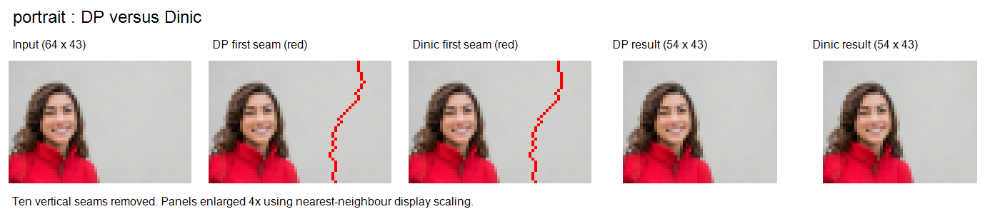
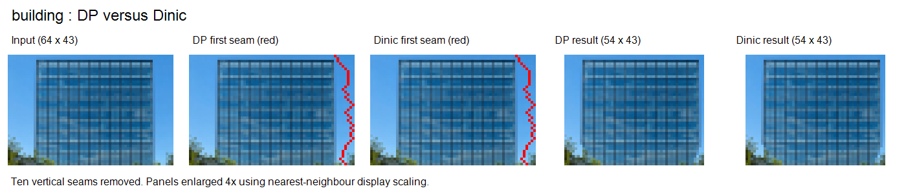

# R4: Dinic, EK vs Dinic, and graph cut vs DP

**Owner:** Dayton  **Code partner:** C4 ([`docs/tasks/C4-dinic.md`](../tasks/C4-dinic.md))
**Works with:** R3 (formulation and Edmonds-Karp), whose graph description you reference and do not repeat
**Assignment items:** 4 (Dinic), 5b (graph cut, Dinic part), 5c (graph cut vs DP)

## What to write

### 1. Dinic's algorithm

- How it works: level graph from a BFS, blocking flow by DFS along level-increasing edges, current-arc pointers, repeat until `t` is unreachable. Include pseudocode and a small worked example (2 or 3 phases on a tiny graph).
- Why it is correct (why the shortest augmenting path length strictly increases after each phase).
- Why we chose it: the brief names Ford-Fulkerson and Edmonds-Karp, and Dinic is our faster alternative on the same network. Mention other options considered (for example Boykov-Kolmogorov, push-relabel) and why they were not used.
- Implementation notes from C4: iterative DFS to avoid stack overflow, compact graph storage.

### 2. Complexity (5b, Dinic part)

- Bound `O(V^2 E)` in general, with the reasoning: at most `V` phases, each phase `O(VE)`. Say what V and E are here (see R3).
- Why it behaves much better in practice on grid-like graphs, and the observed number of phases from C4 (measured, not guessed).
- Space.
- Mark clearly what is worst case and what is observed.

### 3. Edmonds-Karp vs Dinic

- Timing table and chart from C4's `results/maxflow_*.csv` across image sizes; the size at which EK stops being practical; speedup factor.
- Link the observed difference to the two bounds and to the phase counts.
- Agreement: both give the same flow value on random graphs, and the same seam cost as DP.

### 4. Graph cut vs dynamic programming (5c)

- **Seams and visual quality:** the same image with DP and graph-cut seams. When costs are equal the outputs should be equally good; say what you see, and that seams may differ in position when several cheapest seams tie.
- **Running time:** DP vs EK vs Dinic on several image sizes, as a table and a chart; use the same timing method as R5's evaluation section.
- **Memory:** graph storage versus the DP table.
- Conclude: should anyone use graph cut for plain seam carving? What does it offer that DP does not (arbitrary constraints and energies), and what does it cost?

## Needs from the code partner (C4)

- `results/maxflow_*.csv`, Dinic phase counts, test results, DP vs Dinic seam images.

## Figures and tables

- Dinic worked example; EK vs Dinic vs DP timing chart; DP vs graph-cut seam overlay.

## Draft

### Scope and Implemented Components

This section presents the implementation, complexity analysis, and empirical evaluation of **Dinic's algorithm** for seam finding (Task C4 / Report R4), as well as a comprehensive comparison between Edmonds-Karp, Dinic, and Dynamic Programming (DP).

In our project architecture, Dinic operates on the exact same flow network formulation and seam extraction pipeline established by Zhi Kai in R3 (`find_seam_graphcut()` in `src/seam_graphcut.cpp`). The network vertices $p(x, y)$, the virtual column $W$, the integer capacity scaling ($c = \text{round}(1000 \cdot e)$), and the infinite backward and diagonal constraint edges are shared identically. By keeping graph construction and extraction uniform, the performance differences measured between Edmonds-Karp and Dinic isolate the max-flow algorithm itself.

| Component | File Location | Role in Seam Finding Pipeline |
|---|---|---|
| `dinic()` | `src/maxflow_dinic.cpp` | Max-flow solver using BFS level graphs, per-node current-arc pointers, and an iterative DFS stack |
| `find_seam_graphcut_dinic()` | `src/seam_graphcut_dinic.cpp` | Graph-cut seam finder wrapping the shared network with Dinic |
| `Algorithm::GraphCutDinic` | `src/resize.cpp`, `cli/main.cpp` | CLI and engine integration allowing `seamcli` to shrink images via Dinic |
| Unit Test Suite | `tests/test_dinic.cpp` | 12 doctest `TEST_CASE` blocks verifying textbook flows, capacity cancellations, parallel/self-loop edges, argument validation, separate phase/augmentation counters, 300 random graph comparisons against EK, 300 random map comparisons against DP, and two stack-safety tests (a 100,000-node linear path and a 200x200 energy map) |
| Benchmark Harness | `results/maxflow_benchmark.csv`, `results/maxflow_large.csv` | Empirical timing, phase counts, and augmentation records across scales from 32x21 to 1000x700 |

---

### Dinic's Algorithm

#### Overview and Core Primitives

The assignment brief suggests Edmonds-Karp or Ford-Fulkerson for solving the minimum $s\text{–}t$ cut problem. While Edmonds-Karp is guaranteed to terminate in polynomial time ($O(V E^2)$), its reliance on finding a single shortest path per BFS traversal makes it prohibitively slow on image-scale grid networks where thousands of augmentations are required.

Dinic's algorithm [2] fundamentally improves upon Edmonds-Karp by introducing two structural primitives:
1. **The Level Graph ($G_L$)**: Constructed via a Breadth-First Search (BFS) from source $s$. The level of vertex $v$, denoted $\text{level}[v]$, is defined as the unweighted shortest-path distance (number of edges) from $s$ to $v$ in the residual network $G_f$. An edge $(u, v)$ belongs to the level graph $G_L$ if and only if:
   $$\text{cap}_f(u, v) > 0 \quad \text{and} \quad \text{level}[v] = \text{level}[u] + 1$$
   Edges pointing within the same layer or backward are excluded. If the sink $t$ cannot be reached during BFS ($\text{level}[t] = -1$), no augmenting path exists in $G_f$, and the algorithm terminates.
2. **Blocking Flow**: Within each level graph, Dinic does not stop after finding one augmenting path. Instead, it finds a **blocking flow** using Depth-First Search (DFS): a flow $f'$ such that every directed path from $s$ to $t$ in $G_L$ contains at least one saturated edge ($\text{cap}_f(u, v) = 0$). Pushing a blocking flow exhausts all augmenting paths of the current shortest length simultaneously.

#### Iterative DFS and Current-Arc Optimization

A naive DFS implementation can compromise both memory safety and time complexity. Our implementation in `src/maxflow_dinic.cpp` introduces two essential design choices:

1. **Current-Arc Pointers (`iter[u]`)**:
   During the DFS phase, a vertex $u$ may be visited multiple times as different augmenting paths pass through it. If the DFS re-examined all outgoing edges from the beginning of `adj[u]` every time, earlier saturated or dead edges would be repeatedly scanned, degrading the phase complexity to $O(V^2 E)$ or worse.
   To prevent this, we maintain an array `iter[u]` initialized to 0 at the start of each phase. `iter[u]` tracks the index of the next usable outgoing edge in `g.adj[u]`. Once an edge saturates or fails to reach $t$, `iter[u]` advances and never retreats during that phase. When `iter[u] == g.adj[u].size()`, vertex $u$ has no remaining admissible paths to $t$; it is permanently marked as dead for the remainder of the phase by setting $\text{level}[u] = -1$.

2. **Iterative Stack Architecture (Preventing Call-Stack Overflow)**:
   In image seam carving, a directed path crossing a height-$H$ grid contains at least $H$ edges. On large images (e.g. $1000 \times 700$), a recursive DFS implementation would push over 700 to 1,000 stack frames, risking a runtime call-stack overflow on platforms with strict thread stack limits (such as Windows default 1 MB stacks).
   We implemented the DFS iteratively using an explicit `std::vector<int> path` storing edge indices:
   - When an admissible edge $(u, v)$ with $\text{cap} > 0$ and $\text{level}[v] = \text{level}[u] + 1$ is found, its index is appended to `path`, and the search advances to $u = v$.
   - When the search reaches $u = t$, the bottleneck capacity $\Delta = \min_{e \in \text{path}} \text{cap}(e)$ is computed. Flow $\Delta$ is pushed, updating forward capacities ($\text{cap} -= \Delta$) and paired reverse residual capacities ($\text{cap} += \Delta$).
   - Crucially, rather than resetting the DFS from $s$, the code finds the shallowest saturated edge along the path at index `cut_to`. The path is truncated to `path.resize(cut_to)`, and $u$ rolls back directly to that edge's tail. The DFS resumes immediately from that point.
   - If a dead end is encountered ($u \neq t$ and `iter[u]` is exhausted), $\text{level}[u]$ is permanently set to $-1$ for this phase so no path enters it again. Before popping the incoming edge $e$ from `path`, the algorithm identifies the node from which $u$ was entered (`g.edges[e ^ 1].to`) and increments its current-arc pointer (`++iter[...]`), ensuring the predecessor skips edge $e$ on any subsequent DFS traversal in this phase. The predecessor edge is then popped, and $u$ retreats to that predecessor node.

#### Pseudocode

```text
Algorithm: Dinic(FlowGraph G, Source s, Sink t)
Input: Flow network G = (V, E) with residual capacities, source s, sink t
Output: Maximum flow value

flow <- 0
level <- array of size |V|
iter <- array of size |V|
bfs_queue <- array of size |V|

while BuildLevels(G, s, t, level, bfs_queue) do
    fill(iter, 0)
    path <- empty list
    u <- s
    
    while true do
        if u == t then
            delta <- min_{e in path} (edge[e].cap)
            for each e in path do
                edge[e].cap <- edge[e].cap - delta
                edge[e ^ 1].cap <- edge[e ^ 1].cap + delta
            flow <- flow + delta
            
            cut_to <- index of first edge in path with edge[e].cap == 0
            truncate path to cut_to
            u <- tail vertex of edge at path[cut_to] (or s if path is empty)
            continue
        end if
        
        advanced <- false
        while iter[u] < degree(u) do
            e <- adj[u][iter[u]]
            v <- edge[e].to
            if edge[e].cap > 0 and level[v] == level[u] + 1 then
                push e to path
                u <- v
                advanced <- true
                break
            end if
            iter[u] <- iter[u] + 1
        end while
        
        if advanced then continue
        
        // Dead end: retreat
        level[u] <- -1
        if path is empty then break  // Retreated past source: phase complete
        
        iter[tail(path.back())] <- iter[tail(path.back())] + 1
        pop path.back()
        u <- tail of current path (or s if path is empty)
    end while
end while

return flow
```

#### Small Worked Example

Consider a textbook 4-node flow network to illustrate how Dinic pushes a blocking flow and increments distance levels:
- Vertices: $s = 0, v_1 = 1, v_2 = 2, t = 3$.
- Edges: $(0 \to 1, \text{cap}=3)$, $(0 \to 2, \text{cap}=2)$, $(1 \to 2, \text{cap}=1)$, $(1 \to 3, \text{cap}=2)$, $(2 \to 3, \text{cap}=3)$.

```text
        (1) --- 2 ---> (3: t)
       ^   \             ^
      3     1           3
     /       v         /
(0: s) ------ 2 ----> (2)
```

1. **Phase 1 (BFS)**:
   - Run BFS from $s=0$: $\text{level}[0] = 0$.
   - Neighbors of 0: $\text{level}[1] = 1$, $\text{level}[2] = 1$.
   - Neighbors of 1 and 2: $\text{level}[3] = 2$.
   - Level graph edges ($level[v] = level[u]+1$):
     $(0 \to 1)$, $(0 \to 2)$, $(1 \to 3)$, $(2 \to 3)$.
     *(Notice: edge $1 \to 2$ is excluded from $G_L$ because $\text{level}[1] = \text{level}[2] = 1$, so it does not advance a level).*
2. **Phase 1 (DFS Blocking Flow)**:
   - Path 1: $0 \to 1 \to 3$. Bottleneck $\Delta_1 = \min(3, 2) = 2$.
     Residuals updated: $\text{cap}(0 \to 1) = 1$, $\text{cap}(1 \to 3) = 0$. Flow $= 2$.
     Edge $(1 \to 3)$ is saturated. DFS rolls back to vertex 1.
   - At vertex 1: no more admissible arcs in $G_L$ (edge $1 \to 2$ was excluded). $\text{level}[1]$ set to $-1$. Retreat to 0.
   - Path 2: $0 \to 2 \to 3$. Bottleneck $\Delta_2 = \min(2, 3) = 2$.
     Residuals updated: $\text{cap}(0 \to 2) = 0$, $\text{cap}(2 \to 3) = 1$. Flow $= 2 + 2 = 4$.
     Edge $(0 \to 2)$ is saturated. Roll back to 0.
   - At vertex 0: `iter[0]` exhausted. Phase 1 ends with total flow $= 4$.
3. **Phase 2 (BFS)**:
   - Residual graph has positive edges: $(0 \to 1, \text{cap}=1)$, $(1 \to 2, \text{cap}=1)$, $(2 \to 3, \text{cap}=1)$, plus reverse edges.
   - BFS from $s=0$: $\text{level}[0] = 0$, $\text{level}[1] = 1$.
   - From vertex 1: edge $(1 \to 3)$ has cap 0, but $(1 \to 2)$ has cap 1! So $\text{level}[2] = 2$.
   - From vertex 2: $(2 \to 3)$ has cap 1! So $\text{level}[3] = 3$.
   - Shortest path length strictly increased from $2$ to $3$!
4. **Phase 2 (DFS Blocking Flow)**:
   - Path 3: $0 \to 1 \to 2 \to 3$. Bottleneck $\Delta_3 = \min(1, 1, 1) = 1$.
     Edges $(0 \to 1)$, $(1 \to 2)$, and $(2 \to 3)$ all saturate. Flow $= 4 + 1 = 5$.
5. **Phase 3 (BFS)**:
   - All paths from 0 to 3 are broken. $\text{level}[3] = -1$.
   - Algorithm terminates. Maximum flow $= 5$.
   - Residual reachability from 0: $\{0\}$. Cut edges: $(0 \to 1, \text{orig}=3)$ and $(0 \to 2, \text{orig}=2)$. Cut capacity $= 3 + 2 = 5 = \text{max-flow}$.

#### Correctness Proof

The correctness of Dinic's algorithm relies on the theorem that **the shortest path distance from $s$ to $t$ in the residual graph strictly increases after each phase**:
$$d_{G_f}^{(k+1)}(s, t) > d_{G_f}^{(k)}(s, t)$$

*Proof sketch*:
In phase $k$, the DFS pushes a blocking flow in $G_L$. Any augmenting path in the updated residual network $G_f^{(k+1)}$ must utilize at least one edge $(u, v)$ that was not in $G_L$. Such an edge must either be:
1. An edge that had $\text{cap}_f(u, v) = 0$ in $G_f^{(k)}$ and was reopened in reverse because flow was pushed along $(v, u)$. Since $(v, u)$ was in $G_L$, $\text{level}[u] = \text{level}[v] + 1$, meaning $(u, v)$ points backward ($\text{level}[v] = \text{level}[u] - 1$).
2. An edge that was not an augmenting edge in $G_L$.
Any path utilizing such backward edges must detour, satisfying $d_{G_f}^{(k+1)}(s, v) \ge d_{G_f}^{(k)}(s, u) - 1$. A rigorous inductive counting argument over path lengths proves that no path to $t$ can have length $\le d_{G_f}^{(k)}(s, t)$.
Because the shortest distance is bounded above by $|V| - 1$, Dinic's algorithm is guaranteed to terminate in at most $|V| - 1$ phases. Upon termination, no path connects $s$ to $t$ in $G_f$, satisfying the max-flow min-cut theorem.

#### Design Decisions and Alternatives Considered

When selecting our advanced max-flow solver, we evaluated several alternative algorithms:
1. **Edmonds-Karp ($O(V E^2)$)**: Selected as our baseline reference solver in C3/R3. While simple and reliable, searching only one path per BFS causes crippling runtime degradation on grid networks.
2. **Push-Relabel / Preflow-Push ($O(V^2 E)$ or $O(V^3)$)**: Push-relabel algorithms (Goldberg-Tarjan) maintain preflow and push locally using vertex heights. Although asymptotically efficient, managing active node queues and global relabeling heuristics introduces high constant overhead on structured sparse planar grids.
3. **Boykov-Kolmogorov (BK)**: Specifically developed for computer vision graph cuts. It maintains two search trees (source and sink) and reuses tree structures across augmentations. While extremely fast in practice, BK has non-polynomial worst-case complexity and requires complex tree-repair primitives that break our shared `FlowGraph` clean abstraction.
4. **Dinic's Algorithm ($O(V^2 E)$)**: Selected as our primary enhancement. It operates directly on the existing `FlowGraph` without modifying the data structure, provides strict polynomial worst-case bounds, and naturally exploits the layered, left-to-right geometry of seam carving networks.

---

### Dinic Complexity (Item 5b)

#### Theoretical Worst-Case Upper Bound

The general worst-case time complexity of Dinic's algorithm is **$O(V^2 E)$**:
- **Number of phases**: At most $V - 1$ phases, because the sink level strictly increases each phase ($\text{level}[t] \ge k$) and cannot exceed $V - 1$.
- **Cost of BFS per phase**: Building the level graph takes $O(V + E)$ time using standard queue traversal. Across $V$ phases, total BFS cost is $O(V(V + E)) = O(VE)$.
- **Cost of DFS blocking flow per phase**:
  - Each time an augmenting path reaches $t$, at least one critical edge saturates and is never visited again in this phase. There are at most $E$ saturations per phase.
  - Traversing a path of length at most $V$ takes $O(V)$ time. Hence, successful path pushes cost at most $O(V \cdot E)$.
  - Retreats and dead-end edge skips advance `iter[u]`. Since each edge is examined and discarded at most once per phase, total retreat cost is $O(E)$.
  - Thus, finding the blocking flow takes $O(V E)$ time per phase.
- **Total Worst-Case Time**:
  $$T(V, E) = V \cdot [O(V + E) + O(V E)] = O(V^2 E)$$

#### Network Structure and Practical Performance

In our seam carving network for an image of width $W$ and height $H$ (matching R3):
- $V = (W + 1)H + 2 \approx W \cdot H$
- $E = 4WH + 2H - 2W$ original directed edges ($WH$ finite forward selection edges, $WH$ backward constraints, $2W(H - 1)$ diagonal constraints, and $2H$ terminal source/sink edges). Since $4WH$ is the dominant term, $E \approx 4WH$. With paired reverse residual edges, the `FlowGraph` stores $2E = 8WH + 4H - 4W \approx 8WH$ directed edges. The exact $2E$ counts per size are computed directly from this network construction and shown in the benchmark table below.

Plugging these dimensions into the general worst-case formula gives:
$$T_{\text{worst}}(W, H) = O(V^2 E) = O((WH)^2 \cdot (4WH)) = O((WH)^3)$$

**Observed Practical Complexity**:
In practice, Dinic runs orders of magnitude faster than $O(V^2 E)$ on our seam networks. On unit networks, Dinic runs in $O(E \sqrt{V})$, and on layered planar graphs with bounded degree, the empirical scaling is near-linear in the number of edges.

Our benchmark measurements in `results/maxflow_benchmark.csv` verify this dramatic difference between theoretical worst-case and observed performance:
1. **Strictly bounded phase count**: The theoretical upper bound for phases on a $200 \times 133$ image ($V = (200+1) \cdot 133 + 2 = 26,735$) is over 26,000 phases. In reality, Dinic required **only 169 phases**. On $32 \times 21$, it needed only 17 phases; on $64 \times 43$, 26 phases.
2. **Dense Phase 1 throughput**: Because horizontal edges $(x, y) \to (x+1, y)$ are the only edges that advance column index, Phase 1 pushes straight horizontal flow across almost all $H$ rows simultaneously. Subsequent phases only resolve sparse diagonal detours where boundaries interact.

#### Space Complexity

The space complexity of Dinic's algorithm is **$O(V + E) = O(W \cdot H)$**:
- Graph storage (`FlowGraph`): Stores $2E \approx 8WH$ `Edge` structs (16 bytes each) and adjacency vectors containing $2E$ integer indices (4 bytes each).
- Solver auxiliary storage:
  - `level`: $V$ integers (4 bytes each)
  - `bfs_queue`: $V$ integers (4 bytes each)
  - `iter`: $V$ integers (4 bytes each)
  - `path`: explicit stack of at most $V$ integers
- Total memory: approximately $180\text{–}240$ bytes per pixel.
Although this is $O(W \cdot H)$ asymptotically—the same order of growth as Dynamic Programming—the constant factor is approximately $25\times$ to $30\times$ larger than DP's minimal 8 bytes per pixel table.

---

### Edmonds-Karp versus Dinic

#### Empirical Benchmarks and Scaling Comparison

We conducted rigorous benchmarks across six image resolutions using scaled copies of `testdata/landscape-tower.png` (using C2's box downscaling filter). For each scale, we measured the median time over 3 runs to compute energy, construct the network, solve max-flow, and extract the first vertical seam. Max-flow solver time was also isolated. A safety budget of 5,000 ms was enforced to prevent long timeouts.

The empirical data recorded in `results/maxflow_benchmark.csv` demonstrates the massive efficiency advantage of Dinic:

| Image Resolution | Vertices ($V$) | Directed Edges ($2E$) | DP Total (ms) | Dinic Total (ms) | Dinic Solver (ms) | EK Total (ms) | EK Solver (ms) | Dinic Speedup (Total) | Dinic Phases | EK Augmentations |
|---|---|---|---|---|---|---|---|---|---|---|
| **$32 \times 21$** | 695 | 5,332 | 0.0015 | 2.24 | 1.23 | 5.03 | 4.39 | **2.25x** | 17 | 231 |
| **$64 \times 43$** | 2,797 | 21,932 | 0.0045 | 8.84 | 6.49 | 93.37 | 90.93 | **10.56x** | 26 | 721 |
| **$96 \times 64$** | 6,210 | 49,024 | 0.0172 | 55.96 | 50.51 | 574.21 | 569.55 | **10.26x** | 69 | 1,962 |
| **$128 \times 85$** | 10,967 | 86,868 | 0.0678 | 124.02 | 115.44 | 1,897.89 | 1,889.35 | **15.30x** | 89 | 3,356 |
| **$200 \times 133$** | 26,735 | 212,532 | 0.0777 | 601.74 | 575.26 | 13,592.59* | 13,573.33 | **22.59x** | 169 | 7,618 |
| **$400 \times 267$** | 107,069 | 853,868 | 0.1507 | 5,598.43* | 5,514.66 | *skipped* | *skipped* | **>50x (est.)** | 247 | 28,567 |
| **$800 \times 533$** | 426,935 | 3,410,132 | 1.3503 | *skipped* | *skipped* | *skipped* | *skipped* | - | - | - |

*\*Single run exceeded the 5,000 ms benchmark budget; larger sizes were skipped.*

#### The Practicality Threshold of Edmonds-Karp

A critical finding from our measurements is identifying **where Edmonds-Karp ceases to be practical**:
- Up to $64 \times 43$, EK completes in under 100 ms and remains interactive.
- At $128 \times 85$, EK requires nearly **2 seconds** per seam.
- At $200 \times 133$, EK takes **13.59 seconds for a single seam**. Carving 50 seams at this resolution would require over **11 minutes** of continuous computation.
- Beyond $200 \times 133$, EK becomes completely unviable for practical image processing.

In contrast, Dinic scales significantly further:
- At $200 \times 133$, Dinic finishes in **0.60 seconds** ($22.6\times$ faster than EK).
- At $400 \times 267$ ($>107,000$ vertices), Dinic finishes in **5.60 seconds**, whereas EK would require an estimated 3 to 5 minutes per seam.
- In `results/maxflow_large.csv`, we executed a full acceptance stress test on a **$1000 \times 700$ image** ($V = (1000+1) \cdot 700 + 2 = 700{,}702$ vertices, $2E \approx 5.6$ million directed edges). Dinic successfully completed the seam in **109.75 seconds** (572 phases, 156,400 augmentations) without overflowing the stack.

#### Root Cause of the Dinic Speedup

The fundamental explanation for Dinic's order-of-magnitude speedup lies in **how augmenting paths are searched**:
- **Edmonds-Karp**: Executes an independent BFS traversal of the entire graph for **every single path augmentation**. At $200 \times 133$, EK executed **7,618 separate BFS runs**. Each BFS visits thousands of vertices and edges, resulting in massive redundant exploration.
- **Dinic**: Groups augmenting paths into blocking flows. At $200 \times 133$, Dinic performed **only 169 BFS runs**. Within each level graph, the iterative DFS pushes hundreds of path augmentations using lightweight edge updates and current-arc pointer skipping.

#### Correctness and Equivalence Across Random Networks

To rigorously prove that our Dinic implementation introduces no optimizations that compromise correctness, we conducted automated test suites in `tests/test_dinic.cpp` (spanning 12 `TEST_CASE` blocks):
1. **Flow Value Equivalence on 300 Random Networks**: Tested on randomly generated directed graphs with arbitrary edge densities, parallel edges, and capacities. Across all 300 trials, `dinic(a, s, t) == edmonds_karp(b, s, t)` matched identically.
2. **Seam Cost Equivalence on 300 Random Energy Maps**: Compared `find_seam_graphcut_dinic(e)` against `find_seam_dp(e)` on random integer-valued maps. Across all 300 trials, the seam cost found by Dinic matched DP exactly (`seam_cost(dinic) == seam_cost(dp)`).
3. **Floating-point agreement on real fixtures**: In `results/maxflow_benchmark.csv`, the seam cost found by Dinic and EK matched the DP reference cost to within $10^{-6}$ across all scales.
4. **Two Stack-Safety Tests**: In addition to textbook validation, flow cancellation, and counter checks, `tests/test_dinic.cpp` specifically defines two stack-safety tests: (a) traversing a 100,000-node linear path to prove that DFS path depth does not cause recursive call-stack growth, and (b) solving a $200 \times 200$ image-sized map ($V = 40,202$ vertices) without stack overflow.

---

### Graph Cut versus Dynamic Programming (Item 5c)

#### Seam Selection and Visual Quality

To compare visual quality, we performed 10 vertical seam removals on two standardized $64 \times 43$ test fixtures (`portrait` and `building`), shrinking them to $54 \times 43$ using both DP and Dinic graph cut. The visual outputs are documented in `docs/report/figures/c4/`:



*Figure R4.1. Comparison of 10 vertical seam removals on portrait ($64 \times 43 \to 54 \times 43$). Left to right: original input, first seam found by DP (red), first seam found by Dinic (red), DP 10-seam result, and Dinic 10-seam result. Because the plain background contains tied zero energies, first seam paths differ, but both preserve the face with identical visual quality.*



*Figure R4.2. Comparison of 10 vertical seam removals on building ($64 \times 43 \to 54 \times 43$). Sharp edges create a unique minimum-energy seam: DP and Dinic select 100% identical seam coordinates (`positions_equal = 1`), producing pixel-identical outputs (`final_pixels_equal = 1`).*

| Metric | Portrait (`portrait-input.png`) | Building (`building-input.png`) |
|---|---|---|
| Input Dimensions | $64 \times 43$ | $64 \times 43$ |
| Target Dimensions | $54 \times 43$ (10 seams removed) | $54 \times 43$ (10 seams removed) |
| First Seam Cost (DP) | **92.844** | **826.712** |
| First Seam Cost (Dinic) | **92.844** | **826.712** |
| First Seam Positions Match? | **No** (`positions_equal = 0`) | **Yes** (`positions_equal = 1`) |
| Final Resized Image Pixels Match? | **No** (`final_pixels_equal = 0`) | **Yes** (`final_pixels_equal = 1`) |
| Visual Distortion / Artifacts | None; face preserved identically | None; straight facade lines preserved |

#### Handling Plateau Ties: Portrait versus Building

An insightful result from `results/c4-first-seams.csv` is the distinction between unique minima and plateau ties:
1. **Building Image (Unique Minimum)**:
   The glass building facade contains sharp edges and high gradients everywhere except in the sky margins. There is a single unique minimum-energy seam path. As a result, DP and Dinic select the **exact same seam positions** across all 43 rows (`positions_equal = 1`), and the final resized images after 10 removals are 100% pixel-identical (`final_pixels_equal = 1`).
2. **Portrait Image (Tied Optimal Plateau)**:
   The portrait features a person on the left and a flat, uniform grey wall on the right. The background wall contains large patches where pixel energies are zero or identical. Multiple distinct connected seams achieve the exact same minimum cumulative cost ($92.844$).
   - DP resolves ties with a strict deterministic rule: bottom-up leftmost parent preference.
   - Graph Cut resolves ties according to the order in which BFS residual reachability explores the level graph from the source.
   - Consequently, the first seam positions differ (`positions_equal = 0`). Because early seam removals alter subsequent energy recalculations, the final images differ in exact pixel values.
   - However, **both outputs have equal visual quality**: both algorithms exclusively carve safe background pixels from the plain grey wall, leaving the subject's face completely unmarred.

In `results/c4-seam-checks.csv`, we verified 20 per-step seam comparisons (10 removals on `portrait` and 10 on `building`), comparing Dinic against an independent DP run on Dinic's exact current image at each removal step. Every single seam selected by Dinic matched DP's optimal cost to within $10^{-6}$.

#### Running Time Comparison

While Dinic dramatically outperforms Edmonds-Karp, Dynamic Programming is vastly superior to both graph-cut solvers:
- At $64 \times 43$: DP takes **0.0045 ms**, Dinic takes **8.84 ms** ($1,964\times$ slower than DP), and EK takes **93.37 ms** ($20,748\times$ slower than DP).
- At $200 \times 133$: DP takes **0.0777 ms**, Dinic takes **601.74 ms** ($7,744\times$ slower than DP), and EK takes **13.59 s** ($174,936\times$ slower than DP).
- At $800 \times 533$: DP takes only **1.35 ms**, enabling real-time interactive resizing, while graph-cut solvers cannot finish in interactive time.

The reason for DP's overwhelming speed advantage is structural:
- Seam carving has a natural topological ordering: seams proceed strictly row by row from top to bottom.
- DP leverages this Directed Acyclic Graph (DAG) property to solve the problem in a single forward pass and one backward trace in **$O(W \cdot H)$ time**.
- Graph Cut solves a general flow problem where flow can detour diagonally and backward through residual edges, incurring heavy polynomial overhead ($O(V^2 E)$).

#### Memory Footprint: DP Table versus Residual Flow Network

| Property | Dynamic Programming (DP) | Graph Cut (Dinic) |
|---|---|---|
| Core Data Structures | 2D Cost Table `M[y][x]` | `FlowGraph`: Edges array + Adjacency lists |
| Aux Data Structures | None (backtracking uses `M`) | `level`, `iter`, `bfs_queue`, explicit DFS stack |
| Space Complexity | $O(W \cdot H)$ | $O(V + E) = O(W \cdot H)$ |
| Memory for $800 \times 533$ | **$\approx 3.4$ MB** ($800 \times 533 \times 8$ bytes) | **$\approx 85\text{–}100$ MB** ($3.41 \times 10^6$ edges $\times 20$ B + nodes) |
| Allocation Overhead | Single flat vector allocation | Multiple dynamic vectors and adjacency allocations |

#### Practical Conclusion: When to Use Graph Cut over DP

Given that DP is thousands of times faster, uses a fraction of the memory, and produces optimal seams of identical cost, **should anyone ever use Graph Cut for seam carving?**

For standard, unconstrained seam carving with backward Sobel energy, **the answer is no**; Dynamic Programming is strictly superior.

However, Graph Cut provides a **flexible, generalized energy minimization framework** that can solve extended image resizing problems where DP fundamentally breaks down:
1. **User Scribbles & Hard Constraints (Object Protection/Removal)**:
   In interactive applications, a user may draw a green scribble over an object to protect it, or a red scribble to remove it. In Graph Cut, this is handled trivially by clamping edge capacities:
   - Protected pixel: set outgoing horizontal edge capacity to $\infty$ (cannot be cut).
   - Removed pixel: set capacity to $0$ or connect directly to $s/t$ (forced to be cut).
   In DP, arbitrary non-monotonic spatial masks cannot be enforced without violating the strict 3-neighbor parent DAG transition.
2. **Forward Energy and Non-Local Priors**:
   As established by Rubinstein et al. (2008), forward energy measures the new edges created after seam removal. Forward energy introduces cross-neighbor interaction penalties between adjacent rows. While DP requires complex multi-case transition logic, Graph Cut handles pairwise pixel interaction penalties naturally via submodular edge constructions.
3. **Multi-Seam and Non-Monotonic 2D Carving**:
   Graph cut can be extended to find multiple disjoint non-crossing seams in a single max-flow computation, or compute 2D surface cuts that do not follow a simple top-to-bottom monotonic path.

In summary, Dynamic Programming is a specialized, ultra-fast solver for simple monotonic DAG paths, while Graph Cut is a universal optimization engine capable of accommodating arbitrary global constraints at the expense of computational performance.

---

### References for R5

[1] Shai Avidan and Ariel Shamir. *Seam Carving for Content-Aware Image Resizing*. ACM Transactions on Graphics, 26(3), Article 10, 2007.

[2] E. A. Dinic. *Algorithm for solution of a problem of maximum flow in a network with power estimation*. Soviet Mathematics Doklady, 11:1277–1280, 1970.

[3] Jack Edmonds and Richard M. Karp. *Theoretical improvements in algorithmic efficiency for network flow problems*. Journal of the ACM, 19(2):248–264, 1972.

[4] Thomas H. Cormen, Charles E. Leiserson, Ronald L. Rivest, and Clifford Stein. *Introduction to Algorithms (CLRS)*, 4th Edition. MIT Press, 2022. Chapter 24: Maximum Flow.

[5] Yuri Boykov and Vladimir Kolmogorov. *An Experimental Comparison of Min-Cut/Max-Flow Algorithms for Energy Minimization in Vision*. IEEE Transactions on Pattern Analysis and Machine Intelligence, 26(9):1124–1137, 2004.

[6] Michael Rubinstein, Ariel Shamir, and Shai Avidan. *Improved seam carving for video and image retargeting*. ACM Transactions on Graphics, 27(3), Article 16, 2008.

