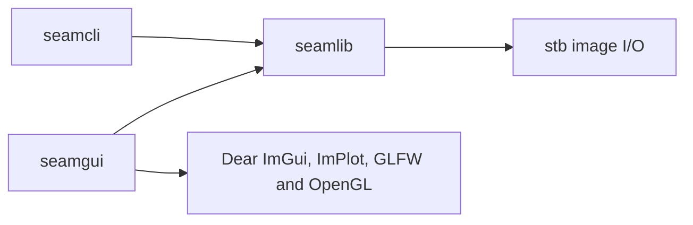
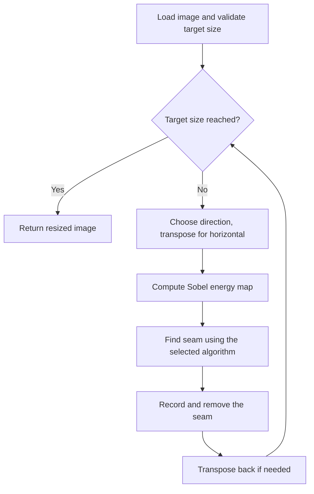
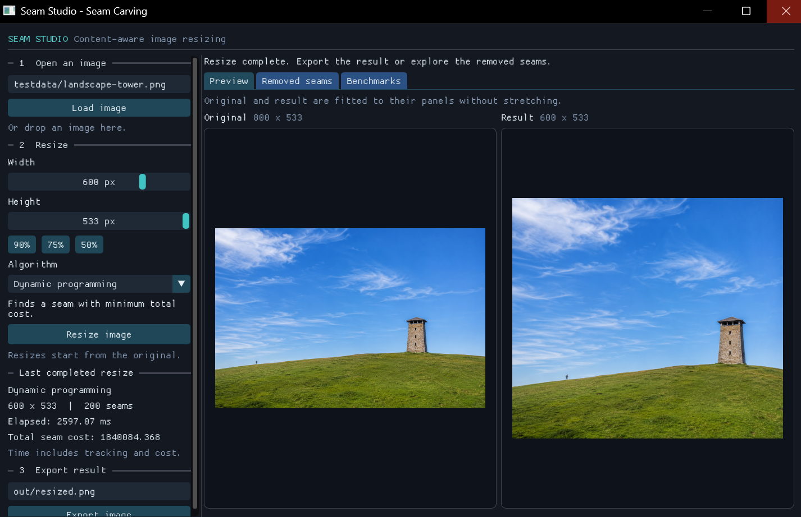
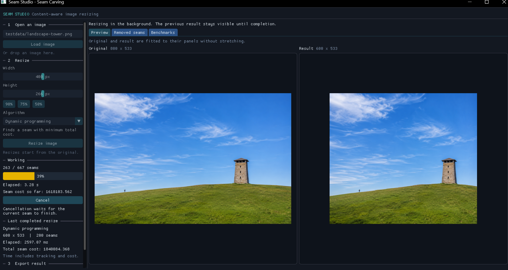
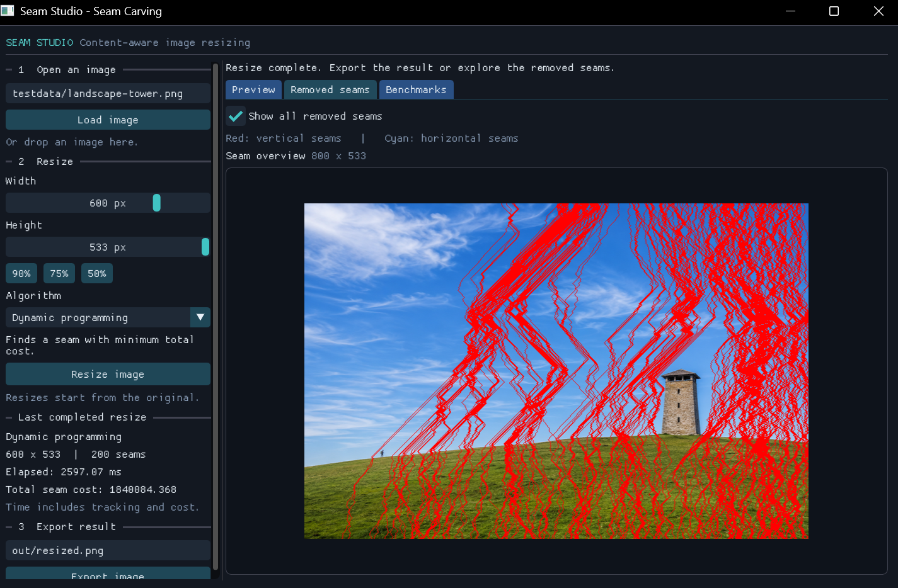
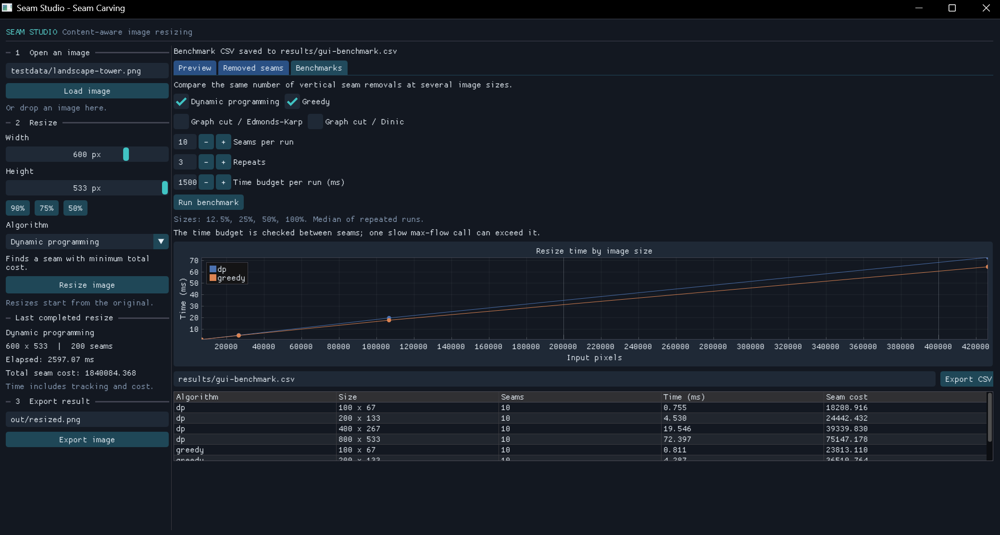

# R5: Introduction, design, evaluation method, GUI, references

**Owner:** Jarrel  **Code partner:** C5 ([`docs/tasks/C5-gui.md`](../tasks/C5-gui.md))
**Assignment items:** report structure (9a iii), bonus 7b, references

## What to write

### 1. Introduction

- What seam carving is and why it beats scaling and cropping (the assignment's three-image example), with the Avidan and Shamir idea in a few sentences.
- The problem statement for this project, and an overview of the report.

### 2. System design and architecture

- The three targets and why: `seamlib` (engine), `seamcli` (headless), `seamgui` (ImGui/ImPlot). Draw a component diagram and the data flow of one resize (image -> energy map -> seam -> remove -> repeat).
- Key data types (`Image`, `EnergyMap`, `Seam`) and the common seam-finder interface that lets DP, greedy and graph cut be swapped.
- Design decisions and their reasons, taken from [`docs/adr/`](../adr/): C++17 with no OpenCV (and what was considered), the native ImGui frontend, the alternating vertical/horizontal rule, shrinking only.
- Build, test and CI setup in one short paragraph (details in R6's bonus section).

### 3. Test images and evaluation method

- The test images (source, size, why chosen) and the synthetic hand-checkable cases.
- How we measure: time with a steady clock, median of repeats, machine and compiler used (CPU, RAM, OS, g++ version, optimisation flags), what "seam cost" and "visual quality" mean (criteria used when judging by eye).
- This section is the shared method for R1, R2, R3, R6 and R4. Agree it with them early; get the machine details from whoever runs the benchmarks.

### 4. Interactive GUI (bonus b)

- What the user can do (load, resize with sliders, choose algorithm, run, see timing, benchmark plot, CSV export, step-through) with screenshots.
- How it is built: ImGui and ImPlot on GLFW + OpenGL3, the worker thread that keeps the UI responsive, how the GUI reuses `seamlib` without duplicating logic.
- Limitations and what could be improved.

### 5. References

- Collect references from R1, R2, R3, R6 and R4. Start with the assignment's links (Avidan and Shamir, the Wikipedia article, the two ACM papers, the avikdas.com article), then add textbook sources for DP, greedy, max-flow, Edmonds-Karp, Dinic and Sobel. One consistent citation style.

## Needs from the code partner (C5)

- GUI screenshots in `figures/`; the build instructions; the demo script.

## Figures and tables

- Architecture diagram; data-flow diagram; test image table; GUI screenshots.

## Draft

## Introduction

The tower example in the assignment shows what happens when we try to make an image narrower. Scaling squeezes the tower along with the rest of the picture. Cropping keeps its shape but cuts away some of the landscape. Seam carving removes one pixel from each row at a time. If the seams pass through the sky or grass, more of the tower and its surroundings can stay in the picture. [1]

A vertical seam contains one pixel in each row and can move at most one column between rows. A horizontal seam works the same way across columns. We use Sobel to measure how much the grayscale value changes around each pixel. The energy is the sum of the absolute horizontal and vertical Sobel responses. The cost of a seam is the sum of the energies of the pixels it passes through. After each removal, we recompute the energy map because the pixels next to the seam now have different neighbours.

The program takes an RGB image and a target width and height. We compare dynamic programming (DP), greedy search, and graph cut to see how much time they take to find seams, what those seams cost, and how the resized images look.

## System design and implementation

### Program structure

| Target | What it does |
|---|---|
| `seamlib` | Loads and saves images, computes energy maps, finds and removes seams, and runs benchmarks. |
| `seamcli` | Resizes images and runs benchmarks from the command line. It can also save images of the removal steps. |
| `seamgui` | Provides a desktop interface for resizing, seam playback, and benchmark plots. |

**Figure R5.1.** The CLI and GUI use the same engine.

An `Image` holds the RGB pixels and dimensions. Sobel takes that image and produces an `EnergyMap`. Each finder takes the energy map and returns a `Seam` containing the positions to remove. The `resize` function chooses the finder, handles the removal, and calls an optional callback before each step. The CLI uses this callback to produce step images. The GUI uses it to update progress and record the removed seams.

### Resizing an image

**Figure R5.2.** The resize loop repeats until both dimensions reach their targets.

When both dimensions need to shrink, we alternate between vertical and horizontal seams, starting with a vertical seam. Once one dimension reaches its target, we finish the other. This keeps the removal order predictable without trying every possible sequence. For a horizontal seam, we transpose the image and use the same finder and removal code, then transpose the result back. The project only handles shrinking, so the target for each dimension is between one pixel and the original size.

### Design choices

- **Image processing.** We considered Python and OpenCV. Using C++17 with the stb headers kept the setup simpler for MinGW users. We wrote the Sobel calculation ourselves so we could follow how each pixel’s energy was computed.
- **Desktop interface.** A browser or Streamlit interface would have introduced another language or a local server. Dear ImGui and ImPlot let us build the app in C++ and call `seamlib` directly.
- **Build and tests.** CMake builds the engine, CLI, and doctest suite by default. Enabling `SEAM_BUILD_GUI` fetches fixed releases of the GUI dependencies. GitHub Actions builds and tests on Windows and Ubuntu, checks a CLI resize and its step images, and builds the optional GUI in a separate Linux job.

## Test images and evaluation

### Images used

We generated the five main test images with ChatGPT and downscaled them to 800 × 533 RGB PNGs. Each image gives us something different to check after removal. The prompts and preparation are in the [test-data notes](../../testdata/README.md).

| Image | What we look for |
|---|---|
| `landscape-tower.png` | Whether seams use the open sky and grass and leave the tower and small hiker intact. |
| `portrait-red-jacket.png` | Whether seams use the empty wall and preserve the face and shoulders. |
| `edges-glass-building.png` | Whether the window frames stay straight and the grid stays regular. |
| `person-beach.png` | Whether horizontal removal disturbs the horizon, person, or reflection. |
| `trap-wall-door.png` | Whether the crack and door boundary produce a cost difference between greedy and DP. |

We also use small energy maps where we can work out the answer by hand. For example, the greedy trap test has a greedy seam cost of 17 and a DP seam cost of 6. Other tests cover ties, boundary pixels, and resizing in both directions. The graph-cut photo test uses a separate castle image sampled to 64 × 43. It checks that Edmonds–Karp and DP agree on the cost at each step, that the seams stay connected and within the image, and that removing two seams in each direction gives 62 × 41.

### What we measure

- **Search time.** We time the seam finder with `std::chrono::steady_clock` and add up the search times for the run.
- **Total time.** This includes building the energy maps, finding each seam, adding its cost, and removing it. The input is scaled before timing. We start each repeat from the same scaled image and remove the same number of vertical seams. The CSV reports the repeat with the median total time, using the lower middle repeat when the count is even. A run stopped before it finishes all requested seams is left out of the CSV.
- **Seam cost.** The total is the sum of the costs of all removed seams, each measured on the energy map at the time of removal. For an optimality check, we compare finders on the same energy map. If the algorithms remove different pixels early on, they may work on different images later.
- **Visual quality.** We compare outputs at the same target size and look at what changed. In the portrait we check the face and shoulders. In the building we check the shape of the window frames. A low seam cost tells us the seam passed through low-energy pixels, while the images show what that means for the subject.

The GUI benchmark shown below was recorded on Windows in a Release build. The CPU, RAM, compiler version, and exact optimisation flags still need to be confirmed for that run.

## 7b Interactive GUI

### Resizing and progress

The user can type an image path or drag an image onto the window. The width and height sliders set the target dimensions. After selecting an algorithm and clicking **Resize image**, the user can compare the original and result side by side, see the elapsed time and total seam cost, and export the result as PNG or JPEG.

**Figure R5.3.** DP reduced the landscape from 800 × 533 to 600 × 533 by removing 200 vertical seams.

GLFW creates the window and OpenGL context. Dear ImGui draws the controls, and ImPlot draws the benchmark chart. We run the resize on a worker with `std::async` so the window stays responsive. The worker has its own copy of the input and calls the same resize function as the CLI. The main thread draws the interface, reads progress through atomics, and uploads the result when the worker finishes.

**Figure R5.4.** The resize towards 400 × 266 is at 263 of 667 removals. The last completed result is still visible while the new job runs.

### Viewing the removed seams

In **Removed seams**, we can play the steps in order or jump to a specific step. Saving an image for every step would use more memory, so the GUI keeps the original, the seam coordinates, and one checkpoint. It rebuilds the image just before the selected removal and draws the seam over it. The overview maps all removed pixels back to the original image.

**Figure R5.5.** Overview of the 200 vertical seams from the 600 × 533 result.

### Benchmarks

The benchmark tab calls the same benchmark function as the CLI. The plot and the exported CSV use the same rows. The example below uses `landscape-tower.png` at four sizes, with ten vertical seam removals and three repeats at each size.

| Algorithm at 800 × 533 | Search time (ms) | Total time (ms) |
|---|---:|---:|
| DP | 11.185 | 72.397 |
| Greedy | 0.132 | 64.222 |

Greedy spent much less time searching in this run. The gap in total time was smaller because both methods still had to compute the energy map and remove the seam at each step. [Exported benchmark CSV](../../results/gui-benchmark.csv)

**Figure R5.6.** Median total time for DP and greedy across the four input sizes.

### Limitations

- **Cancellation.** Resize checks for cancellation between seams, so a long max-flow call has to finish first. Benchmarks check between algorithms and keep completed results.
- **Preview timing.** The preview timer includes seam tracking and an extra Sobel pass to report the cost. The benchmark timer leaves out the GUI work. Passing the existing energy map to the callback would save the extra pass.
- **Algorithm availability.** The GUI build used for this demo had a Dinic option that displayed an error when selected. The comparison in R6 covers the separate Dinic results.

## References

[1] S. Avidan and A. Shamir, “Seam Carving for Content-Aware Image Resizing,” *ACM Transactions on Graphics*, vol. 26, no. 3, 2007. [Paper](https://doi.org/10.1145/1276377.1276390)

[2] M. Rubinstein, A. Shamir, and S. Avidan, “Improved Seam Carving for Video Retargeting,” *ACM Transactions on Graphics*, vol. 27, no. 3, 2008. [Author’s publications](https://people.csail.mit.edu/mrub/)

[3] J. Edmonds and R. M. Karp, “Theoretical Improvements in Algorithmic Efficiency for Network Flow Problems,” *Journal of the ACM*, vol. 19, no. 2, pp. 248–264, 1972. [Paper](https://doi.org/10.1145/321694.321699)

[4] E. A. Dinic, “Algorithm for Solution of a Problem of Maximum Flow in a Network with Power Estimation,” *Soviet Mathematics Doklady*, vol. 11, pp. 1277–1280, 1970.

[5] T. H. Cormen, C. E. Leiserson, R. L. Rivest, and C. Stein, *Introduction to Algorithms*, 4th ed., MIT Press, 2022. [Publisher](https://mitpress.mit.edu/9780262046305/introduction-to-algorithms/)

[6] R. C. Gonzalez and R. E. Woods, *Digital Image Processing*, 4th ed., Pearson, 2018.
