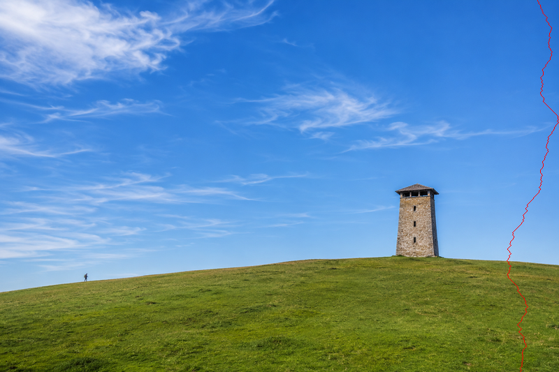
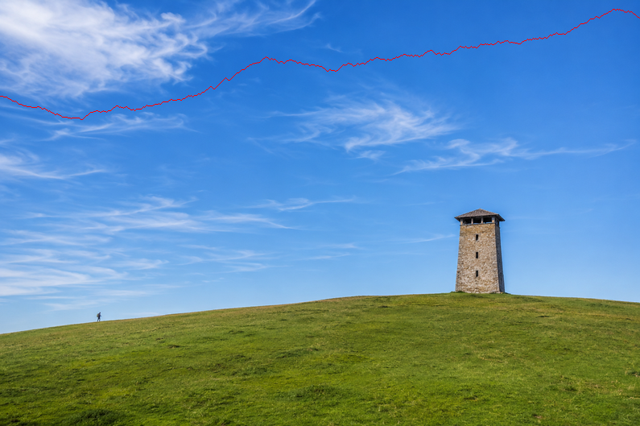
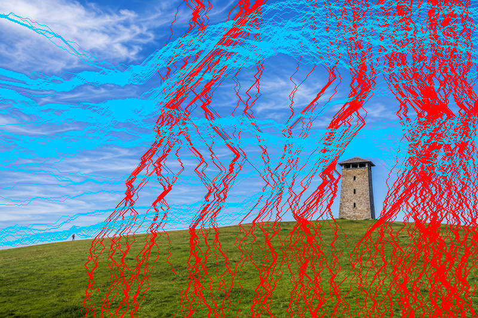
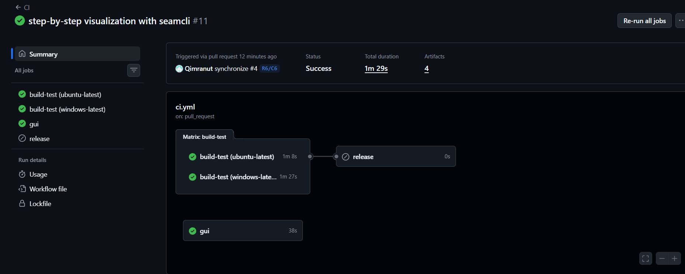
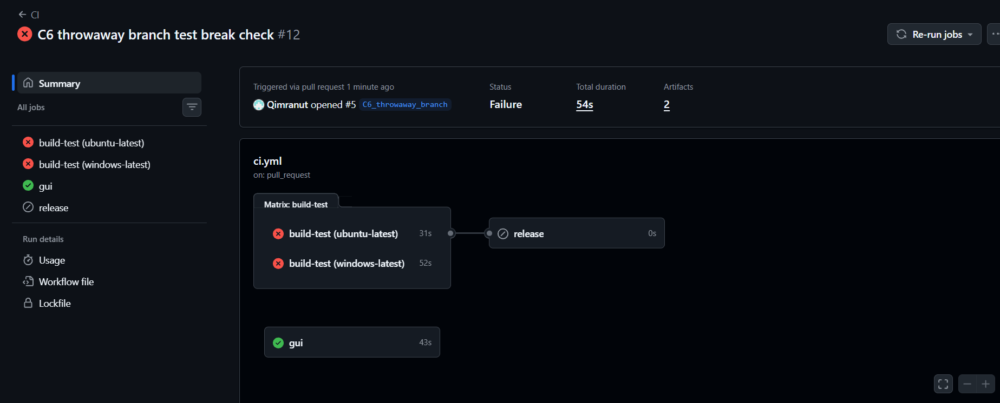

# R6: Front matter, improvements, bonus, AI declaration, assembly

**Owner:** Zhe An  **Code partner:** C6 ([`docs/tasks/C6-visualisation-ci-improvements.md`](../tasks/C6-visualisation-ci-improvements.md))
**Assignment items:** 5d, bonus 7a and 7c, 5c (three-way summary), 9a (i, iv, v), final assembly

## What to write

### 1. Front matter (9a i and iv)

- Team ID, and every member's name with **SIT ID**.
- Links: GitHub repository (make sure it is accessible to the marker) and the presentation video (YouTube or similar). Add the video link once it is recorded.
- Title, date, and a one-paragraph abstract of what was done.

### 2. Improvements (5d)

The brief asks: "do we need to maintain the entire DP Table?, does multi-threading help?"
- **DP table:** what is actually needed (two rows for the cost, a direction value per cell for backtracking), the memory saved, and the time effect, with C6's measurements.
- **Incremental energy update:** idea, complexity gain per seam, results.
- **Multi-threading:** what was parallelised (energy rows, DP cells within a row), speedup per image size and thread count. Explain **why** small images may not speed up (thread overhead, memory-bound work) and the limit from the sequential dependency between DP rows.
- Report negative results honestly. Every claim needs a number from `results/improvements_*.csv`.

### 3. Bonus write-up (7a and 7c)

- **Step-by-step visualisation:** how the frames and the all-seams overview are produced (including mapping seams back to original coordinates), with sample images. (The interactive GUI part is in R5.)
- **CI/CD:** what the workflow does (build and test on two operating systems, smoke test, optional GUI build, artifacts, badge), with a screenshot of a green run.

### 4. Three-way comparison and conclusion (5c summary)

- A summary table of DP, greedy, graph cut (EK and Dinic): optimal or not, time and space, measured speed, visual quality, and when to use each. Pull the evidence from R1, R2, R3 and R4; do not repeat their sections.
- Conclusions and lessons learned.

### 5. AI usage declaration (9a v)

- Build it from [`docs/ai-usage.md`](../ai-usage.md): which AI tools were used, at which stage (design, implementation, report writing), what was kept or changed, and **the main prompts used**. Remind teammates to log as they go; chase missing entries a few days before the deadline.

### 6. Final assembly and submission

- Merge R1 to R4 into the order in [`README.md`](README.md); unify terms with `GLOSSARY.md`, numbering, figure captions and references; check every figure referenced exists.
- Run the checklist in the next section, export to PDF (or Word), and submit to **XSite Assignment 2 Report Only**. Put the slides and test inputs/outputs in **Assignment 2 Other Materials**.

## Submission checklist (deadline Fri 20 Nov, 23:59)

- [ ] Team ID and all members with SIT IDs
- [ ] Answers to the Question (item 2): 2a (i), 2a (ii), 2b
- [ ] Algorithm, design, implementation, results/evaluation, comparison and discussion
- [ ] Time and space complexity (5b); comparison with greedy and graph cut (5c); improvements (5d)
- [ ] GitHub link (opens for the marker) and video link (opens, under the time limit: 2 minutes per person, 12 minutes for the team)
- [ ] AI usage declaration with the main prompts
- [ ] Slides and test inputs/outputs in the "Other Materials" dropbox
- [ ] Everyone can explain the report and the code for the quiz on Tue 24 Nov

## Needs from the code partner (C6)

- `results/improvements_*.csv`; step-by-step sample images; CI run screenshot.

## Draft

**Algorithms Assignment 2**

| Team Members | SIT ID |
|----------|----------|
| Tan Wei Jun | 2401179 |
| Lee Zhe An | 2401481 |
| Dayton Ng Zhi Jie | 2400624 |
| Chew Shee Yang | 2400693 |
| Jarrel Tay Wee Han | 2401506 |
| Yap Zhi Kai | 2401674 |

**Date:** 14/11/2026

**Group:** 6

---

R1

R2

R3

R4

## 5c Comparison with Greedy Algorithms, Graph Cut Algorithms

**Image Used:** 'landscape-tower.png', scaled down to 3 sizes (100x67, 200x133, 400x267).

**Search Time:** Time taken, in milliseconds, for one search for the cheapest seam on the first energy map.
**Seam Cost:** The total energy of the pixels a seam passes through, which measures how much visible detail the seam removes. The lower this cost is, the less visible distortion there is.

| Size | DP search (ms) | Greedy search (ms) | Graph cut (EK) search (ms) | Graph cut (Dinic) search (ms) | EK vs Dinic |
|---|---|---|---|---|---|
| 100×67 | 0.0069 | 0.0007 | 285.6 | 24.6 | 11.6× |
| 200×133 | 0.034 | 0.0013 | 4,849 | 323.7 | 15.0× |
| 400×267 | 0.127 | 0.0035 | 93,284 | 1,784 | 52.3× |

| Size | DP cost | Greedy cost | Greedy vs DP | Graph cut (EK) cost | Graph cut (Dinic) cost |
|---|---|---|---|---|---|
| 100×67 | 3,486 | 4,133 | 1.19× | 3,486 | 3,486 |
| 200×133 | 4,644 | 8,614 | 1.85× | 4,644 | 4,644 |
| 400×267 | 7,501 | 14,076 | 1.88× | 7,501 | 7,501 |

**Observations**

- **DP is the best choice for seam cutting**: While DP does not have the shortest search time out of all 4 of the algorithms tested (Greedy searches faster), it has the second best search time while maintaining same cost as EK and Dinic.
- **Greedy cost has the highest cost**: Initially at 100x67, Greedy only had a cost of 4133, about 1.19x that of DP and the graph cut algorithms. However, this gap widens as it increases to about 1.85x on 200x133, and lastly 1.88x on 400x267.
- **Graph cut algorithms are slow:** Both the EK and Dinic graph cut algorithms took much longer per search than non-graph cut algorithms. For example, at 200x133, a search with EK and Dinic reached search times of 4849 ms and 323.7 ms respectively, while DP and Greedy searches took 0.034 ms and 0.0013 ms.
- **Dinic is faster than EK:** From 100x67 to 400x267, Dinic's search time comes to 24.6 ms, 323.7 ms and 1784 ms to EK's 285.6, 4849 ms, and 93,284 ms. The performance gap widens with each larger image dimension, going from 11.6x to 15.0x to 52.3x.

### Conclusions and lessons learned

**Global optimum matters:** While Greedy is the fastest search, its seams cost 1.19x to 1.88x more than the optimum, so it removes more visible detail.
**Improvements proposed do not outweigh algorithm choice:** While improvements such as incremental energy and threading can help improve the operation time, it will only improve it by a constant factor and not change the O(WxH) bound. 
**Limitations:** All tabulated results are derived from the same image, with a single run and the only 3 sizes (100x67, 200x133, 400x267).

## 5d Improvements
---

**DP Table**
The DP table M[i][j] holds the cheapest cost of reaching pixel (i, j) from the top.
To compute row i, only row i - 1 is needed, so the costs need just 2 rows.

The seam itself is different. After the last row, we walk back up and need to know
which of the three pixels above each step came from, which is why a direction
(-1, 0 or +1) is stored for every cell. Those fit in 1 byte instead of an 8-byte double.

- **Memory:** DP structures are about 7.3-7.9x smaller. Space is still O(WH) as the directions 
  are still an HxW table.
- **Speed:** DP search is up to 1.6x faster on large images and about 0.75x its original speed on
  small images. Overall, for the whole program it makes a minor difference, around
  0.94 - 1.03x as DP makes up a small part of the time.

### Incremental Energy

After removing a seam, a pixel's energy only changes if its 3x3 neighbourhood
touched the removed pixels. That is about 6 pixels per row. Everything else
retains its old energy, just shifted 1 column left.

Per-seam time dropped by 3.3x, 3.1x and 2.0x on small, medium and large 
images respectively, and the gain shrinks on larger images occurs 
as the copy of the whole energy map is still O(WH), so the recompute is cheap 
but the copy did not. The overall bound stays at O(WH).

### Multi-threading

There are two places to split work across threads.

- **Energy, by rows:** Each row can be computed independently so it speeds up by 
  2.2-2.7x at 8 threads on medium and large images. On the small image, it did not help because
  starting threads cost more than the 0.5ms of work.
- **DP, by cells within a row:** Unfortunately, DP becomes significantly slower as a result of multi-threading.
  Row i needs the finished row i-1, so all threads must wait for each other after every row
  (a barrier). This barrier costs about 21µs at 2 threads while one row's work
  is only 0.2-1.8µs. So threads spend nearly all their time waiting and the DP becomes
  13x to 1200x slower.

The limit on the pipeline overall is Amdahl's law: only the energy portion
is parallel 69% of the time, so unlimited threads can only give at most about 3.2x.

### Improvements Take-away

- **Do we need the whole DP table?** No. Two cost rows and a 1-byte direction
  per cell are enough. This saves memory but there are no significant changes to speed.
- **Does multi-threading help?** For the energy rows on larger images, yes. For the DP,
  no, as each row depends on the previous one.

## Step-by-Step Visualization

The goal of the visualization is to make every seam visible, both as an overview picture of all seams,
as well as per-step visualization.

### Step frames

resize() calls a callback before every removal, giving it the current image and the seam
it is about to remove. --steps utilizes this callback to paint the seam red and save the picture.
Frame 1 is the full 800x533 image with seam 1 drawn, frame 2 is the 799-wide image with seam 2, and
so on.

### All-seams overview

In each step frame, the seam is drawn in red. For the all-seams overview, vertical seams (from top to bottom) are red
while the horizontal seams (from left to right) are colored cyan.

Each seam is found on an image that has already shrunk. For example, seam 50's column numbers refer to the image as it was after 49 removals, not the original. Hence, Seam 50's coordinates cannot be painted onto the original photo, unless we use an index map.

- Keep a table the same size as the current image. Each entry stores the original position of that pixel.
- When a seam is removed, look up each removed pixel in the table. That gives its original position
  and we can mark that an original pixel was removed at step k.
- Lastly, delete those entries from the table, which mimics the same way the image shrinks

Example: 5 original pixels

[0, 1, 2, 3, 4]

Step 1: Remove pixel at position 2

[0, 1, 3, 4]

Step 2: Remove pixel at position 2 again

[0, 1, 4]

By the end of the operation, every original pixel has been either kept or removed,
and removed pixels are indicated as red or cyan (vertical or horizontal seams) on the original image
under the file overview.png.

| Original (800x533) | Step 1 (vertical seam) | Step 10 (horizontal seam) | Step 50 (horizontal seam) |
|---|---|---|---|
|  |  |  |  |

| All seams on the original image | Result (640x430) |
|---|---|
|  |  |

### Rendering each step

The GUI stores the seams and rebuilds frame k by replaying the first k-1 removals on the original
(`render_step`, `replay`).

### Testing

Test images store their own coordinates in the pixel colours (red = x, green = y). Hence, a seam pixel
in any shrunk image tells the test which original pixel it is, and the test checks if the tracker agrees.
It also checks that no two seams share a pixel.

### Discussion

**Index map**
- Time: Recording a seam requires a rebuild of the map which is of O(WH) per seam.
  That would be the same order as removing the seam from the image itself, so it adds a constant factor.
- Memory: Requires two tables of 4-byte integers, which are the current index map and the removal-order table.
  For 800x533, it evaluates to around 1.7 MB per table, 3.4 MB in total. 

**Frames**
- Each frame of the image is around 800 x 533 x 3 bytes = 1.28 MB. All 263 frames will take up to
  336 MB on an upper bound as frames will gradually shrink.
- Storing only the seams will only take up around 0.6 MB for this image.
- Rebuilding frame k is O(k.WH) where k is the step number. This can be reduced by replaying from a checkpoint instead from restarting right from the original image.

**Limitations**
- The overview is unable to show the order in which seams were removed, only that they were vertical or horizontal.
- Rebuilding a step from scratch gets slower for late steps.

**Possible improvement**
- Modifying the color of the overview seams by their removal step using lighter to darker colors could help somewhat identify the order of each seam. 

## CI / CD

CI has been implemented to help automatically build and test code every time something has been
pushed or when a pull request is opened. This helps catch broken code before merges into main and
by testing it on multiple OSes (Ubuntu, Windows), it helps catch OS-specific bugs.

ci.yml has 3 primary jobs.
- **build-test:** Runs twice for Ubuntu and Windows. It builds in Release, runs all tests, a smoke test, 
  and uploads files. This helps identify problems which may only appear with one of the OSes.
- **gui:** Installs the Linux GUI libraries and builds with `-DSEAM_BUILD_GUI=ON`.
- **release:** When a version tag is pushed, it will attach the binaries to a GitHub Release.

| CI Green Run | CI Red Run |
|---|---|
|  |  |

### Smoke Test

After passing the tests, the real seamcli will run on testdata/landscape-tower.png, ask for 640x430,
and check that the output file is 640x430 and the step frames and overview exist. 

### Artifacts

After each run, Github will keep the seamcli program for each OS and the smoke-test images. 
On failure, it will keep the test log.

### Discussion

The workflow has been configured to catch a variety of possible errors along the way.
The unit tests catch individual functions, while the smoke test runs the seamcli on
a test image to ensure that the output has the expected size and that the step frames and
overview are generated. Running on both Ubuntu and Windows also helps catch
potential compiler problems.

Currently, there are some potential flaws with the workflow. The release job has not been run thus far, as it requires a version tag to be pushed. The gui job is also allowed to fail without failing the workflow as it only builds the GUI and does not run any tests. There is also no build caching.

(Write here. Suggested headings: `## Front matter`, `## Improvements`, `## Bonus`, `## Comparison and conclusion`, `## AI usage declaration`)
