# Algorithms Assignment 2

**Content-aware image resizing with seam carving**

| Team Members | SIT ID |
|----------|----------|
| Tan Wei Jun | 2401179 |
| Lee Zhe An | 2401481 |
| Dayton Ng Zhi Jie | 2400624 |
| Chew Shee Yang | 2400693 |
| Jarrel Tay Wee Han | 2401506 |
| Yap Zhi Kai | 2401674 |

**Date** 14/11/2026

**Group** 6

**Source code** [GitHub repository](https://github.com/sheeyang/Algo-Group-Assignment-2)

**Presentation video** [Link to be added]

## 1. Introduction

The tower example in the assignment shows what happens when we try to make an image narrower. Scaling squeezes the tower along with the rest of the picture. Cropping keeps its shape but cuts away some of the landscape. Seam carving removes one pixel from each row at a time. If the seams pass through the sky or grass, more of the tower and its surroundings can stay in the picture. [1]

A vertical seam contains one pixel in each row and can move at most one column between rows. A horizontal seam works the same way across columns. We use Sobel to measure how much the grayscale value changes around each pixel. The energy is the sum of the absolute horizontal and vertical Sobel responses. The cost of a seam is the sum of the energies of the pixels it passes through. After each removal, we recompute the energy map because the pixels next to the seam now have different neighbours.

The program takes an RGB image and a target width and height. We compare dynamic programming (DP), greedy search, and graph cut to see how much time they take to find seams, what those seams cost, and how the resized images look.

## 2. Answers to Question 2

### Question 2a(i) — Number of vertical seams

Let the image have $m \ge 1$ rows and $n > 1$ columns, indexed from 1. A vertical seam is a sequence of columns $s_1,\ldots,s_m$ with $1 \le s_i \le n$ and $|s_i-s_{i-1}| \le 1$ for every $i \ge 2$.

There are $n$ choices for $s_1$. Every valid seam prefix ending before the last row has at least two extensions to the next row. It can stay in the same column or move to an adjacent column. Even at a border, there is an inward move because $n>1$. Extensions of different prefixes are distinct because they retain all earlier column choices. If $P_r$ counts prefixes of length $r$, then $P_1=n$ and $P_{r+1}\ge 2P_r$. Hence there are at least $n2^{m-1}$ vertical seams. At $n=2$ this bound is exact. At $n=1$ there is only one seam, regardless of $m$.

An exhaustive search that visits every seam therefore takes $\Omega(n2^{m-1})$ time even if it accumulates costs while extending prefixes. Dynamic programming uses only $mn$ states because prefixes ending at the same pixel have the same allowed continuations.

### Question 2a(ii) — Minimum-cost seam subproblems

Given the pixel energy $e[i,j]$, let $M[i,j]$ be the minimum cost of a seam prefix that starts anywhere in row 1 and ends at pixel $(i,j)$. The cost is the sum of the energies along that prefix, including both endpoints. The first row contains single-pixel prefixes, so $M[1,j]=e[1,j]$. For $i>1$, define the valid predecessor columns $P(j)=\{p \mid 1\le p\le n,\ |p-j|\le 1\}$. Then

$$
M[i,j] = e[i,j] + \min_{p\in P(j)} M[i-1,p].
$$

For an interior column, the candidates are $j-1,j,j+1$. The first column uses columns 1 and 2, and the last column uses $n-1$ and $n$, provided $n>1$. A single-column map always uses predecessor column 1.

Every prefix ending at $(i,j)$ arrives from some $(i-1,p)$ with $p\in P(j)$. Its cost is at least $M[i-1,p]+e[i,j]$. Conversely, extending a minimum-cost prefix to any such predecessor gives a valid prefix ending at $(i,j)$. In particular, extending the cheapest predecessor attains the recurrence. Together with the first-row base case, this proves by induction that each table entry is the minimum cost for its endpoint.

Every complete seam ends somewhere in row $m$, so its minimum possible cost is $\min_{1\le j\le n}M[m,j]$. Choose a column attaining this minimum and backtrack one row at a time to a valid predecessor with the smallest table value. Each step recovers a predecessor attaining the recurrence, and every recovered pair is connected by construction. The full table takes $\Theta(mn)$ time and space.

### Question 2b and greedy seam carving

(weijun)

## 3. Algorithms, design and implementation

### System design and implementation

#### Program structure

| Target | What it does |
|---|---|
| `seamlib` | Loads and saves images, computes energy maps, finds and removes seams, and runs benchmarks. |
| `seamcli` | Resizes images and runs benchmarks from the command line. It can also save images of the removal steps. |
| `seamgui` | Provides a desktop interface for resizing, seam playback, and benchmark plots. |

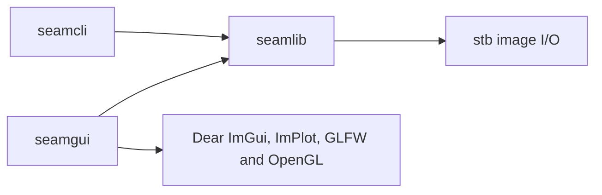

**Figure 1.** The CLI and GUI use the same engine.

An `Image` holds the RGB pixels and dimensions. Sobel takes that image and produces an `EnergyMap`. Each finder takes the energy map and returns a `Seam` containing the positions to remove. The `resize` function chooses the finder, handles the removal, and calls an optional callback before each step. The CLI uses this callback to produce step images. The GUI uses it to update progress and record the removed seams.

#### Resizing an image

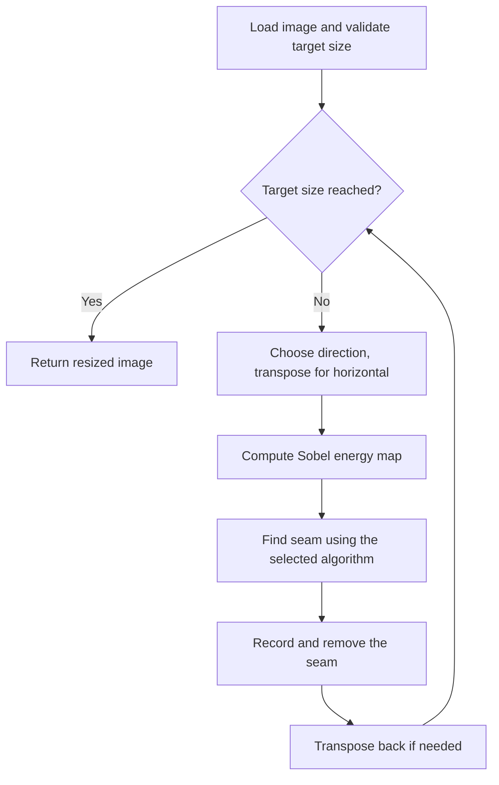

**Figure 2.** The resize loop repeats until both dimensions reach their targets.

When both dimensions need to shrink, we alternate between vertical and horizontal seams, starting with a vertical seam. Once one dimension reaches its target, we finish the other. This keeps the removal order predictable without trying every possible sequence. For a horizontal seam, we transpose the image and use the same finder and removal code, then transpose the result back. The project only handles shrinking, so the target for each dimension is between one pixel and the original size.

#### Design choices

- **Image processing.** We considered Python and OpenCV. Using C++17 with the stb headers kept the setup simpler for MinGW users. We wrote the Sobel calculation ourselves so we could follow how each pixel’s energy was computed.
- **Desktop interface.** A browser or Streamlit interface would have introduced another language or a local server. Dear ImGui and ImPlot let us build the app in C++ and call `seamlib` directly.
- **Build and tests.** CMake builds the engine, CLI, and doctest suite by default. Enabling `SEAM_BUILD_GUI` fetches fixed releases of the GUI dependencies. GitHub Actions builds and tests on Windows and Ubuntu, checks a CLI resize and its step images, and builds the optional GUI in a separate Linux job.

### Dynamic programming implementation

#### Sobel energy

The implementation first evaluates grayscale intensity as $Y=0.299R+0.587G+0.114B$. The following two $3\times3$ Sobel kernels give the horizontal and vertical responses $G_x$ and $G_y$, respectively.

$$
K_x=\begin{bmatrix}-1&0&1\\-2&0&2\\-1&0&1\end{bmatrix},
\qquad
K_y=\begin{bmatrix}-1&-2&-1\\0&0&0\\1&2&1\end{bmatrix}.
$$

When a kernel tap falls outside the image, the row and column are clamped to the nearest valid coordinates. Each energy is $|G_x|+|G_y|$. This gives low energies to locally flat areas and high energies to strong grayscale transitions. Sobel supplies a fixed pixel cost for the recurrence and gives DP, greedy and graph cut the same seam cost to minimise. Avidan and Shamir also studied adding local entropy to the gradient, which incorporates texture information through a larger neighbourhood [1]. Forward energy estimates the new discontinuities that deletion creates [2]. Its costs depend on the direction of each step, which changes the objective and the predecessor terms. See [energy.cpp](../../src/energy.cpp).

#### Finding and removing seams

The code stores $M$ as a full row-major array of `double` values. It fills the rows from top to bottom and backtracks through those same values. The last-row scan and each predecessor choice take the leftmost minimum. With exactly represented costs, tied seams are therefore ordered by column from the bottom row upward. For fractional energies, the code compares stored values directly, so rounding can affect which values compare equal. A fixed rule makes the output repeatable for a given energy map and helps explain differences between algorithms when equally cheap seams exist. See [seam_dp.cpp](../../src/seam_dp.cpp).

```text
FindVerticalSeam(I):
    e = SobelEnergy(I)
    M[1, *] = e[1, *]
    for each row i from 2 to height(I):
        for each column j from 1 to width(I):
            M[i, j] = e[i, j] + min(M[i-1, p] for p in P(j))
    s[height(I)] = leftmost minimum column in the last row of M
    for each row i from height(I) down to 2:
        s[i-1] = leftmost minimum column in M[i-1, *] among P(s[i])
    return s

Shrink(I, target_width, target_height):
    prefer vertical first
    while either dimension exceeds its target:
        choose the preferred direction if it still needs shrinking
        otherwise choose the other direction
        transpose I if the chosen direction is horizontal
        s = FindVerticalSeam(I)
        I = copy each row in order, omitting its pixel at s[row]
        transpose I back if the chosen direction was horizontal
        prefer the direction opposite to the one just used
    return I
```

Transposition turns the original columns into rows, so a vertical seam on the transposed image gives one removed pixel per original column. The two Sobel responses swap under transposition, and their absolute values are summed, so the energy is transposed as well in exact arithmetic. Energy is recomputed after every removal because the surviving pixels can have new neighbours. When both dimensions need shrinking, the implementation alternates directions, starting vertically. The optimality proof applies to one seam in its current image. The final image depends on the sequence of removals. See [resize.cpp](../../src/resize.cpp).

#### Worked example

The table uses the 3-by-3 energy map in the hand-checked DP test. Rows and columns are numbered from 1.

| Row | $e[i,1]$ | $e[i,2]$ | $e[i,3]$ | $M[i,1]$ | $M[i,2]$ | $M[i,3]$ |
| --- | ---: | ---: | ---: | ---: | ---: | ---: |
| 1 | 5 | **1** | 0 | 5 | **1** | 0 |
| 2 | **1** | 9 | 9 | **2** | 9 | 9 |
| 3 | 5 | **1** | 9 | 7 | **3** | 18 |

At the left boundary, $M[2,1]=1+\min(5,1)=2$. The bottom-row minimum is $M[3,2]=3$. Backtracking goes through $M[2,1]=2$ and $M[1,2]=1$, giving seam $(2,1,2)$ with cost $1+1+1=3$. The zero-energy top-right pixel can reach only pixels of energy 9 in the second row. See [test_dp.cpp](../../tests/test_dp.cpp).

### Graph cut with Edmonds–Karp

#### Scope and implemented components

This section covers the graph-cut formulation and Edmonds-Karp (EK) solver
implemented for C3. The aim is to find a minimum-cost seam using a flow
network and verify it against the existing dynamic-programming (DP) finder.
The image loading, Sobel energy calculation and resize loop are shared team
components; this implementation supplies the network, EK solver and seam
extraction. Dinic is a separate solver described in Section 3.

| Implemented component | Role in seam finding |
|-----------------------|----------------------|
| `FlowGraph` and `add_edge()` in `src/maxflow.*` | Store capacities, adjacency indices and paired reverse residual edges |
| `edmonds_karp()` in `src/maxflow.cpp` | Compute maximum flow using BFS augmenting paths |
| `reachable_from()` in `src/maxflow.cpp` | Identify the source side of the cut after maximum flow |
| `find_seam_graphcut()` in `src/seam_graphcut.cpp` | Build the shared network, invoke a supplied solver and extract the seam |
| `find_seam_graphcut_ek()` in `src/seam_graphcut.cpp` | Select EK for the shared graph-cut finder |

Keeping the graph independent of image data allows the solver to be tested
on small networks with known answers. Keeping network construction separate
from the choice of solver also lets Dinic use the same formulation and
extraction, making the solver comparison more controlled.

#### Graph cut formulation

Seam carving removes a connected sequence of low-energy pixels to reduce an
image's dimensions [1]. Our graph-cut implementation finds one vertical seam
at a time. For width W and height H, a seam is a sequence s[y] containing one
column per row, with abs(s[y] - s[y-1]) <= 1. Its cost is the sum of the current
image's Sobel energies at those pixels. After removal, energies are recomputed.
Horizontal seams use the same finder on the transposed image.

For the implemented backward-energy objective,

```text
e(x,y) = abs(Gx(x,y)) + abs(Gy(x,y))
seam_cost(s) = sum over y of e(s[y],y)
```

Gx and Gy are the horizontal and vertical Sobel responses of the grayscale
image. A low cost means the selected pixels have low local intensity changes;
it does not guarantee that the algorithm understands or preserves every
semantically important object. The requested width and height determine how
many seams the resize loop removes.

The network contains nodes p(x,y), for 0 <= x <= W and 0 <= y < H, plus a
source and sink. Columns 0 to W-1 represent real pixels. Column W is virtual.
The capacities are c(x,y) = round(1000 * e(x,y)). Let C be their sum and set
INF = C + 1, using checked `long long` arithmetic.

| Directed edge | Capacity | Purpose |
|---------------|----------|---------|
| source -> p(0,y) | INF | The first node in each row belongs to the source side |
| p(W,y) -> sink | INF | Each virtual node belongs to the sink side |
| p(x,y) -> p(x+1,y), x=0..W-1 | c(x,y) | Cutting this edge selects real pixel (x,y) |
| p(x,y) -> p(x-1,y), x=1..W | INF | The source side of a row must be a prefix |
| p(x,y) -> p(x-1,y-1), where valid | INF | Constrain the endpoint in the row above |
| p(x,y) -> p(x-1,y+1), where valid | INF | Constrain the endpoint in the row below |

The virtual column corrects a boundary problem in the brief's basic network.
If the last real column connects directly to the sink with infinite capacity,
it cannot be selected as the rightmost source-side pixel. In our network,
cutting p(W-1,y) -> p(W,y) selects the last real pixel and charges its energy,
so every column available to DP is also available to graph cut.


*Figure 3.* The real-pixel energy grid has value 1 at columns [1,1,2,1]
and value 9 elsewhere. This connected seam is the unique optimum. Its scaled
cut capacity is 4000, corresponding to original seam cost 4. Blue dashed
edges are INF constraints; red horizontal edges cross the cut. All backward
and diagonal constraints are included, including those from the virtual
column. The figure does not draw the additional reverse residual edges.

#### Why the minimum cut is an optimal seam

The network establishes a correspondence between valid seams and cuts that
avoid INF edges:

1. A straight seam defines a cut with capacity at most C. Therefore a minimum
   cut costs less than INF and cannot cross any INF edge.
2. The source and sink connections force the first node of each row into S
   and the virtual node into T. Backward constraints prevent a node in S from
   having a node in T to its left. Thus each row consists of an S prefix and
   a T suffix, separated by exactly one finite forward edge.
3. Let s[y] be the last real column in the S prefix. If s[y] exceeded an
   adjacent endpoint by more than one, its diagonal INF edge would cross from
   S to T. Applying the same argument in the other direction gives
   abs(s[y] - s[y-1]) <= 1. The selected pixels therefore form a valid seam.
4. Conversely, any valid seam defines these prefixes. None of its backward,
   diagonal or terminal edges crosses from S to T. Its cut capacity is exactly
   sum_y c(s[y],y).
5. The max-flow/min-cut theorem identifies the smallest cut capacity with the
   maximum flow value [7]. The resulting seam minimises the sum of the scaled
   capacities, because every competing valid seam defines a competing cut.

After max-flow, `reachable_from()` traverses edges with positive residual
capacity from the source. The visited nodes give S, and the rightmost visited
real pixel in each row gives the seam. The flow solver's returned number is
not itself the sequence of pixels to remove.

```text
construct the network from the current energy map
run edmonds_karp(network, source, sink)
S = nodes reachable from source using positive residual capacity
for each row y:
    seam[y] = largest real column x with p(x,y) in S
return seam
```

#### Capacity precision, ties and alternatives

The solver uses integer capacities to avoid floating-point tolerance decisions
inside BFS and flow updates. Scaling by 1000 matches the thousandth precision
of our grayscale coefficients, apart from floating-point arithmetic error.
Nonfinite and negative energies are rejected, and unsafe capacity ranges are
checked. Integer-valued test maps in the supported range retain their exact
cost ordering.

For arbitrary double-valued maps, rounding can change very close rankings.
Optimality is therefore exact for the integer capacities, not a promise of
identical answers for arbitrary unrounded doubles. Photo comparisons use an
absolute cost tolerance of 1e-6; random integer-map tests use exact equality.

Several seams can share the minimum cost. DP applies its documented bottom-up
tie rule, whereas residual reachability determines EK's returned minimum cut.
We compare costs on the same current image rather than require equal pixel
positions. Floating-point arithmetic can also perturb mathematically equal
costs by very small amounts.

Our finite edges use backward Sobel energy. A forward-energy formulation could
instead account for neighbour differences introduced by removal, but its
transition costs would need a corresponding formulation and validation. We
did not claim to implement that alternative. DP directly exploits the
row-by-row structure of this problem; the flow-network approach provides a
shared representation for EK and Dinic and allows other constraints when a
valid graph formulation is available. Dinic and broader comparisons are
covered in Section 3.

#### Edmonds–Karp implementation

`FlowGraph` stores edge records in a contiguous vector and outgoing edge
indices in per-node adjacency vectors. Every added edge is followed by its
reverse residual edge, initially of capacity zero. Thus `i ^ 1` identifies
the paired edge. The explicit backward INF constraints are separate edges;
they must not be confused with reverse residual edges.

Edmonds-Karp repeatedly finds an augmenting path with the fewest edges using
BFS [7]. Our implementation records the incoming edge index for each visited
node, finds the smallest residual capacity along the path, and pushes that
amount. It subtracts from forward residual capacities and adds to their
paired reverse capacities. This permits later paths to undo earlier flow
choices. It stops when the sink is unreachable.

```text
flow = 0
while BFS finds a residual source-to-sink path:
    amount = minimum residual capacity along that path
    for each path edge i:
        residual[i] -= amount
        residual[i XOR 1] += amount
    flow += amount
return flow
```

Each augmentation preserves a feasible flow. The bottleneck prevents any
path edge from exceeding its remaining capacity, and adding the same amount
along the path preserves flow conservation at intermediate nodes. Paired
reverse edges represent cancellation of previously sent flow rather than
additional original capacity.

When no augmenting path remains, the source-reachable set S excludes the
sink. Every original edge from S to T is saturated; otherwise its positive
residual capacity would make its destination reachable. No original edge
from T to S carries positive flow, because its reverse residual edge would
also make a node in T reachable. Consequently the flow value equals the
capacity of this cut. Since no feasible flow can exceed a cut's capacity,
the flow and cut are optimal. Combined with the cut-to-seam correspondence,
this establishes correctness for the integer-capacity seam objective.

The shared solver module was subsequently extended with an optional
`MaxFlowStats` overload that records EK augmentations for the solver comparison.
The three-argument solver interface remains available, so the seam-network
code and its `MaxFlowFn` contract are unchanged.

### Graph cut with Dinic

#### Scope and implemented components

Dinic provides a second max-flow solver for graph-cut seam finding.

In our project architecture, Dinic operates on the exact same flow network formulation and seam extraction pipeline described in the graph-cut formulation above (`find_seam_graphcut()` in `src/seam_graphcut.cpp`). The network vertices $p(x, y)$, the virtual column $W$, the integer capacity scaling ($c = \text{round}(1000 \cdot e)$), and the infinite backward and diagonal constraint edges are shared identically. By keeping graph construction and extraction uniform, the performance differences measured between Edmonds-Karp and Dinic isolate the max-flow algorithm itself.

| Component | File Location | Role in Seam Finding Pipeline |
|---|---|---|
| `dinic()` | `src/maxflow_dinic.cpp` | Max-flow solver using BFS level graphs, per-node current-arc pointers, and an iterative DFS stack |
| `find_seam_graphcut_dinic()` | `src/seam_graphcut_dinic.cpp` | Graph-cut seam finder wrapping the shared network with Dinic |
| `Algorithm::GraphCutDinic` | `src/resize.cpp`, `cli/main.cpp` | CLI and engine integration allowing `seamcli` to shrink images via Dinic |
| Unit Test Suite | `tests/test_dinic.cpp` | 12 doctest `TEST_CASE` blocks verifying textbook flows, capacity cancellations, parallel/self-loop edges, argument validation, separate phase/augmentation counters, 300 random graph comparisons against EK, 300 random map comparisons against DP, and two stack-safety tests (a 100,000-node linear path and a 200x200 energy map) |
| Benchmark Harness | `results/maxflow_benchmark.csv`, `results/maxflow_large.csv` | Empirical timing, phase counts, and augmentation records across scales from 32x21 to 1000x700 |

#### Overview and Core Primitives

The assignment brief suggests Edmonds-Karp or Ford-Fulkerson for solving the minimum $s\text{–}t$ cut problem. While Edmonds-Karp is guaranteed to terminate in polynomial time ($O(V E^2)$), its reliance on finding a single shortest path per BFS traversal makes it prohibitively slow on image-scale grid networks where thousands of augmentations are required.

Dinic's algorithm [4] fundamentally improves upon Edmonds-Karp by introducing two structural primitives:
1. **The Level Graph ($G_L$)**: Constructed via a Breadth-First Search (BFS) from source $s$. The level of vertex $v$, denoted $\text{level}[v]$, is defined as the unweighted shortest-path distance (number of edges) from $s$ to $v$ in the residual network $G_f$. An edge $(u, v)$ belongs to the level graph $G_L$ if and only if:
   $$\text{cap}_f(u, v) > 0 \quad \text{and} \quad \text{level}[v] = \text{level}[u] + 1$$
   Edges pointing within the same layer or backward are excluded. If the sink $t$ cannot be reached during BFS ($\text{level}[t] = -1$), no augmenting path exists in $G_f$, and the algorithm terminates.
2. **Blocking Flow**: Within each level graph, Dinic does not stop after finding one augmenting path. Instead, it finds a **blocking flow** using Depth-First Search (DFS): a flow $f'$ such that every directed path from $s$ to $t$ in $G_L$ contains at least one saturated edge ($\text{cap}_f(u, v) = 0$). Pushing a blocking flow exhausts all augmenting paths of the current shortest length simultaneously.

#### Iterative DFS and Current-Arc Optimization

A naive DFS implementation can compromise both memory safety and time complexity. Our implementation in `src/maxflow_dinic.cpp` introduces two essential design choices:

1. **Current-Arc Pointers (`iter[u]`)**:
   During the DFS phase, a vertex $u$ may be visited multiple times as different augmenting paths pass through it. If the DFS re-examined all outgoing edges from the beginning of `adj[u]` every time, earlier saturated or dead edges would be repeatedly scanned, degrading the phase complexity to $O(V^2 E)$ or worse.
   To prevent this, we maintain an array `iter[u]` initialized to 0 at the start of each phase. `iter[u]` tracks the index of the next usable outgoing edge in `g.adj[u]`. Once an edge saturates or fails to reach $t$, `iter[u]` advances and never retreats during that phase. When `iter[u] == g.adj[u].size()`, vertex $u$ has no remaining admissible paths to $t$; it is permanently marked as dead for the remainder of the phase by setting $\text{level}[u] = -1$.

2. **Iterative Stack Architecture (Preventing Call-Stack Overflow)**:
   In image seam carving, a directed path crossing a height-$H$ grid contains at least $H$ edges. On large images (e.g. $1000 \times 700$), a recursive DFS implementation would push over 700 to 1,000 stack frames, risking a runtime call-stack overflow on platforms with strict thread stack limits (such as Windows default 1 MB stacks).
   We implemented the DFS iteratively using an explicit `std::vector<int> path` storing edge indices:
   - When an admissible edge $(u, v)$ with $\text{cap} > 0$ and $\text{level}[v] = \text{level}[u] + 1$ is found, its index is appended to `path`, and the search advances to $u = v$.
   - When the search reaches $u = t$, the bottleneck capacity $\Delta = \min_{e \in \text{path}} \text{cap}(e)$ is computed. Flow $\Delta$ is pushed, updating forward capacities ($\text{cap} -= \Delta$) and paired reverse residual capacities ($\text{cap} += \Delta$).
   - Crucially, rather than resetting the DFS from $s$, the code finds the shallowest saturated edge along the path at index `cut_to`. The path is truncated to `path.resize(cut_to)`, and $u$ rolls back directly to that edge's tail. The DFS resumes immediately from that point.
   - If a dead end is encountered ($u \neq t$ and `iter[u]` is exhausted), $\text{level}[u]$ is permanently set to $-1$ for this phase so no path enters it again. Before popping the incoming edge $e$ from `path`, the algorithm identifies the node from which $u$ was entered (`g.edges[e ^ 1].to`) and increments its current-arc pointer (`++iter[...]`), ensuring the predecessor skips edge $e$ on any subsequent DFS traversal in this phase. The predecessor edge is then popped, and $u$ retreats to that predecessor node.

#### Pseudocode

```text
Algorithm: Dinic(FlowGraph G, Source s, Sink t)
Input: Flow network G = (V, E) with residual capacities, source s, sink t
Output: Maximum flow value

flow <- 0
level <- array of size |V|
iter <- array of size |V|
bfs_queue <- array of size |V|

while BuildLevels(G, s, t, level, bfs_queue) do
    fill(iter, 0)
    path <- empty list
    u <- s

    while true do
        if u == t then
            delta <- min_{e in path} (edge[e].cap)
            for each e in path do
                edge[e].cap <- edge[e].cap - delta
                edge[e ^ 1].cap <- edge[e ^ 1].cap + delta
            flow <- flow + delta

            cut_to <- index of first edge in path with edge[e].cap == 0
            truncate path to cut_to
            u <- tail vertex of edge at path[cut_to] (or s if path is empty)
            continue
        end if

        advanced <- false
        while iter[u] < degree(u) do
            e <- adj[u][iter[u]]
            v <- edge[e].to
            if edge[e].cap > 0 and level[v] == level[u] + 1 then
                push e to path
                u <- v
                advanced <- true
                break
            end if
            iter[u] <- iter[u] + 1
        end while

        if advanced then continue

        // Dead end: retreat
        level[u] <- -1
        if path is empty then break  // Retreated past source: phase complete

        iter[tail(path.back())] <- iter[tail(path.back())] + 1
        pop path.back()
        u <- tail of current path (or s if path is empty)
    end while
end while

return flow
```

#### Small Worked Example

Consider a textbook 4-node flow network to illustrate how Dinic pushes a blocking flow and increments distance levels:
- Vertices: $s = 0, v_1 = 1, v_2 = 2, t = 3$.
- Edges: $(0 \to 1, \text{cap}=3)$, $(0 \to 2, \text{cap}=2)$, $(1 \to 2, \text{cap}=1)$, $(1 \to 3, \text{cap}=2)$, $(2 \to 3, \text{cap}=3)$.

```text
        (1) --- 2 ---> (3: t)
       ^   \             ^
      3     1           3
     /       v         /
(0: s) ------ 2 ----> (2)
```

1. **Phase 1 (BFS)**:
   - Run BFS from $s=0$: $\text{level}[0] = 0$.
   - Neighbors of 0: $\text{level}[1] = 1$, $\text{level}[2] = 1$.
   - Neighbors of 1 and 2: $\text{level}[3] = 2$.
   - Level graph edges ($level[v] = level[u]+1$):
     $(0 \to 1)$, $(0 \to 2)$, $(1 \to 3)$, $(2 \to 3)$.
     *(Notice: edge $1 \to 2$ is excluded from $G_L$ because $\text{level}[1] = \text{level}[2] = 1$, so it does not advance a level).*
2. **Phase 1 (DFS Blocking Flow)**:
   - Path 1: $0 \to 1 \to 3$. Bottleneck $\Delta_1 = \min(3, 2) = 2$.
     Residuals updated: $\text{cap}(0 \to 1) = 1$, $\text{cap}(1 \to 3) = 0$. Flow $= 2$.
     Edge $(1 \to 3)$ is saturated. DFS rolls back to vertex 1.
   - At vertex 1: no more admissible arcs in $G_L$ (edge $1 \to 2$ was excluded). $\text{level}[1]$ set to $-1$. Retreat to 0.
   - Path 2: $0 \to 2 \to 3$. Bottleneck $\Delta_2 = \min(2, 3) = 2$.
     Residuals updated: $\text{cap}(0 \to 2) = 0$, $\text{cap}(2 \to 3) = 1$. Flow $= 2 + 2 = 4$.
     Edge $(0 \to 2)$ is saturated. Roll back to 0.
   - At vertex 0: `iter[0]` exhausted. Phase 1 ends with total flow $= 4$.
3. **Phase 2 (BFS)**:
   - Residual graph has positive edges: $(0 \to 1, \text{cap}=1)$, $(1 \to 2, \text{cap}=1)$, $(2 \to 3, \text{cap}=1)$, plus reverse edges.
   - BFS from $s=0$: $\text{level}[0] = 0$, $\text{level}[1] = 1$.
   - From vertex 1: edge $(1 \to 3)$ has cap 0, but $(1 \to 2)$ has cap 1! So $\text{level}[2] = 2$.
   - From vertex 2: $(2 \to 3)$ has cap 1! So $\text{level}[3] = 3$.
   - Shortest path length strictly increased from $2$ to $3$!
4. **Phase 2 (DFS Blocking Flow)**:
   - Path 3: $0 \to 1 \to 2 \to 3$. Bottleneck $\Delta_3 = \min(1, 1, 1) = 1$.
     Edges $(0 \to 1)$, $(1 \to 2)$, and $(2 \to 3)$ all saturate. Flow $= 4 + 1 = 5$.
5. **Phase 3 (BFS)**:
   - All paths from 0 to 3 are broken. $\text{level}[3] = -1$.
   - Algorithm terminates. Maximum flow $= 5$.
   - Residual reachability from 0: $\{0\}$. Cut edges: $(0 \to 1, \text{orig}=3)$ and $(0 \to 2, \text{orig}=2)$. Cut capacity $= 3 + 2 = 5 = \text{max-flow}$.

#### Correctness Proof

The correctness of Dinic's algorithm relies on the theorem that **the shortest path distance from $s$ to $t$ in the residual graph strictly increases after each phase**:
$$d_{G_f}^{(k+1)}(s, t) > d_{G_f}^{(k)}(s, t)$$

*Proof sketch*:
In phase $k$, the DFS pushes a blocking flow in $G_L$. Any augmenting path in the updated residual network $G_f^{(k+1)}$ must utilize at least one edge $(u, v)$ that was not in $G_L$. Such an edge must either be:
1. An edge that had $\text{cap}_f(u, v) = 0$ in $G_f^{(k)}$ and was reopened in reverse because flow was pushed along $(v, u)$. Since $(v, u)$ was in $G_L$, $\text{level}[u] = \text{level}[v] + 1$, meaning $(u, v)$ points backward ($\text{level}[v] = \text{level}[u] - 1$).
2. An edge that was not an augmenting edge in $G_L$.
Any path utilizing such backward edges must detour, satisfying $d_{G_f}^{(k+1)}(s, v) \ge d_{G_f}^{(k)}(s, u) - 1$. A rigorous inductive counting argument over path lengths proves that no path to $t$ can have length $\le d_{G_f}^{(k)}(s, t)$.
Because the shortest distance is bounded above by $|V| - 1$, Dinic's algorithm is guaranteed to terminate in at most $|V| - 1$ phases. Upon termination, no path connects $s$ to $t$ in $G_f$, satisfying the max-flow min-cut theorem.

#### Design Decisions and Alternatives Considered

When selecting our advanced max-flow solver, we evaluated several alternative algorithms:
1. **Edmonds-Karp ($O(V E^2)$)**: Selected as our baseline reference solver. While simple and reliable, searching only one path per BFS causes crippling runtime degradation on grid networks.
2. **Push-Relabel / Preflow-Push ($O(V^2 E)$ or $O(V^3)$)**: Push-relabel algorithms (Goldberg-Tarjan) maintain preflow and push locally using vertex heights. Although asymptotically efficient, managing active node queues and global relabeling heuristics introduces high constant overhead on structured sparse planar grids.
3. **Boykov-Kolmogorov (BK)**: Specifically developed for computer vision graph cuts. It maintains two search trees (source and sink) and reuses tree structures across augmentations. While extremely fast in practice, BK has non-polynomial worst-case complexity and requires complex tree-repair primitives that break our shared `FlowGraph` clean abstraction.
4. **Dinic's Algorithm ($O(V^2 E)$)**: Selected as our primary enhancement. It operates directly on the existing `FlowGraph` without modifying the data structure, provides strict polynomial worst-case bounds, and naturally exploits the layered, left-to-right geometry of seam carving networks.

## 4. Results and evaluation

### Test images and evaluation

#### Images used

We generated the five main test images with ChatGPT and downscaled them to 800 × 533 RGB PNGs. Each image gives us something different to check after removal. The prompts and preparation are in the [test-data notes](../../testdata/README.md).

| Image | What we look for |
|---|---|
| `landscape-tower.png` | Whether seams use the open sky and grass and leave the tower and small hiker intact. |
| `portrait-red-jacket.png` | Whether seams use the empty wall and preserve the face and shoulders. |
| `edges-glass-building.png` | Whether the window frames stay straight and the grid stays regular. |
| `person-beach.png` | Whether horizontal removal disturbs the horizon, person, or reflection. |
| `trap-wall-door.png` | Whether the crack and door boundary produce a cost difference between greedy and DP. |

We also use small energy maps where we can work out the answer by hand. For example, the greedy trap test has a greedy seam cost of 17 and a DP seam cost of 6. Other tests cover ties, boundary pixels, and resizing in both directions. The graph-cut photo test uses a separate castle image sampled to 64 × 43. It checks that Edmonds–Karp and DP agree on the cost at each step, that the seams stay connected and within the image, and that removing two seams in each direction gives 62 × 41.

#### What we measure

- **Search time.** We time the seam finder with `std::chrono::steady_clock` and add up the search times for the run.
- **Total time.** This includes building the energy maps, finding each seam, adding its cost, and removing it. The input is scaled before timing. We start each repeat from the same scaled image and remove the same number of vertical seams. The CSV reports the repeat with the median total time, using the lower middle repeat when the count is even. A run stopped before it finishes all requested seams is left out of the CSV.
- **Seam cost.** The total is the sum of the costs of all removed seams, each measured on the energy map at the time of removal. For an optimality check, we compare finders on the same energy map. If the algorithms remove different pixels early on, they may work on different images later.
- **Visual quality.** We compare outputs at the same target size and look at what changed. In the portrait we check the face and shoulders. In the building we check the shape of the window frames. A low seam cost tells us the seam passed through low-energy pixels, while the images show what that means for the subject.

The GUI benchmark in Section 6 was recorded on Windows in a Release build. The CPU, RAM, compiler version, and exact optimisation flags still need to be confirmed for that run.

### DP correctness and results

| Check | Expected result and evidence |
| --- | --- |
| Exhaustive comparison | For each combination of width and height from 1 to 6, the test enumerated every seam on 50 fixed-seed integer energy maps. All 1,800 maps returned a valid seam with the minimum cost and the expected bottom-up tie choice. |
| Hand-checked seams | The 3-by-3 example, width-one, height-one, 1-by-1 and tie cases returned the expected seams. Empty or inconsistent maps raised `std::invalid_argument`. |
| Sobel energy | A flat image gave zero energy, the synthetic edges had their expected responses, and the 2-by-1 border case gave 400 at each pixel. The tests also checked the grayscale weights and transpose symmetry. |
| Resize | The tests covered unchanged targets, width-only, height-only, mixed and 1-by-1 targets, and invalid sizes. They also checked the callback count, removal order and equivalence of a horizontal seam to a vertical seam on the transpose. |

Both CTest targets passed in the Windows verification run (`ctest --test-dir build --output-on-failure`), including all 100 doctest cases and the CLI dimension checks. The DP-related cases are in [test_dp.cpp](../../tests/test_dp.cpp), [test_energy.cpp](../../tests/test_energy.cpp) and [test_resize.cpp](../../tests/test_resize.cpp).

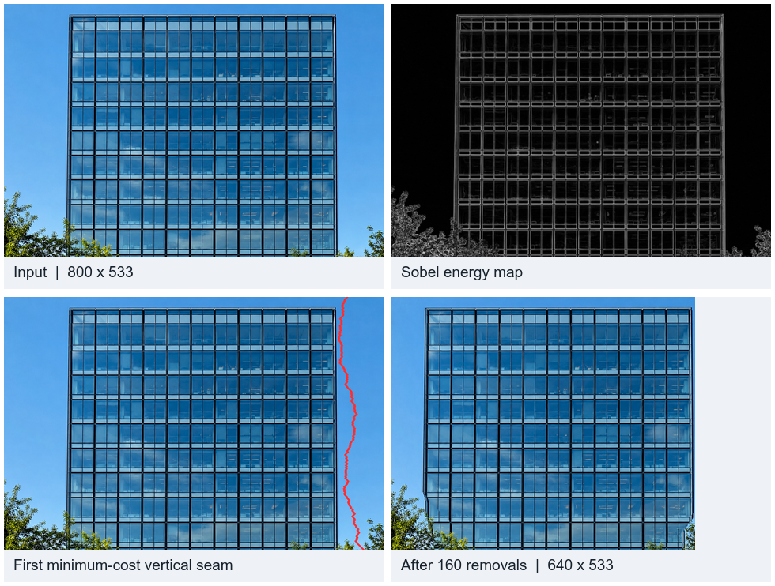

**Figure 4.** The Sobel energy map for `edges-glass-building.png` is displayed in grayscale, with brighter pixels representing higher energy. The red line is widened for visibility and follows the first minimum-cost vertical seam, which runs through the sky to the right of the building and has a seam cost of 1,300.908. The last panel shows the output after 160 vertical removals. At 20% width reduction the sky margins are narrower and the window grid remains recognisable. The figure uses the baseline DP implementation and the team's generated [test image](../../testdata/README.md).

The benchmark below uses scaled copies of the same image and removes 20 vertical seams in each of three repeats per size. The table reports the run with the median total time. Seam finding includes the DP table fill and backtracking. Total time also includes the image copy, Sobel recomputation, seam cost calculation and pixel removal. At 800 by 533, seam finding accounted for about 8.2% of the measured total. The shared work around seam finding matters when interpreting whole-resize timings. See the [benchmark CSV](../../results/bench_edges-glass-building.csv) and [run log](../../results/bench_edges-glass-building.log).

| Starting width × height | Total time (ms) | Seam finding (ms) |
| --- | ---: | ---: |
| 100 × 67 | 5.078 | 0.589 |
| 200 × 133 | 15.191 | 1.405 |
| 400 × 267 | 61.117 | 3.208 |
| 800 × 533 | 264.001 | 21.551 |

### Edmonds–Karp correctness and results

#### Correctness tests

The archived C3 Release verification run on 16 November 2026 passed all
87 test cases and 94,133 assertions. Its output is preserved in
[`results/c3-tests.log`](../../results/c3-tests.log). This is the count for
that recorded run; later team integrations add further tests. The relevant
C3 checks include:

- A six-node network with known maximum flow 23 and independently summed
  cut capacity 23; a graph requiring cancellation through a reverse edge;
  parallel edges, a self loop, zero capacities and an unreachable sink.
- Exactly equal EK and DP seam costs on 500 deterministic random integer
  maps, with widths and heights from 1 to 7. Every returned seam is checked
  for connectivity and valid column indices.
- A unique optimum in the last real column, width-one and height-one maps,
  zero energies, tied minima and thousandth-valued inputs.
- Rejection of invalid maps, invalid nodes, unsafe capacities and flow
  overflow; vertical and horizontal resizing through the shared resize loop.
- A JPEG-loading integration test using a 64x43 sample of the supplied castle
  photo, comparing EK to DP on each current image during mixed resizing.

These tests provide evidence in addition to the network proof; finite random
tests alone do not establish correctness for every input.

#### Visual comparison and measurements

The two team-generated source images were box-downscaled from 800x533 to
64x43 using `scale_image()` at scale 0.08. Both algorithms then removed ten
vertical seams, recomputing Sobel energy after every removal, to reach 54x43.
This initial scaling is input preparation, not part of either seam finder.
Provenance is documented in [`testdata/c3/README.md`](../../testdata/c3/README.md).

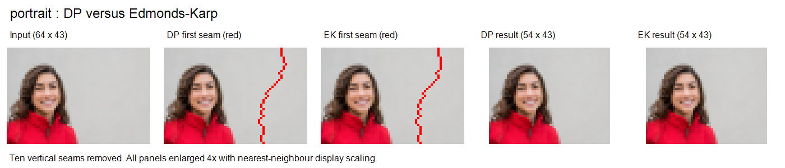

*Figure 5.* Original small portrait, first DP and EK seams in red, and the
two ten-seam results. Both first seams run through the background to the
right of the subject. Their original-energy costs are both 92.844 to three
decimal places, although their positions are not identical. Both outputs
retain the face and red jacket; they are not pixel-identical. At this small
resolution, the figure supports only a limited visual comparison, not a
general claim about perceptual quality.

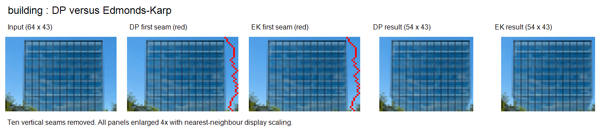

*Figure 6.* Both first seams follow the building's right-side background
and have cost 826.712. They are identical in position. The final 54x43 images
are pixel-identical, although that does not imply the complete removal order
was identical. Both outputs narrow the scene; preserving every architectural
proportion is not guaranteed by an energy-minimisation objective.

For every one of the twenty EK removals across these two examples, a fresh
DP reference was evaluated on EK's exact current image. Costs agreed within
1e-6; the largest observed difference was about 1.71e-13. The per-step evidence
is [`c3-seam-checks.csv`](../../results/c3-seam-checks.csv), with first-seam and
final-pixel comparisons in [`c3-first-seams.csv`](../../results/c3-first-seams.csv).

Separate timing runs used the MSVC x64 Release build with optimisation,
on the same local Windows machine (Intel64 Family 6 Model 165 Stepping 3).
For each image and algorithm, five fresh ten-seam runs were made; the table
reports the median total time. Timing excludes file loading, saving and
figure rendering. `find_ms` measures the seam-finding share of that selected
median run and is not an independent median.

| Input | DP total (ms) | EK total (ms) | DP find (ms) | EK find (ms) |
|-------|--------------:|--------------:|-------------:|-------------:|
| Portrait, 64x43 -> 54x43 | 2.607 | 315.552 | 0.143 | 313.684 |
| Building, 64x43 -> 54x43 | 1.625 | 296.285 | 0.061 | 294.615 |

Sources: [`c3-benchmark-portrait.csv`](../../results/c3-benchmark-portrait.csv)
and [`c3-benchmark-building.csv`](../../results/c3-benchmark-building.csv).
These are local measurements, not universal speed ratios. The measurements
show that graph-cut seam finding accounts for almost all of EK's total time
even on these small examples. Here, `find_ms` includes network construction,
max-flow and seam extraction; it does not isolate the max-flow loop. These
MSVC measurements and the Dinic benchmark in the next section used different build environments.

The benchmark CSVs also record cumulative costs along each algorithm's own
removal sequence. They differ here: portrait 1130.006 (DP) versus 1130.916
(EK), and building 11817.066 (DP) versus 11813.936 (EK). This does not contradict
per-seam optimality: tie choices can produce different current images and
future costs, and finding the cheapest current seam does not optimise the
entire sequence of ten removals. The same-current-image checks above are the
appropriate correctness comparison.

### Dinic correctness and results

#### Correctness and Equivalence Across Random Networks

To rigorously prove that our Dinic implementation introduces no optimizations that compromise correctness, we conducted automated test suites in `tests/test_dinic.cpp` (spanning 12 `TEST_CASE` blocks):
1. **Flow Value Equivalence on 300 Random Networks**: Tested on randomly generated directed graphs with arbitrary edge densities, parallel edges, and capacities. Across all 300 trials, `dinic(a, s, t) == edmonds_karp(b, s, t)` matched identically.
2. **Seam Cost Equivalence on 300 Random Energy Maps**: Compared `find_seam_graphcut_dinic(e)` against `find_seam_dp(e)` on random integer-valued maps. Across all 300 trials, the seam cost found by Dinic matched DP exactly (`seam_cost(dinic) == seam_cost(dp)`).
3. **Floating-point agreement on real fixtures**: In `results/maxflow_benchmark.csv`, the seam cost found by Dinic and EK matched the DP reference cost to within $10^{-6}$ across all scales.
4. **Two Stack-Safety Tests**: In addition to textbook validation, flow cancellation, and counter checks, `tests/test_dinic.cpp` specifically defines two stack-safety tests: (a) traversing a 100,000-node linear path to prove that DFS path depth does not cause recursive call-stack growth, and (b) solving a $200 \times 200$ image-sized map ($V = 40,202$ vertices) without stack overflow.

#### Empirical Benchmarks and Scaling Comparison

We benchmarked seven resolutions using box-downscaled copies of `testdata/landscape-tower.png`. The benchmark reports the median seam-finder time over three runs where the time budget permitted. The graph-cut seam-finder time includes graph construction, max-flow and seam extraction. The benchmark also reports max-flow solver time separately. When a run exceeded 5,000 ms, the benchmark skipped larger sizes for that algorithm.

The empirical data recorded in [the solver benchmark CSV](../../results/maxflow_benchmark.csv) demonstrates the massive efficiency advantage of Dinic:

| Image Resolution | Vertices ($V$) | Directed Edges ($2E$) | DP Total (ms) | Dinic Total (ms) | Dinic Solver (ms) | EK Total (ms) | EK Solver (ms) | Dinic Speedup (Total) | Dinic Phases | EK Augmentations |
|---|---|---|---|---|---|---|---|---|---|---|
| **$32 \times 21$** | 695 | 5,332 | 0.0015 | 2.24 | 1.23 | 5.03 | 4.39 | **2.25x** | 17 | 231 |
| **$64 \times 43$** | 2,797 | 21,932 | 0.0045 | 8.84 | 6.49 | 93.37 | 90.93 | **10.56x** | 26 | 721 |
| **$96 \times 64$** | 6,210 | 49,024 | 0.0172 | 55.96 | 50.51 | 574.21 | 569.55 | **10.26x** | 69 | 1,962 |
| **$128 \times 85$** | 10,967 | 86,868 | 0.0678 | 124.02 | 115.44 | 1,897.89 | 1,889.35 | **15.30x** | 89 | 3,356 |
| **$200 \times 133$** | 26,735 | 212,532 | 0.0777 | 601.74 | 575.26 | 13,592.59* | 13,573.33 | **22.59x** | 169 | 7,618 |
| **$400 \times 267$** | 107,069 | 853,868 | 0.1507 | 5,598.43* | 5,514.66 | *skipped* | *skipped* | **>50x (est.)** | 247 | 28,567 |
| **$800 \times 533$** | 426,935 | 3,410,132 | 1.3503 | *skipped* | *skipped* | *skipped* | *skipped* | - | - | - |

*\*Single run exceeded the 5,000 ms benchmark budget; larger sizes were skipped.*

#### Seam Selection and Visual Quality

To compare visual quality, we performed 10 vertical seam removals on two standardized $64 \times 43$ test fixtures (`portrait` and `building`), shrinking them to $54 \times 43$ using both DP and Dinic graph cut. The visual outputs are documented in `docs/report/figures/c4/`:

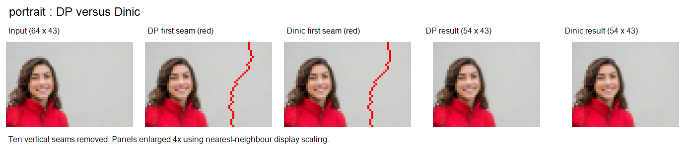

*Figure 7. Comparison of 10 vertical seam removals on portrait ($64 \times 43 \to 54 \times 43$). Left to right: original input, first seam found by DP (red), first seam found by Dinic (red), DP 10-seam result, and Dinic 10-seam result. Because the plain background contains tied zero energies, first seam paths differ, but both preserve the face with identical visual quality.*

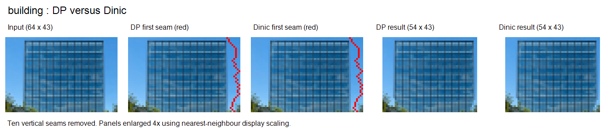

*Figure 8. Comparison of 10 vertical seam removals on building ($64 \times 43 \to 54 \times 43$). Sharp edges create a unique minimum-energy seam: DP and Dinic select 100% identical seam coordinates (`positions_equal = 1`), producing pixel-identical outputs (`final_pixels_equal = 1`).*

| Metric | Portrait (`portrait-input.png`) | Building (`building-input.png`) |
|---|---|---|
| Input Dimensions | $64 \times 43$ | $64 \times 43$ |
| Target Dimensions | $54 \times 43$ (10 seams removed) | $54 \times 43$ (10 seams removed) |
| First Seam Cost (DP) | **92.844** | **826.712** |
| First Seam Cost (Dinic) | **92.844** | **826.712** |
| First Seam Positions Match? | **No** (`positions_equal = 0`) | **Yes** (`positions_equal = 1`) |
| Final Resized Image Pixels Match? | **No** (`final_pixels_equal = 0`) | **Yes** (`final_pixels_equal = 1`) |
| Visual Distortion / Artifacts | None; face preserved identically | None; straight facade lines preserved |

#### Handling Plateau Ties: Portrait versus Building

An insightful result from `results/c4-first-seams.csv` is the distinction between unique minima and plateau ties:
1. **Building Image (Unique Minimum)**:
   The glass building facade contains sharp edges and high gradients everywhere except in the sky margins. There is a single unique minimum-energy seam path. As a result, DP and Dinic select the **exact same seam positions** across all 43 rows (`positions_equal = 1`), and the final resized images after 10 removals are 100% pixel-identical (`final_pixels_equal = 1`).
2. **Portrait Image (Tied Optimal Plateau)**:
   The portrait features a person on the left and a flat, uniform grey wall on the right. The background wall contains large patches where pixel energies are zero or identical. Multiple distinct connected seams achieve the exact same minimum cumulative cost ($92.844$).
   - DP resolves ties with a strict deterministic rule: bottom-up leftmost parent preference.
   - Graph Cut resolves ties according to the order in which BFS residual reachability explores the level graph from the source.
   - Consequently, the first seam positions differ (`positions_equal = 0`). Because early seam removals alter subsequent energy recalculations, the final images differ in exact pixel values.
   - However, **both outputs have equal visual quality**: both algorithms exclusively carve safe background pixels from the plain grey wall, leaving the subject's face completely unmarred.

In `results/c4-seam-checks.csv`, we verified 20 per-step seam comparisons (10 removals on `portrait` and 10 on `building`), comparing Dinic against an independent DP run on Dinic's exact current image at each removal step. Every single seam selected by Dinic matched DP's optimal cost to within $10^{-6}$.

## 5. Analysis and discussion

### Time and space complexity (5b)

#### DP complexity

For one vertical seam on an $h\times w$ image:

| Operation | Time | Storage |
| --- | --- | --- |
| Compute Sobel energy | $\Theta(hw)$, with fixed-size kernels per pixel | $\Theta(hw)$ for the energy map |
| Fill the DP table | $\Theta(hw)$, with at most three predecessor costs per pixel | $\Theta(hw)$ for the cumulative costs |
| Pick the endpoint and backtrack | $\Theta(w+h)$, scanning the bottom row and recovering one pixel per row | $\Theta(h)$ for the seam |
| Remove the seam | $\Theta(hw)$, scanning rows and copying survivors | $\Theta(h(w-1))$ for the new image |

The minimum cost alone can be found in $\Theta(w)$ DP workspace by retaining two rows. The baseline keeps the full table so it can recover the seam in one upward pass. A horizontal step swaps $h$ and $w$ and adds two transposes. Each transpose costs at most $\Theta(hw)$ time and space, so the per-step bounds remain the same.

The implementation first copies the $m\times n$ input image in $\Theta(mn)$ time. If the current dimensions before removal $t$ are $h_t\times w_t$, the total runtime for $k$ removals is $\Theta(mn+\sum_{t=0}^{k-1}h_tw_t)$. For $k$ vertical removals, with $1\le k\le n-1$, the sum is

$$
\sum_{t=0}^{k-1}m(n-t) = m\left(kn-\frac{k(k-1)}{2}\right).
$$

The sum stays between $kmn/2$ and $kmn$ under this bound on $k$, so vertical-only resizing takes $\Theta(kmn)$ for $k\ge 1$. For mixed directions, $O((k+1)mn)$ follows because each current image fits inside the original dimensions. Peak storage is $\Theta(mn)$ for the baseline because each step holds a constant number of image-sized buffers and releases its temporary storage before the next step.

#### Graph cut with Edmonds–Karp

This implementation creates V = H(W+1)+2 nodes. There are WH finite forward
edges, WH explicit backward edges, 2W(H-1) diagonals and 2H terminal edges:

```text
E = 4WH + 2H - 2W original directed edges
2E stored edge records, including reverse residual edges
```

Network construction and residual reachability each take O(WH) time and
storage. The adjacency vectors and BFS working arrays require O(V+E) memory,
which is O(WH) for this network.

The EK bound follows from the BFS distances in the residual graph, which do
not decrease. Each augmentation saturates a bottleneck edge. Before that edge
can become a bottleneck again, a later path must use its reverse edge; its
tail's BFS distance then increases by at least two. Each edge can become a
bottleneck O(V) times, giving O(VE) augmentations. BFS costs O(E) here, so the
worst-case running time is O(VE^2) [7].

Since V and E are both O(WH), one EK seam has an O((WH)^3) worst-case bound.
DP takes O(WH) time per seam. Removing k seams rebuilds and solves a changing
network each time; using the initial dimensions gives a loose upper bound of
O(k(WH)^3) for EK versus O(kWH) for DP. These are worst-case bounds, not
predictions of a particular runtime. Our EK evaluation therefore uses small
inputs, as recommended in the C3 task.

#### Graph cut with Dinic

##### Theoretical Worst-Case Upper Bound

The general worst-case time complexity of Dinic's algorithm is **$O(V^2 E)$**:
- **Number of phases**: At most $V - 1$ phases, because the sink level strictly increases each phase ($\text{level}[t] \ge k$) and cannot exceed $V - 1$.
- **Cost of BFS per phase**: Building the level graph takes $O(V + E)$ time using standard queue traversal. Across $V$ phases, total BFS cost is $O(V(V + E)) = O(VE)$.
- **Cost of DFS blocking flow per phase**:
  - Each time an augmenting path reaches $t$, at least one critical edge saturates and is never visited again in this phase. There are at most $E$ saturations per phase.
  - Traversing a path of length at most $V$ takes $O(V)$ time. Hence, successful path pushes cost at most $O(V \cdot E)$.
  - Retreats and dead-end edge skips advance `iter[u]`. Since each edge is examined and discarded at most once per phase, total retreat cost is $O(E)$.
  - Thus, finding the blocking flow takes $O(V E)$ time per phase.
- **Total Worst-Case Time**:
  $$T(V, E) = V \cdot [O(V + E) + O(V E)] = O(V^2 E)$$

##### Network Structure and Practical Performance

In our seam carving network for an image of width $W$ and height $H$:
- $V = (W + 1)H + 2 \approx W \cdot H$
- $E = 4WH + 2H - 2W$ original directed edges ($WH$ finite forward selection edges, $WH$ backward constraints, $2W(H - 1)$ diagonal constraints, and $2H$ terminal source/sink edges). Since $4WH$ is the dominant term, $E \approx 4WH$. With paired reverse residual edges, the `FlowGraph` stores $2E = 8WH + 4H - 4W \approx 8WH$ directed edges. The exact $2E$ counts per size are computed directly from this network construction and shown in the solver benchmark table in Section 4.

Plugging these dimensions into the general worst-case formula gives:
$$T_{\text{worst}}(W, H) = O(V^2 E) = O((WH)^2 \cdot (4WH)) = O((WH)^3)$$

**Observed Practical Complexity**:
In practice, Dinic runs orders of magnitude faster than $O(V^2 E)$ on our seam networks. On unit networks, Dinic runs in $O(E \sqrt{V})$, and on layered planar graphs with bounded degree, the empirical scaling is near-linear in the number of edges.

Our benchmark measurements in [the solver benchmark CSV](../../results/maxflow_benchmark.csv) verify this dramatic difference between theoretical worst-case and observed performance:
1. **Strictly bounded phase count**: The theoretical upper bound for phases on a $200 \times 133$ image ($V = (200+1) \cdot 133 + 2 = 26,735$) is over 26,000 phases. In reality, Dinic required **only 169 phases**. On $32 \times 21$, it needed only 17 phases; on $64 \times 43$, 26 phases.
2. **Dense Phase 1 throughput**: Because horizontal edges $(x, y) \to (x+1, y)$ are the only edges that advance column index, Phase 1 pushes straight horizontal flow across almost all $H$ rows simultaneously. Subsequent phases only resolve sparse diagonal detours where boundaries interact.

##### Space Complexity

The space complexity of Dinic's algorithm is **$O(V + E) = O(W \cdot H)$**:
- Graph storage (`FlowGraph`): Stores $2E \approx 8WH$ `Edge` structs (16 bytes each) and adjacency vectors containing $2E$ integer indices (4 bytes each).
- Solver auxiliary storage:
  - `level`: $V$ integers (4 bytes each)
  - `bfs_queue`: $V$ integers (4 bytes each)
  - `iter`: $V$ integers (4 bytes each)
  - `path`: explicit stack of at most $V$ integers
- Total memory: approximately $180\text{–}240$ bytes per pixel.
Although this is $O(W \cdot H)$ asymptotically—the same order of growth as Dynamic Programming—the constant factor is approximately $25\times$ to $30\times$ larger than DP's minimal 8 bytes per pixel table.

### Algorithm comparison (5c)

#### Edmonds–Karp versus Dinic

##### The Practicality Threshold of Edmonds-Karp

A critical finding from our measurements is identifying **where Edmonds-Karp ceases to be practical**:
- Up to $64 \times 43$, EK completes in under 100 ms and remains interactive.
- At $128 \times 85$, EK requires nearly **2 seconds** per seam.
- At $200 \times 133$, EK takes **13.59 seconds for a single seam**. Carving 50 seams at this resolution would require over **11 minutes** of continuous computation.
- Beyond $200 \times 133$, EK becomes completely unviable for practical image processing.

In contrast, Dinic scales significantly further:
- At $200 \times 133$, Dinic finishes in **0.60 seconds** ($22.6\times$ faster than EK).
- At $400 \times 267$ ($>107,000$ vertices), Dinic finishes in **5.60 seconds**, whereas EK would require an estimated 3 to 5 minutes per seam.
- In `results/maxflow_large.csv`, we executed a full acceptance stress test on a **$1000 \times 700$ image** ($V = (1000+1) \cdot 700 + 2 = 700{,}702$ vertices, $2E \approx 5.6$ million directed edges). Dinic successfully completed the seam in **109.75 seconds** (572 phases, 156,400 augmentations) without overflowing the stack.

##### Root Cause of the Dinic Speedup

The fundamental explanation for Dinic's order-of-magnitude speedup lies in **how augmenting paths are searched**:
- **Edmonds-Karp**: Executes an independent BFS traversal of the entire graph for **every single path augmentation**. At $200 \times 133$, EK executed **7,618 separate BFS runs**. Each BFS visits thousands of vertices and edges, resulting in massive redundant exploration.
- **Dinic**: Groups augmenting paths into blocking flows. At $200 \times 133$, Dinic performed **only 169 BFS runs**. Within each level graph, the iterative DFS pushes hundreds of path augmentations using lightweight edge updates and current-arc pointer skipping.

#### Graph cut versus dynamic programming

##### Running time comparison

While Dinic dramatically outperforms Edmonds-Karp, Dynamic Programming is vastly superior to both graph-cut solvers:
- At $64 \times 43$: DP takes **0.0045 ms**, Dinic takes **8.84 ms** ($1,964\times$ slower than DP), and EK takes **93.37 ms** ($20,748\times$ slower than DP).
- At $200 \times 133$: DP takes **0.0777 ms**, Dinic takes **601.74 ms** ($7,744\times$ slower than DP), and EK takes **13.59 s** ($174,936\times$ slower than DP).
- At $800 \times 533$: DP takes only **1.35 ms**, enabling real-time interactive resizing, while graph-cut solvers cannot finish in interactive time.

The reason for DP's overwhelming speed advantage is structural:
- Seam carving has a natural topological ordering: seams proceed strictly row by row from top to bottom.
- DP leverages this Directed Acyclic Graph (DAG) property to solve the problem in a single forward pass and one backward trace in **$O(W \cdot H)$ time**.
- Graph Cut solves a general flow problem where flow can detour diagonally and backward through residual edges, incurring heavy polynomial overhead ($O(V^2 E)$).

##### Memory Footprint: DP Table versus Residual Flow Network

| Property | Dynamic Programming (DP) | Graph Cut (Dinic) |
|---|---|---|
| Core Data Structures | 2D Cost Table `M[y][x]` | `FlowGraph`: Edges array + Adjacency lists |
| Aux Data Structures | None (backtracking uses `M`) | `level`, `iter`, `bfs_queue`, explicit DFS stack |
| Space Complexity | $O(W \cdot H)$ | $O(V + E) = O(W \cdot H)$ |
| Memory for $800 \times 533$ | **$\approx 3.4$ MB** ($800 \times 533 \times 8$ bytes) | **$\approx 85\text{–}100$ MB** ($3.41 \times 10^6$ edges $\times 20$ B + nodes) |
| Allocation Overhead | Single flat vector allocation | Multiple dynamic vectors and adjacency allocations |

##### Practical Conclusion: When to Use Graph Cut over DP

Given that DP is thousands of times faster, uses a fraction of the memory, and produces optimal seams of identical cost, **should anyone ever use Graph Cut for seam carving?**

For standard, unconstrained seam carving with backward Sobel energy, **the answer is no**; Dynamic Programming is strictly superior.

However, Graph Cut provides a **flexible, generalized energy minimization framework** that can solve extended image resizing problems where DP fundamentally breaks down:
1. **User Scribbles & Hard Constraints (Object Protection/Removal)**:
   In interactive applications, a user may draw a green scribble over an object to protect it, or a red scribble to remove it. In Graph Cut, this is handled trivially by clamping edge capacities:
   - Protected pixel: set outgoing horizontal edge capacity to $\infty$ (cannot be cut).
   - Removed pixel: set capacity to $0$ or connect directly to $s/t$ (forced to be cut).
   In DP, arbitrary non-monotonic spatial masks cannot be enforced without violating the strict 3-neighbor parent DAG transition.
2. **Forward Energy and Non-Local Priors**:
   As established by Rubinstein et al. (2008), forward energy measures the new edges created after seam removal. Forward energy introduces cross-neighbor interaction penalties between adjacent rows. While DP requires complex multi-case transition logic, Graph Cut handles pairwise pixel interaction penalties naturally via submodular edge constructions.
3. **Multi-Seam and Non-Monotonic 2D Carving**:
   Graph cut can be extended to find multiple disjoint non-crossing seams in a single max-flow computation, or compute 2D surface cuts that do not follow a simple top-to-bottom monotonic path.

In summary, Dynamic Programming is a specialized, ultra-fast solver for simple monotonic DAG paths, while Graph Cut is a universal optimization engine capable of accommodating arbitrary global constraints at the expense of computational performance.

##### Discussion of the Edmonds–Karp results

The implementation demonstrates that a flow-network formulation can solve
the same current-seam minimisation problem as DP, subject to the documented
capacity precision. The virtual column makes all real pixel columns eligible,
and the INF constraints encode seam validity instead of checking it only
after a cut is found. The network proof, known-flow tests and DP agreement
checks support the correctness claim together.

The cost is additional graph storage and much greater computation. The
small-image timings support using DP for ordinary repeated seam carving and
using EK as a reference implementation for the graph-cut approach. A slow
large-image run is therefore a practical limitation, not evidence by itself
that the returned seam is wrong. The solver comparison evaluates Dinic on the
same network; this section establishes the formulation and EK reference.

#### Comparison across DP, greedy and graph cut

The benchmark used three sizes of `landscape-tower.png` and removed two vertical seams at each size. [Benchmark CSV](../../results/compare_400.csv)

Search time is the total number of milliseconds spent finding the two seams. Seam cost is the sum of both removed seams’ costs, each measured on its own energy map.

| Size | DP search (ms) | Greedy search (ms) | Graph cut (EK) search (ms) | Graph cut (Dinic) search (ms) | EK vs Dinic |
|---|---|---|---|---|---|
| 100×67 | 0.0069 | 0.0007 | 285.6 | 24.6 | 11.6× |
| 200×133 | 0.034 | 0.0013 | 4,849 | 323.7 | 15.0× |
| 400×267 | 0.127 | 0.0035 | 93,284 | 1,784 | 52.3× |

| Size | DP cost | Greedy cost | Greedy vs DP | Graph cut (EK) cost | Graph cut (Dinic) cost |
|---|---|---|---|---|---|
| 100×67 | 3,486 | 4,133 | 1.19× | 3,486 | 3,486 |
| 200×133 | 4,644 | 8,614 | 1.85× | 4,644 | 4,644 |
| 400×267 | 7,501 | 14,076 | 1.88× | 7,501 | 7,501 |


**Observations**

- **DP is the best choice for seam cutting**: While DP does not have the shortest search time out of all 4 of the algorithms tested (Greedy searches faster), it has the second best search time while maintaining same cost as EK and Dinic.
- **Greedy cost has the highest cost**: Initially at 100x67, Greedy only had a cost of 4133, about 1.19x that of DP and the graph cut algorithms. However, this gap widens as it increases to about 1.85x on 200x133, and lastly 1.88x on 400x267.
- **Graph-cut search times.** At 200 × 133, finding both seams took 4,849 ms with EK and 323.7 ms with Dinic. DP took 0.034 ms and greedy took 0.0013 ms.
- **Dinic is faster than EK:** From 100x67 to 400x267, Dinic's search time comes to 24.6 ms, 323.7 ms and 1784 ms to EK's 285.6, 4849 ms, and 93,284 ms. The performance gap widens with each larger image dimension, going from 11.6x to 15.0x to 52.3x.

### Improvements (5d)

#### DP table

The DP table M[i][j] holds the cheapest cost of reaching pixel (i, j) from the top.
To compute row i, only row i - 1 is needed, so the costs need just 2 rows.

The seam itself is different. After the last row, we walk back up and need to know
which of the three pixels above each step came from, which is why a direction
(-1, 0 or +1) is stored for every cell. Those fit in 1 byte instead of an 8-byte double.

- **Memory:** DP structures are about 7.3-7.9x smaller. Space is still O(WH) as the directions
  are still an HxW table.
- **Speed:** DP search is up to 1.6x faster on large images and about 0.75x its original speed on
  small images. Overall, for the whole program it makes a minor difference, around
  0.94 - 1.03x as DP makes up a small part of the time.

#### Incremental Energy

After removing a seam, a pixel's energy only changes if its 3x3 neighbourhood
touched the removed pixels. That is about 6 pixels per row. Everything else
retains its old energy, just shifted 1 column left.

Per-seam time dropped by 3.3x, 3.1x and 2.0x on small, medium and large
images respectively, and the gain shrinks on larger images occurs
as the copy of the whole energy map is still O(WH), so the recompute is cheap
but the copy did not. The overall bound stays at O(WH).

#### Multi-threading

There are two places to split work across threads.

- **Energy, by rows:** Each row can be computed independently so it speeds up by
  2.2-2.7x at 8 threads on medium and large images. On the small image, it did not help because
  starting threads cost more than the 0.5ms of work.
- **DP, by cells within a row:** Unfortunately, DP becomes significantly slower as a result of multi-threading.
  Row i needs the finished row i-1, so all threads must wait for each other after every row
  (a barrier). This barrier costs about 21µs at 2 threads while one row's work
  is only 0.2-1.8µs. So threads spend nearly all their time waiting and the DP becomes
  13x to 1200x slower.

The limit on the pipeline overall is Amdahl's law: only the energy portion
is parallel 69% of the time, so unlimited threads can only give at most about 3.2x.

#### Improvements Take-away

- **Do we need the whole DP table?** No. Two cost rows and a 1-byte direction
  per cell are enough. This saves memory but there are no significant changes to speed.
- **Does multi-threading help?** For the energy rows on larger images, yes. For the DP,
  no, as each row depends on the previous one.

[DP table measurements](../../results/improvements_memory.csv) · [Incremental energy measurements](../../results/improvements_incremental.csv) · [Threading measurements](../../results/improvements_threads.csv)

## 6. Bonus features

### Step-by-step visualization (7a)

The goal of the visualization is to make every seam visible, both as an overview picture of all seams,
as well as per-step visualization.

#### Step frames

resize() calls a callback before every removal, giving it the current image and the seam
it is about to remove. --steps utilizes this callback to paint the seam red and save the picture.
Frame 1 is the full 800x533 image with seam 1 drawn, frame 2 is the 799-wide image with seam 2, and
so on.

#### All-seams overview

In each step frame, the seam is drawn in red. For the all-seams overview, vertical seams (from top to bottom) are red
while the horizontal seams (from left to right) are colored cyan.

Each seam is found on an image that has already shrunk. For example, seam 50's column numbers refer to the image as it was after 49 removals, not the original. Hence, Seam 50's coordinates cannot be painted onto the original photo, unless we use an index map.

- Keep a table the same size as the current image. Each entry stores the original position of that pixel.
- When a seam is removed, look up each removed pixel in the table. That gives its original position
  and we can mark that an original pixel was removed at step k.
- Lastly, delete those entries from the table, which mimics the same way the image shrinks

Example: 5 original pixels

[0, 1, 2, 3, 4]

Step 1: Remove pixel at position 2

[0, 1, 3, 4]

Step 2: Remove pixel at position 2 again

[0, 1, 4]

By the end of the operation, every original pixel has been either kept or removed,
and removed pixels are indicated as red or cyan (vertical or horizontal seams) on the original image
under the file overview.png.

| Original (800x533) | Step 1 (vertical seam) | Step 10 (horizontal seam) | Step 50 (horizontal seam) |
|---|---|---|---|
|  |  |  |  |


| All seams on the original image | Result (640x430) |
|---|---|
| 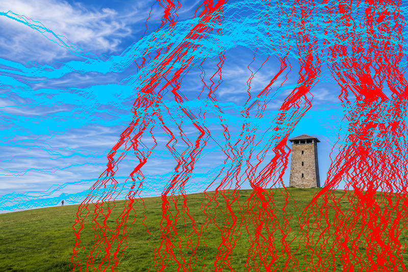 |  |


#### Rendering each step

The GUI stores the seams and rebuilds frame k by replaying the first k-1 removals on the original
(`render_step`, `replay`).

#### Testing

Test images store their own coordinates in the pixel colours (red = x, green = y). Hence, a seam pixel
in any shrunk image tells the test which original pixel it is, and the test checks if the tracker agrees.
It also checks that no two seams share a pixel.

#### Discussion

**Index map**
- Time: Recording a seam requires a rebuild of the map which is of O(WH) per seam.
  That would be the same order as removing the seam from the image itself, so it adds a constant factor.
- Memory: Requires two tables of 4-byte integers, which are the current index map and the removal-order table.
  For 800x533, it evaluates to around 1.7 MB per table, 3.4 MB in total.

**Frames**
- Each frame of the image is around 800 x 533 x 3 bytes = 1.28 MB. All 263 frames will take up to
  336 MB on an upper bound as frames will gradually shrink.
- Storing only the seams will only take up around 0.6 MB for this image.
- Rebuilding frame k is O(k.WH) where k is the step number. This can be reduced by replaying from a checkpoint instead from restarting right from the original image.

**Limitations**
- The overview is unable to show the order in which seams were removed, only that they were vertical or horizontal.
- Rebuilding a step from scratch gets slower for late steps.

**Possible improvement**
- Modifying the color of the overview seams by their removal step using lighter to darker colors could help somewhat identify the order of each seam.

### Interactive GUI (7b)

#### Resizing and progress

The user can type an image path or drag an image onto the window. The width and height sliders set the target dimensions. After selecting an algorithm and clicking **Resize image**, the user can compare the original and result side by side, see the elapsed time and total seam cost, and export the result as PNG or JPEG.

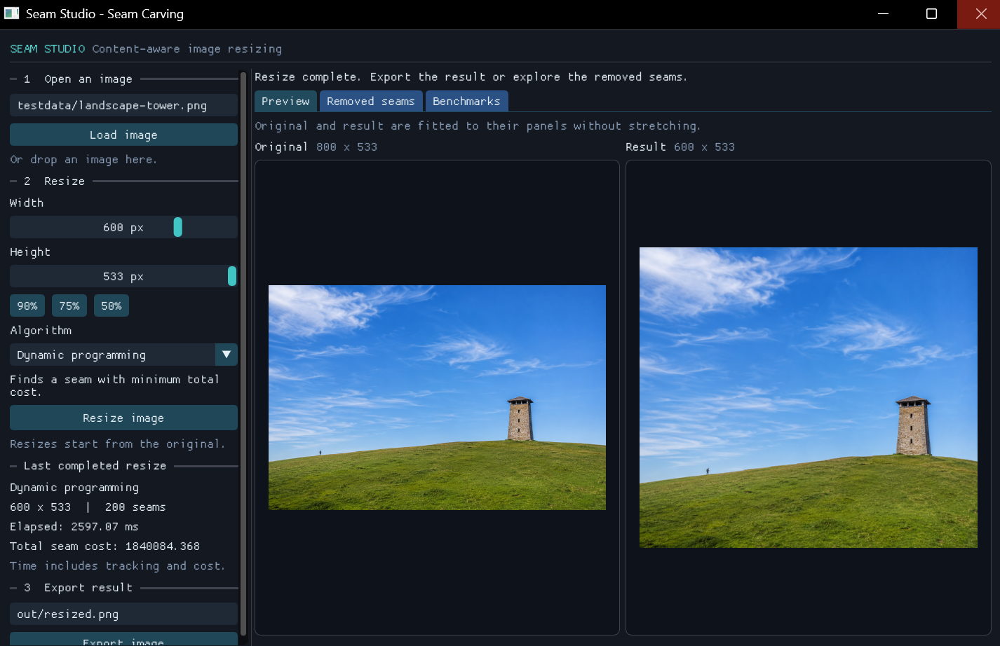

**Figure 9.** DP reduced the landscape from 800 × 533 to 600 × 533 by removing 200 vertical seams.

GLFW creates the window and OpenGL context. Dear ImGui draws the controls, and ImPlot draws the benchmark chart. We run the resize on a worker with `std::async` so the window stays responsive. The worker has its own copy of the input and calls the same resize function as the CLI. The main thread draws the interface, reads progress through atomics, and uploads the result when the worker finishes.

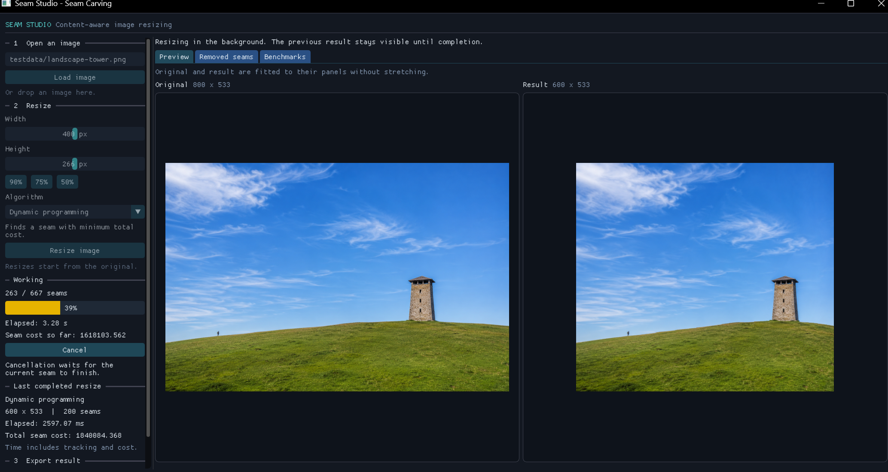

**Figure 10.** The resize towards 400 × 266 is at 263 of 667 removals. The last completed result is still visible while the new job runs.

#### Viewing the removed seams

In **Removed seams**, we can play the steps in order or jump to a specific step. Saving an image for every step would use more memory, so the GUI keeps the original, the seam coordinates, and one checkpoint. It rebuilds the image just before the selected removal and draws the seam over it. The overview maps all removed pixels back to the original image.

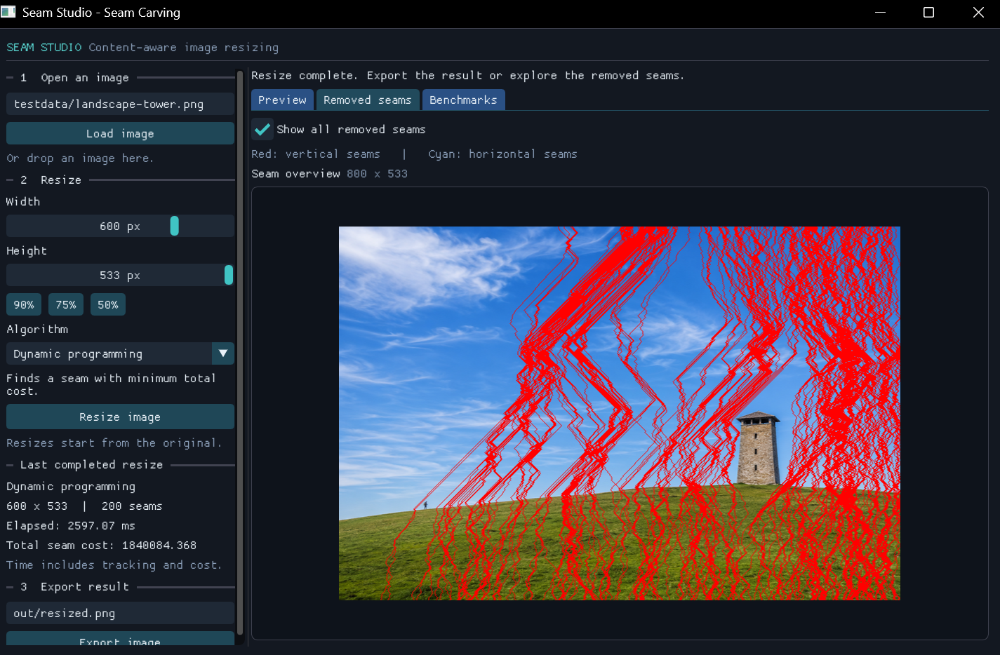

**Figure 11.** Overview of the 200 vertical seams from the 600 × 533 result.

#### Benchmarks

The benchmark tab calls the same benchmark function as the CLI. The plot and the exported CSV use the same rows. The example below uses `landscape-tower.png` at four sizes, with ten vertical seam removals and three repeats at each size.

| Algorithm at 800 × 533 | Search time (ms) | Total time (ms) |
|---|---:|---:|
| DP | 11.185 | 72.397 |
| Greedy | 0.132 | 64.222 |

Greedy spent much less time searching in this run. The gap in total time was smaller because both methods still had to compute the energy map and remove the seam at each step. [Exported benchmark CSV](../../results/gui-benchmark.csv)

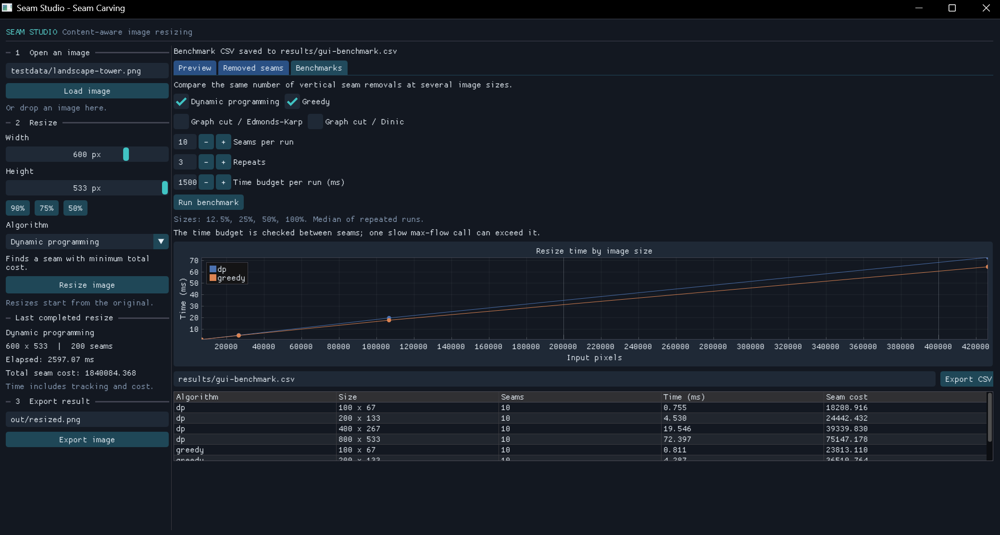

**Figure 12.** Median total time for DP and greedy across the four input sizes.

#### Limitations

- **Cancellation.** Resize checks for cancellation between seams, so a long max-flow call has to finish first. Benchmarks check between algorithms and keep completed results.
- **Preview timing.** The preview timer includes seam tracking and an extra Sobel pass to report the cost. The benchmark timer leaves out the GUI work. Passing the existing energy map to the callback would save the extra pass.
- **Algorithm availability.** The GUI build used for this demo had a Dinic option that displayed an error when selected. Sections 4 and 5 cover the separate Dinic results.

### CI/CD (7c)

CI has been implemented to help automatically build and test code every time something has been
pushed or when a pull request is opened. This helps catch broken code before merges into main and
by testing it on multiple OSes (Ubuntu, Windows), it helps catch OS-specific bugs.

[](https://github.com/sheeyang/Algo-Group-Assignment-2/actions/workflows/ci.yml)

ci.yml has 3 primary jobs.
- **build-test:** Runs twice for Ubuntu and Windows. It builds in Release, runs all tests, a smoke test,
  and uploads files. This helps identify problems which may only appear with one of the OSes.
- **gui:** Installs the Linux GUI libraries and builds with `-DSEAM_BUILD_GUI=ON`.
- **release:** When a version tag is pushed, it will attach the binaries to a GitHub Release.

| CI Green Run | CI Red Run |
|---|---|
| 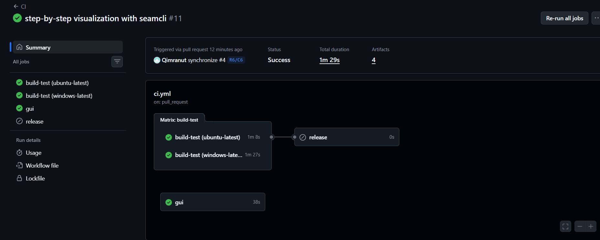 | 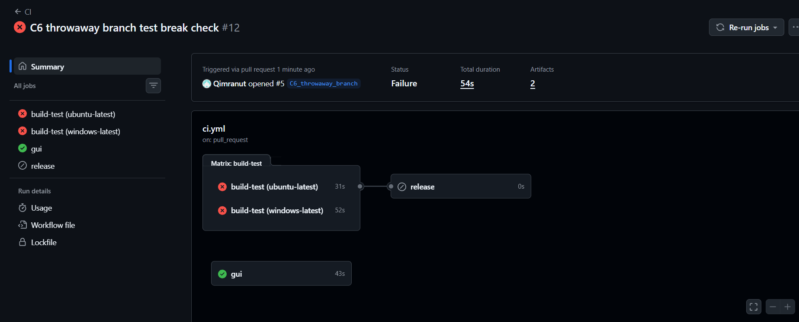 |

#### Smoke Test

After passing the tests, the real seamcli will run on testdata/landscape-tower.png, ask for 640x430,
and check that the output file is 640x430 and the step frames and overview exist.

#### Artifacts

After each run, Github will keep the seamcli program for each OS and the smoke-test images.
On failure, it will keep the test log.

#### Discussion

The workflow has been configured to catch a variety of possible errors along the way.
The unit tests catch individual functions, while the smoke test runs the seamcli on
a test image to ensure that the output has the expected size and that the step frames and
overview are generated. Running on both Ubuntu and Windows also helps catch
potential compiler problems.

Currently, there are some potential flaws with the workflow. The release job has not been run thus far, as it requires a version tag to be pushed. The gui job is also allowed to fail without failing the workflow as it only builds the GUI and does not run any tests. There is also no build caching.


(Write here. Suggested headings: `## Front matter`, `## Improvements`, `## Bonus`, `## Comparison and conclusion`, `## AI usage declaration`)

## 7. Conclusion

DP gave the best balance of seam cost and runtime for the tested Sobel-based resizing tasks. Greedy search ran fastest in the landscape comparison. Its removed seams cost 1.19 to 1.88 times as much as DP’s. Edmonds–Karp and Dinic matched DP’s reported cost in that comparison and took longer to find the seams. Dinic was consistently faster than Edmonds–Karp in the comparisons where both solvers completed.

The optimisations reduced memory use or runtime for individual stages. Two cost rows and one direction per pixel reduced DP storage. Incremental energy updates saved work around each removal, and threading helped compute energy on larger images. Synchronising threads after every DP row outweighed the work saved.

The four-method comparison used a single run at each of three resolutions of one image. The other experiments examine seam validity, ties and visual outcomes on additional fixtures.

## 8. AI usage declaration

The team used the tools listed below during design, implementation, verification and report writing. The log records the main prompts and how the team used the output.

| Date | Who | Tool | Phase (design / implementation / report) | Main prompt | What we kept / changed |
|------|-----|------|-------------------------------------------|-------------|------------------------|
| 2026-11-10 | | Claude Code | design + setup | `/grill-with-docs` "read the assignment requirements, and help me setup the project" | Chose C++17, ImGui/ImPlot, repo layout, glossary, ADRs; scaffold generated |
| 2026-11-10 | Shee Yang | Claude Code | design + implementation (C1) | `/grill-with-docs` "help me do C1" | Agreed 8 decisions (bad-input throws, tie rule judged bottom-up, double energies with integer-valued test maps, horizontal seam tested via `StepCallback`). AI wrote the validation and comments in `seam_dp.cpp`, `tests/test_dp.cpp`, `test_energy.cpp`, `test_image.cpp`, `test_resize.cpp`, and two glossary clarifications. Checked by mutating the DP and confirming the tests fail |
| 2026-11-10 | Shee Yang | Claude Code, ChatGPT | implementation (test data) | Claude Code drafted five image prompts (landscape, portrait, strong edges, person, greedy trap) and `testdata/README.md`; the images were then generated in ChatGPT with those prompts (see `testdata/README.md` for each) | Kept all five images; README records prompt, source and purpose per image |
| 2026-11-13 | Zhi Kai | Codex | design + understanding (C3) | "i am tasked to complete the graph cut network + Edmonds-Kaip how do i start on this for this assignmen?" | AI explained the minimum-cut formulation, paired reverse residual edges, BFS augmenting paths, bottleneck capacities, residual reachability and seam extraction. Identified the last-column limitation in the brief's network and proposed a virtual-column fix. Explained the shared graph interface for C4's Dinic solver. |
| 2026-11-13 | Wei Jun | Claude Code | implementation (C2 greedy) | "explain what c2 is doing and the underlying algorithms" then "branch out and implement greedy" | AI wrote `find_seam_greedy` (leftmost tie rule, border handling, input validation) and `tests/test_greedy.cpp` (trap map where greedy costs 17 vs DP 6, borders, ties, 1000 random maps with greedy >= DP, greedy resize end to end). Checked by flipping the tie comparison and confirming 4 tests fail |
| 2026-11-13 | Wei Jun | Claude Code | implementation (C2 benchmark) | "Start benchmark" | AI wrote `src/bench.h`/`bench.cpp` (`BenchRow` with an added `find_ms` column, `run_benchmark` with median of repeats, skip of unimplemented algorithms and an optional time budget, `scale_image` box downscale, `write_csv`, `algorithm_name`/`parse_algorithm`) and `tests/test_bench.cpp`. Checked total_cost against a hand-written DP loop, and EK cost against DP on the first seam |
| 2026-11-13 | Wei Jun | Claude Code | implementation (C2 CLI + results) | "Commit, then CLI" | AI rewrote `cli/main.cpp` (`--algo`, `--width`, `--height`, `--percent`, `--bench` with `--out`/`--algos`/`--scales`/`--seams`/`--repeats`/`--budget-ms`, `--help`, exit codes 0/1/2, positional form kept), made the benchmark time budget stop a slow run mid-way, added the README CLI section, and generated `results/bench_*.csv` and `.log` for the five test images. Checked by running every option and error case by hand |
| 2026-11-13 | Wei Jun | Claude Code | implementation (C2 report figures) | "Commit, then images" | AI ran `seamcli` with DP and greedy at 90/70/50% width on four test images and laid the outputs out as labelled side-by-side figures in `docs/report/figures/greedy-vs-dp-*.jpg` with a Pillow script; `docs/report/figures/README.md` records the commands |
| 2026-11-15 | Zhe An | Claude Code | design + implementation | "Need help with the brief of C6" | AI wrote `src/seam_dp_opt.{h,cpp}` (low-memory DP, incremental energy, multi-threading), `src/visualize.{h,cpp}`, the `--steps` option in `cli/main.cpp`, `tests/test_improvements.cpp`, `tests/test_visualize.cpp` |
| 2026-11-15 | Zhe An | Claude Code | implementation (measurements) | "Walk me through running the benchmarks and the CSVs" | AI wrote the benchmark programs and I ran them after on my machine. The first CSVs came from a Debug build and were discarded; the committed `results/improvements_*.csv` come from a Release run on the machine |
| 2026-11-15 | Zhe An | Claude Code | implementation (CI/CD) | "how do we implement a CI which helps build and test on ubuntu and windows, smoke test, artifacts and a badge. Walk me through setting it up" | AI drafted `.github/workflows/ci.yml` (Ubuntu + Windows matrix, tests, smoke test, artifacts, optional GUI build, release job). I ran it on Github, fixed any failures that popped up, and got a successful build/run and a failing run for to demonstrate CI. |
| 2026-11-15 | Zhe An | Claude Code | report | "give me a first draft of whats going on in the code and help me understand it." | AI drafted a first version of the improvements and bonus sections using my measured numbers. I rewrote 5d, 7a and 7c in my own words, and the AI reviewed my text for accuracy and wording |
| 2026-11-15 | Shee Yang | Codex | implementation (PR integration) | "merge PR #3" | Resolved CLI conflicts by retaining C2 resize and benchmark options alongside C6 step visualization; retained both AI usage logs and verified the combined build, tests and CLI. |
| 2026-11-15 | Dayton | Antigravity | testing + verification (C4) | "Help me generate comprehensive unit test cases and randomized test suites for Dinic's algorithm, and set up benchmarks to test Dinic against Edmonds-Karp and DP" | Used AI to generate edge-case and property test cases in `tests/test_dinic.cpp` (textbook networks, flow cancellation, parallel edges, self loops, zero capacity, argument rejection), 300 randomized flow networks to test max-flow equivalence with Edmonds-Karp, and 300 random energy maps to verify seam costs against DP. Also used AI to build multi-scale benchmark test runs across 16x16 to 200x200 images to record runtime and phase counts into `results/maxflow_benchmark.csv`. |
| 2026-11-15 | Jarrel | Codex | design + implementation (C5 GUI) | "Help me understand what's happening in the code and how you would recommend proceeding", then "Let's proceed with your recommendation, incorporating my feedback and explaining the decisions made." | AI explained C5/R5, implemented the optional ImGui/ImPlot frontend, background resize/benchmark jobs, seam playback, image/CSV exports, worker tests and build/use documentation. Changes reuse the team's seamlib interfaces; validation details are reported in the accompanying chat. |
| 2026-11-18 | Jarrel | Codex | report (R5) | "Give me a draft of how the report should look like and explain it to me" | Drafted the introduction, architecture diagrams, evaluation method, interactive GUI section, and references using the repository implementation, tests, screenshots, and benchmark CSV. Flagged missing benchmark machine and compiler details. |
| 2026-11-16 | Zhi Kai | Codex | verification + completeness review (C3/R3) | "Can u help me double check have i completed everything?" | AI checked the code, tests, documentation, figures and available measurements against `docs/tasks/C3-graph-cut.md` and the R3 requirements. Rebuilt the Release project, confirmed all 87 tests passed and checked EK CLI output dimensions. Provided a completion checklist identifying the missing DP-versus-EK comparison figures, unfinished R3 draft and existing doctest compiler warning, which guided the remaining work. |
| 2026-11-16 | Shee Yang | Codex | implementation + verification (C2/C4 completion) | "i have merged everyones stuff to main, check if the coding tasks is complete", then "complete them" | Fixed explicit negative CLI dimensions and added executable-level regression checks; added measured Dinic phase/EK augmentation counters with tests, reproducible benchmark and figure generators, DP-versus-Dinic evidence, and updated stale Dinic documentation. |

## 9. References

[1] S. Avidan and A. Shamir, “Seam Carving for Content-Aware Image Resizing,” *ACM Transactions on Graphics*, vol. 26, no. 3, 2007. [Paper](https://doi.org/10.1145/1239451.1239461)

[2] M. Rubinstein, A. Shamir, and S. Avidan, “Improved Seam Carving for Video Retargeting,” *ACM Transactions on Graphics*, vol. 27, no. 3, 2008. [Paper](https://doi.org/10.1145/1360612.1360615)

[3] J. Edmonds and R. M. Karp, “Theoretical Improvements in Algorithmic Efficiency for Network Flow Problems,” *Journal of the ACM*, vol. 19, no. 2, pp. 248–264, 1972. [Paper](https://doi.org/10.1145/321694.321699)

[4] E. A. Dinic, “Algorithm for Solution of a Problem of Maximum Flow in a Network with Power Estimation,” *Soviet Mathematics Doklady*, vol. 11, pp. 1277–1280, 1970.

[5] T. H. Cormen, C. E. Leiserson, R. L. Rivest, and C. Stein, *Introduction to Algorithms*, 4th ed., MIT Press, 2022. [Publisher](https://mitpress.mit.edu/9780262046305/introduction-to-algorithms/)

[6] R. C. Gonzalez and R. E. Woods, *Digital Image Processing*, 4th ed., Pearson, 2018.

[7] MIT OpenCourseWare. *6.046J Design and Analysis of Algorithms, Recitation 7: Network Flow and Matching*, 3 April 2015. [Recitation notes](https://ocw.mit.edu/courses/6-046j-design-and-analysis-of-algorithms-spring-2015/ba74f89434fc261d9366ebf136c04b52_MIT6_046JS15_Recitation7.pdf).

[8] Y. Boykov and V. Kolmogorov, “An Experimental Comparison of Min-Cut/Max-Flow Algorithms for Energy Minimization in Vision,” *IEEE Transactions on Pattern Analysis and Machine Intelligence*, vol. 26, no. 9, pp. 1124–1137, 2004.
