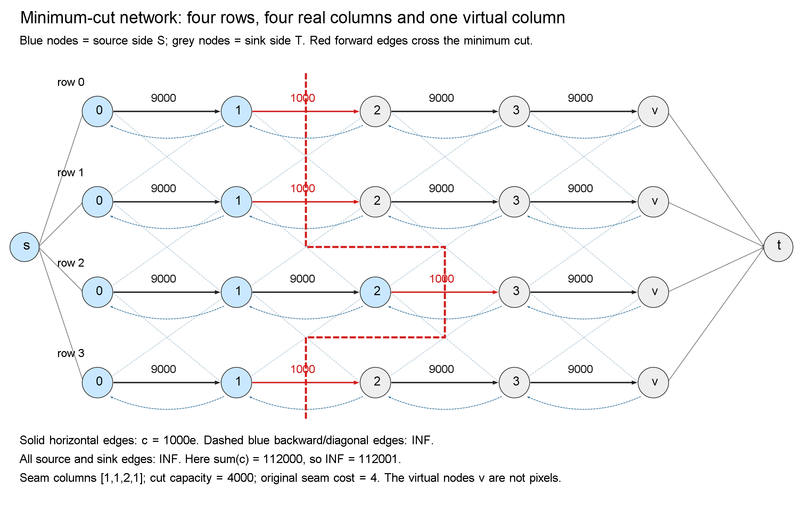
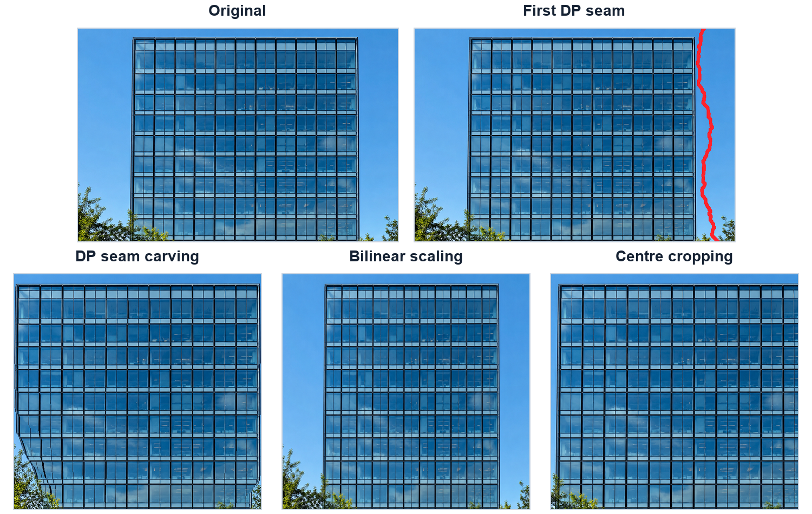
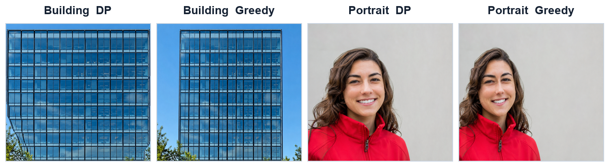
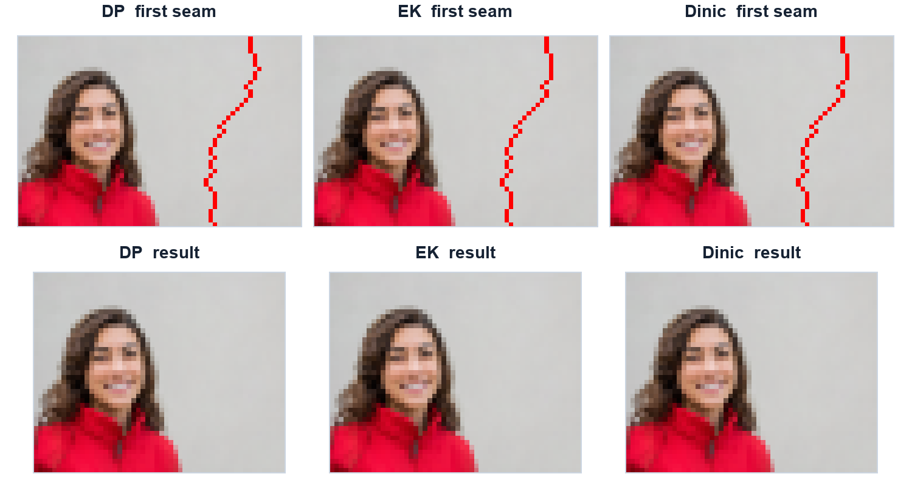
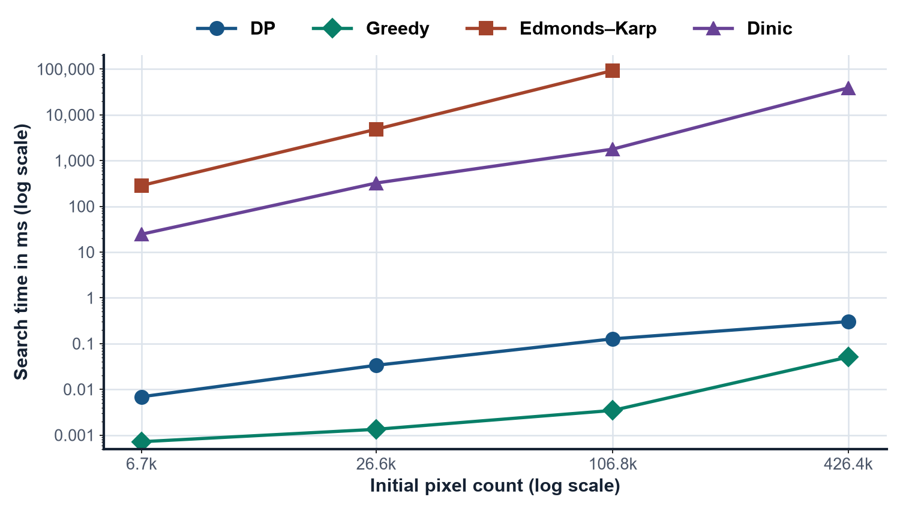
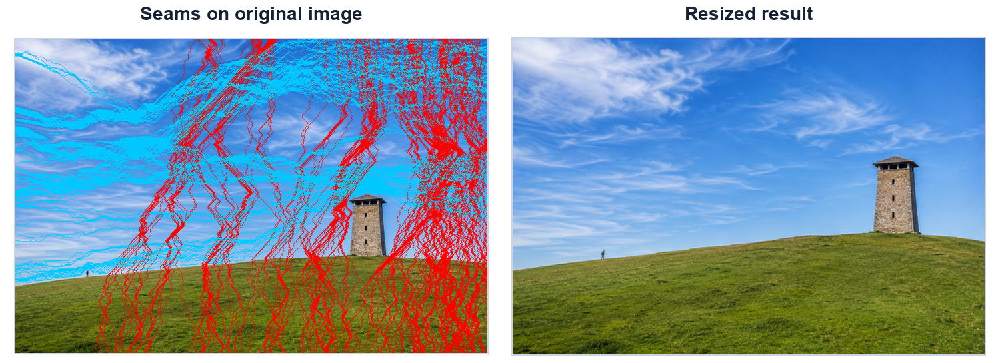

# Image Compression by Seam Carving

**Algorithms Assignment 2**

**Team ID** [Add team ID]

**Team members and SIT IDs** [Add names and SIT IDs]

## Answers to Question 2 (9a ii)

### 2a(i) Number of vertical seams

Let the image have m rows and n columns, with n > 1. A seam starts at any of n pixels in row 1. At every subsequent row, it can stay in the current column or move one column toward an available neighbour. An interior pixel has three extensions, and an edge pixel still has at least two. If n = 1, the second choice disappears.

Each prefix has at least two extensions and different prefixes yield distinct seams. After m − 1 extensions there are **at least n·2ᵐ⁻¹ seams** (that is, n times 2 to the power m − 1). Enumerating all seams is exponential in m. The subproblem below avoids revisiting paths that have the same endpoint.

### 2a(ii) Minimum cost and its subproblems

Let e[i,j] be the energy at row i and column j. Define M[i,j] as the least cost of any seam prefix starting in the first row and ending at (i,j). The cost of a prefix is the sum of the energies along it. Use 1-based indices.

> M[1,j] = e[1,j].
> M[i,j] = e[i,j] + min { M[i−1,p] : 1 ≤ p ≤ n and |p−j| ≤ 1 }, for i > 1.

The first column can use columns 1 and 2 above it, and the last can use columns n − 1 and n. A one-column image has just one predecessor per row. If an optimal prefix to (i,j) used a more expensive prefix to its predecessor, replacing that prefix with the cheapest one ending there would reduce the cost while preserving connectivity. This is the optimal substructure.

The minimum cost of a complete seam is the minimum over the bottom row. Backtracking through the minimising predecessors recovers one optimum. The table has mn entries and each entry examines at most three predecessors. Section 3.1 shows how the implementation fills and backtracks through it.

### 2b Divide and conquer for convolution

Direct 3 × 3 Sobel convolution takes Θ(mn) work. Each output pixel uses a fixed number of samples and there are mn output values to write, so an algorithm producing the full energy map has an Ω(mn) lower bound.

One can split the output into tiles or strips. Each tile reads a one-pixel halo from the original image so its boundary values match the full-image convolution. If N = mn output pixels are split recursively into two equally sized groups and tile boundaries are passed as views, the recurrence is T(N) = 2T(N/2) + O(1) with constant-size leaves, yielding Θ(N) work. Copying overlapping tiles can add work. Independent output tiles can run on multiple cores or fit better in cache. Sobel's separable kernels also permit two 1-D passes, which change the constant factor and add intermediate storage or bookkeeping.

Divide and conquer can therefore reduce elapsed time on suitable hardware, while total work for the full map remains Θ(mn). Section 9 uses measured energy-row parallelism to show when this helps.

## 1. Overview

A vertical seam contains one pixel in every row, and consecutive column indices differ by at most one. A horizontal seam has one pixel in every column under the analogous rule. Seam carving [1] reduces an image one seam at a time by assigning energy to pixels, finding a low-cost connected seam, removing it, and repeating until the target size is reached.

All four implementations use the same backward Sobel energy, pixel-removal code and resize loop. The seam finder is the variable. Dynamic programming (DP) searches all possible seam endpoints through subproblems. Greedy search commits to one pixel per row. Graph cut solves the same seam problem using either Edmonds–Karp (EK) or Dinic on a shared network.

## 2. Common pipeline and energy map

Input pixels are stored as 8-bit RGB triples. The energy calculation uses weighted grayscale intensity **I = 0.299R + 0.587G + 0.114B** without rounding to an 8-bit grayscale value. Both 3 × 3 Sobel kernels are applied to I. For a centre pixel, the horizontal response is the weighted right column minus the weighted left column, with weights (1, 2, 1). The vertical response uses the same weights on the bottom and top rows. Our backward energy is **e = |Gx| + |Gy|**. Pixel coordinates outside the image clamp to the nearest valid row and column.

Removal copies the remaining RGB pixels in each row in order. It changes the neighbours around the seam, so the standard resize loop recomputes energy before every search. For horizontal removal, the loop transposes the RGB image, runs the vertical logic, and transposes the result back. Both Sobel responses exchange roles under transposition, and the sum of their absolute values is invariant under that exchange.

When both dimensions need shrinking, the loop alternates vertical and horizontal removals, starting vertically. Once one dimension reaches its target, it continues along the other. Section 2b above derives the work for a full convolution, and Section 9 evaluates reusing energy values away from the removed seam.

## 3. Seam-finding approaches

### 3.1 Dynamic programming

The algorithm fills the recurrence from Q2(a)(ii) one row at a time. It starts backtracking at the leftmost minimum in the bottom row and repeatedly follows the leftmost minimum-cost valid parent. This gives a deterministic order among tied seams, starting with the bottom row and working upward. Keeping the cumulative table makes it possible to reconstruct the seam directly from the costs.

| Row | Energy values | Cumulative values |
| --- | --- | --- |
| 1 | 5, 1, 0 | 5, 1, 0 |
| 2 | 1, 9, 9 | 2, 9, 9 |
| 3 | 5, 1, 9 | 7, 3, 18 |

In this hand-computed test, M[2,1] = 1 + min(5,1) = 2. The bottom-row minimum is M[3,2] = 3. Backtracking gives columns **(2,1,2)** in top-to-bottom order, with cost 1 + 1 + 1 = 3. The zero-energy start in the rightmost column forces a cost of 9 in the next row. Considering each endpoint avoids committing to that start.

### 3.2 Greedy

Greedy begins at the cheapest top-row pixel. At each row it considers the columns directly below and diagonally adjacent to the previous pixel, discards out-of-range columns, and selects the lowest energy. On a tie it chooses the leftmost candidate, including in the top row. Every chosen step is valid and final.

| Row | Column 1 | Column 2 | Column 3 |
| --- | ---: | ---: | ---: |
| 1 | 1 | 4 | 4 |
| 2 | 8 | 8 | 1 |
| 3 | 8 | 8 | 1 |

On this test grid, greedy selects (1,1,1) and pays **17** because choosing column 1 on the second row keeps column 3 out of reach. DP selects (2,3,3) and pays **6**. The cheaper first move can eliminate a cheaper continuation, so greedy offers no global optimality guarantee.

### 3.3 Graph cut

For each row y, create a chain of n real pixel nodes p(y,0) through p(y,n−1) and a virtual node p(y,n). Add a source and sink. Graph indices start at zero. Let c[y,x] = round(1000·e[y,x]) be the integer capacity for the real pixel in row y and column x.

| Directed arc | Capacity | Function |
| --- | --- | --- |
| Source → first real node, virtual node → sink | B | Force opposite sides at the ends of each row |
| p(y,x) → p(y,x+1), for each real x | c[y,x] | Charge for choosing real pixel x |
| p(y,x) → p(y,x−1), for x ≥ 1 | B | Make source-side nodes a row prefix |
| p(y,x) → p(y±1,x−1), for x ≥ 1 and valid rows | B | Keep adjacent prefix endpoints within one column |

B is one greater than the sum of all finite pixel capacities. Any valid seam defines a cut by assigning each row's real pixels through its selected column to the source side and the remaining nodes to the sink side. Its cost is at most B − 1, so a minimum cut can never cross an arc of capacity B.

Conversely, a cut that avoids those arcs contains the first node on the source side and the virtual node on the sink side. The backward arcs force the source-side part of each row to be one prefix. If one prefix ends at a column at least two positions to the right of an adjacent prefix, its diagonal arc to that row crosses the cut at cost B. Therefore the prefix endpoints satisfy the seam constraint. The only crossing arcs are the finite rightward arcs, one per row, and their sum is the seam cost in scaled units. The virtual node makes the last real pixel eligible, including when n = 1.

After max-flow, start a search from the source on residual arcs of positive capacity. The reachable set is the source side of a minimum cut [3, 5]. For each row, the last reachable real node is the selected pixel. Integer capacities avoid tolerance checks in the flow solver. The scale of 1000 matches the thousandth units of the Sobel energies up to floating-point error. For arbitrary real-valued test maps, rounding can change the order of close seam costs. Optimality for graph cut is defined on the scaled costs.

### 3.3.1 Edmonds–Karp

EK runs BFS over positive-capacity residual arcs to find a shortest augmenting path in number of arcs [3]. It pushes the smallest residual capacity on that path, subtracts the push from each forward residual arc and adds it to the paired reverse arc. Reverse arcs let a later augmentation undo part of an earlier choice. The process ends when BFS cannot reach the sink. Each augmentation costs O(E) and there are O(VE) augmentations in the general bound, for **O(VE²)** time.

### 3.3.2 Dinic

Dinic uses BFS to label reachable nodes by their distance from the source [4, 5]. It then sends a blocking flow using positive-capacity arcs that advance by one level. Once every source-to-sink path in the level graph has a saturated arc, it rebuilds levels from the updated residual network. Within a phase, a current-arc index per node skips arcs already ruled out, and an explicit stack replaces recursive DFS. There are O(V) phases, each costing O(VE) in the general bound, for **O(V²E)** time.

### 3.4 Summary

| Finder | Optimal for one seam | Search time | Search space |
| --- | --- | --- | --- |
| DP | Yes for the given energy map | Θ(mn) | Θ(mn) |
| Greedy | No | Θ(m+n) | O(1) scratch, Θ(m) seam |
| Graph cut with EK | Yes for scaled capacities | O(VE²) | Θ(V+E) |
| Graph cut with Dinic | Yes for scaled capacities | O(V²E) | Θ(V+E) |

The table excludes the shared input energy map. Graph-cut estimates include the graph. Section 7 covers its size and the cost of the full resize.



**Figure 1.** In this example the cut crosses four arcs of capacity 1,000. The blue prefixes end at zero-based columns (1,1,2,1), giving seam cost 4. The constraint capacity B is labelled INF in the diagram.

## 4. Implementation and testing

The project uses C++17 and CMake. The `seamlib` engine contains RGB image I/O and transposition (`image.cpp`), Sobel energy (`energy.cpp`), one implementation per finder, shared residual graph code and the resizing loop (`resize.cpp`). `seamcli` handles file-based resizing and benchmark export. `seamgui` supplies the interactive controls and links the same engine. The project uses stb for image I/O, Dear ImGui and ImPlot for the GUI, GLFW and OpenGL for the window and drawing, and doctest for automated tests.

The seam representation is a vector of column indices, one per row. DP stores its table in one row-major array, so filling a row scans consecutive entries. Graph arcs store indices to their paired reverse arcs for direct updates. A single graph builder accepts a solver function, so changing the max-flow algorithm preserves the network, capacity conversion and seam extraction.

```text
while the current image exceeds the target in either dimension:
    choose the next dimension that still needs shrinking
    work = transpose(current) for horizontal removal, otherwise current
    seam = selected_finder(sobel_energy(work))
    work = remove_vertical_seam(work, seam)
    current = transpose(work) for horizontal removal, otherwise work
```

| Test group | What was checked |
| --- | --- |
| Hand-computed grids | DP returns the cost-3 seam in Section 3.1. The greedy trap returns 17 versus DP's 6. Small graph-cut grids check the selected seam and last-column eligibility. |
| Exhaustive and random checks | DP matches exhaustive search on small maps. EK and Dinic separately match DP on 500 and 300 seeded integer-energy maps. Greedy returns a valid seam of cost at least DP's on 1,000 maps. |
| Flow solver | Dinic and EK agree on 300 random networks. Tests cover reverse-flow cancellation, parallel arcs, zero capacities, an unreachable sink, and a 100,000-node path for iterative traversal. |
| Borders and degenerate cases | Checks cover clamped Sobel sampling, uniform RGB, zero-energy ties, single rows and columns, and 1 × 1 inputs. Finders can return a width-one seam. The public resize entry point keeps both dimensions at least one pixel. |
| End-to-end resize | Tests check horizontal transposition, mixed removal order, exact output dimensions, invalid targets and preserving the input. A reduced castle photo checks two vertical and two horizontal EK seams against DP. |

The integrated C4 Release log records **100 engine tests** and **5 GUI job tests** passed, plus the CLI dimension check. Section 6.1 reports checks on photographic inputs with an absolute cost tolerance of 10⁻⁶. The test sources and output are included in the repository.

## 5. Experimental setup

The five main images are team-generated 800 × 533 RGB PNGs. Each image presents a different visual criterion. The small graph-cut fixtures are 64 × 43 box-downscaled copies of the portrait and building.

| Image | Visual criterion |
| --- | --- |
| Landscape tower | Preserve the tower and small hiker while reducing sky and grass. |
| Red-jacket portrait | Preserve the face and shoulder shape. |
| Glass building | Preserve straight window lines and regular spacing. |
| Person at beach | Preserve the person and the horizon. |
| Wall and door | Preserve the door frame and other straight edges. |

**Four-finder comparison.** We used box-scaled inputs from `landscape-tower.png` and removed two vertical seams per size. The recorded sizes are 100 × 67, 200 × 133, 400 × 267 and 800 × 533. The largest size has DP, greedy and Dinic rows; EK was stopped after five minutes at that size. Search time is the sum of the two finder calls. The file does not record repeat count, machine or compiler metadata for this run. The 800 × 533 Dinic row is a single repeat from a later run of the same benchmark.

**Solver benchmark.** A separate Windows MinGW GCC 13.2.0 Release run measured a single vertical seam on the same scene at widths from 32 to 800. The CPU and RAM were unrecorded for this run. Measurements use a steady clock and the median of three repeats where the time budget permits. The timer starts after computing energy. The graph-cut finder time includes graph construction, solver time and extraction. Solver time is also measured independently inside the call. An in-flight search finishes even when it exceeds the 5,000 ms budget. Later sizes for that solver are skipped.

**GUI and full-resize timing.** The GUI example uses DP and greedy at four scales of the landscape, with ten vertical removals and three repeats. The machine is a Windows PC with an Intel Core i7-14700HX and 31.8 GiB of usable RAM. Its local GUI Release build is configured with MinGW GCC 15.2.0 and `-O3 -DNDEBUG`. The GUI and CLI share a steady-clock benchmark implementation. It reports finder time and seam cost from the same run as the median total time. Total time includes copying the starting image, computing energy, finding and costing seams, and removing them. Loading, initial scaling, display and export are outside this interval.

**Quality and correctness.** On a fixed energy map we compare seam validity and cost. Across a sequence of removals, costs are summed using the current map at every step. For the visual comparison we hold output size fixed and inspect the subject, straight edges and surrounding context. The two conventional baselines are bilinear resizing to the target dimensions and a centre crop to those same dimensions.

## 6. Results

### 6.1 Correctness and seam cost

| Input and workload | DP | Greedy | EK | Dinic |
| --- | ---: | ---: | ---: | ---: |
| Portrait, 64 × 43, first seam | 92.844 | 127.450 | 92.844 | 92.844 |
| Building, 64 × 43, first seam | 826.712 | 3,938.432 | 826.712 | 826.712 |
| Landscape, 100 × 67, two seams | 3,486.44 | 4,132.97 | 3,486.44 | 3,486.44 |
| Landscape, 200 × 133, two seams | 4,643.69 | 8,614.00 | 4,643.69 | 4,643.69 |
| Landscape, 400 × 267, two seams | 7,500.56 | 14,075.60 | 7,500.56 | 7,500.56 |

**Table 1.** First-seam costs and two-removal sums in energy units. The greedy values for the two 64 × 43 fixtures come from a separate one-seam run of the same CLI benchmark.

On both small fixtures, each graph-cut solver removed ten seams. The cost at every step matched DP run on that solver's current image within 10⁻⁶. The building's first seam and final pixels matched DP's. The portrait had different first-seam positions and different final pixels at the same seam cost on the initial map. Several seams can be optimal, and choosing one can change the map for the next removal.

### 6.2 Visual results



**Figure 2.** Width reduction from 800 to 560 pixels. The widened red line marks the first DP seam in the sky beside the building. After 240 removals, DP retains much of the window grid and bends some lines near the lower corners. Bilinear scaling narrows the windows across the scene. The centre crop retains spacing in the visible grid and cuts away the margins and part of the right façade.



**Figure 3.** DP and greedy at the same 560 × 533 output size. Greedy keeps more of the side sky and narrows the façade. DP removes more sky and preserves more of the façade's width. On the portrait, both retain the face, while the greedy output narrows its outline and leaves more wall.



**Figure 4.** First seam overlays (top) and results after ten removals (bottom). The 64 × 43 portrait shrinks to 54 × 43. All three optimisers have the same initial seam cost. DP and graph cut take slightly different equally cheap paths through the background, and each result retains the face.

### 6.3 Runtime

| Initial size | DP (ms) | Greedy (ms) | EK (ms) | Dinic (ms) |
| --- | ---: | ---: | ---: | ---: |
| 100 × 67 | 0.00689 | 0.000716 | 285.582 | 24.612 |
| 200 × 133 | 0.03358 | 0.001338 | 4,849.02 | 323.661 |
| 400 × 267 | 0.12715 | 0.003465 | 93,284.2 | 1,784.04 |
| 800 × 533 | 0.30243 | 0.050885 | — | 39,098.4 |

**Table 2.** Accumulated finder time for two removals, excluding the shared pipeline. A dash means the run was not completed: EK did not finish 800 × 533 within a five-minute limit and was stopped.



**Figure 5.** Table 2 on logarithmic axes. The EK curve ends at 400 × 267 because EK did not finish 800 × 533 within five minutes. Graph-cut times include building the network and extracting the seam.

The separate solver benchmark shows what happens inside the graph-cut calls. At 128 × 85, EK used 3,356 BFS augmentations and took 1,889 ms in its solver. Dinic sent the same number of augmenting pushes in 89 level-graph phases and took 115 ms in its solver. EK crossed the five-second budget at 200 × 133, while Dinic first crossed it at 400 × 267. A separate single-run 1000 × 700 Dinic check matched the DP cost of 7,967.598 and took 109.75 s for the entire search.

The GUI run illustrates the effect of shared work. At 800 × 533 over ten removals, greedy spent 0.132 ms searching versus 11.185 ms for DP. Total time was 64.222 ms for greedy and 72.397 ms for DP, a difference of about 11% relative to DP. The totals include full Sobel recomputation and the RGB copies.

## 7. Complexity analysis

Let m denote the number of rows and n the width in the orientation currently used. The energy calculation and RGB copy are Θ(mn) per removal. A transpose is also Θ(mn), so using it for horizontal seams preserves the asymptotic bounds.

### Graph size and solver bounds

There are **V = m(n+1)+2** vertices, including the virtual column and two terminals. The original arcs are mn finite rightward arcs, mn backward constraints, 2(m−1)n diagonal constraints and 2m terminal arcs. Therefore **E = 2mn + 2(m−1)n + 2m**. Storing a reverse residual arc for every original arc produces 2E adjacency entries. Both V and E are Θ(mn), even when one dimension equals one.

Substitution gives O((mn)³) for both EK and Dinic as general per-seam worst-case upper bounds on this graph. Building and reading the graph take Θ(mn) in addition to solving flow. The graph and solver state occupy Θ(mn) space, with a larger constant than the DP table because each node has adjacency storage and multiple residual arc records.

### Repeated removal

Let Aₜ = mₜnₜ be the area immediately before removal t. Costs add over removals because each works on the output of the previous one. Graphs and DP tables can be released after each search, so their space does not accumulate across k seams.

| Method | Full resize time for k seams | Upper bound using initial dimensions | Peak resize space |
| --- | --- | --- | --- |
| DP | Θ(Σ Aₜ) | O(kmn) | Θ(mn) |
| Greedy | Θ(Σ Aₜ) | O(kmn) | Θ(mn) |
| Graph cut with EK | O(Σ Aₜ³) | O(k(mn)³) | Θ(mn) |
| Graph cut with Dinic | O(Σ Aₜ³) | O(k(mn)³) | Θ(mn) |

The space column includes RGB images, energy and finder state. It excludes saved visualisation frames. For k vertical removals, Σ Aₜ = m[kn − k(k−1)/2]. The greedy finder itself visits only the top row and at most three candidates per remaining row. The full RGB and energy passes explain its Θ(Σ Aₜ) pipeline cost.

### Measured slopes

We fitted log(time) against log(initial pixel count) over the three sizes shared by all four methods in Table 2. The fitted slopes were **1.05 for DP, 0.57 for greedy, 2.09 for EK and 1.55 for Dinic**. For the nearly fixed aspect ratio, Θ(mn) and Θ(m+n) correspond to area slopes 1 and 0.5. The graph-cut slopes measure this one image and size range. The cubic bounds describe worst-case growth and allow smaller observed exponents. Three points and sub-millisecond samples make the estimates sensitive to timing noise and input content.

## 8. Comparison and discussion

DP matched both graph-cut solvers' costs on the measured maps and searched much faster because the problem has one subproblem per endpoint. Greedy saved search time but cost 1.19–1.88 times as much as DP on the three shared landscape sizes. Greedy may suit cases where approximate seams are acceptable. The building comparison shows how its local choices can compress the subject.

Graph cut gives an independent formulation with two interchangeable solvers. It can represent other constraints if they admit a valid graph construction. Forward energy [2] charges for newly adjacent pixels, which could reduce visible discontinuities. It would require transition costs in the DP recurrence or graph and a separate evaluation. As in the baseline comparisons of Avidan and Shamir [1], our building results show how scaling compresses geometry and cropping discards context.

**EK versus Dinic.** The two solvers share the O((mn)³) worst-case bound here. Dinic was 11.6×, 15.0× and 52.3× faster over the two searches at the three shared sizes. The counts in Section 6.3 show how Dinic reuses one BFS level graph for multiple pushes. EK runs BFS for every push. The speedup is empirical and depends on the network.

## 9. Improvements (Q5d)

These variants were evaluated with the project's DP optimisation benchmarks. The standard four-finder comparison uses the common resize path. The repeated-removal improvements here build on the DP subproblem from Q2(a)(ii) and the independent convolution outputs from Q2(b).

**Rolling cost rows and back-pointers.** A row depends on just the previous row. Two rows of doubles suffice during the forward pass. To reconstruct the seam, store one signed byte per pixel with predecessor direction −1, 0 or +1. The method retains Θ(mn) space but reduces cumulative-cost storage from 8mn bytes to about mn + 16n bytes before output and allocation overhead. For the 2048 × 1536 benchmark, measured peak heap for the finder dropped from 24.01 to 3.04 MiB and the combined benchmark showed a 1.03× full-pipeline speedup for this variant.

**Incremental energy.** Shift cached energy values to match retained pixels. For each row, re-evaluate where its 3 × 3 Sobel neighbourhood may have changed due to the seam in that row or either adjacent row. The implementation considers at most six candidate columns per row. The Sobel re-evaluation is O(m) after removal, while copying the cached map and RGB data stays Θ(mn). The combined benchmark measured 3.07×, 3.11× and 2.05× pipeline speedups on the small, medium and large inputs, with identical output pixels.

**Multithreading.** Sobel output rows can be computed independently with a shared read-only RGB image, as discussed in Q2(b). With eight threads the energy pass was 2.20× faster on 1024 × 768 and 2.68× faster on 2048 × 1536. The small 256 × 192 energy pass slowed down. Splitting columns inside a DP row is possible, but each row needs its predecessor row to be complete. The benchmark's per-row barriers outweighed the small amount of work per cell. Successive removals also depend on earlier ones, which constrains parallelism across seams.

## 10. Bonus features

**Step-by-step visualisation.** The resize callback supplies the image immediately before a removal, the seam and its orientation. The CLI can save step frames. A coordinate tracker maps removed pixels back to the original image, so the overview can draw vertical seams in red and horizontal seams in blue. The GUI can replay earlier steps and generate a frame on demand.



**Figure 6.** Overview and final output for an 800 × 533 input reduced to 640 × 430 with mixed-direction removal.

**Interactive resizing.** The desktop GUI lets users load an image, choose a finder, edit target dimensions, start or cancel work, and inspect the result and removed seams. A background worker runs the engine and reports progress to the UI. Cancellation is checked between removals, so a running max-flow call must reach a seam boundary before cancellation takes effect. The benchmark panel draws results and exports the same data as CSV.


**Figure 7.** Interactive resize from 800 × 533 to 600 × 533. The preview shows the original and the output, and the controls report 200 removed seams.

**CI/CD.** GitHub Actions builds and tests on Windows and Ubuntu. A smoke test resizes a fixture, checks its dimensions and checks that the step-frame and overview files exist. Workflow configurations also retain binaries and smoke outputs as artifacts and provide a tagged release job.

## 11. Limitations and conclusion

Our results cover a small set of generated scenes and a small photo fixture. Visual quality was judged by inspection. Backward Sobel energy favours low local gradients, so it can assign a low cost to smooth regions that still matter to the subject. An optimal seam minimises the current energy sum, and repeated removal can commit to a sequence that is suboptimal for the final image. Ties and the fixed vertical–horizontal schedule can also affect the result. The fastest measured solver varies with the objective and problem structure, and the benchmark slopes are specific to the recorded fixtures and size range.

For shrinking images with the implemented backward energy and seam constraints, DP provided the strongest combination of measured speed, seam cost and visual quality. Greedy made individual searches cheap but could cut salient structure. Both graph-cut solvers validated the single-seam optimum on the tested maps, and Dinic let us run substantially larger networks within a comparable time. The measured DP variants suggest that reusing Sobel energy offers the largest pipeline improvement among the optimisations tested.

## Links (9a iv)

- Code repository [GitHub](https://github.com/sheeyang/Algo-Group-Assignment-2)
- Presentation video [Add presentation video URL]

## AI usage declaration (9a v)

We used Claude Code, ChatGPT, Codex and Antigravity for project planning, implementation support, test fixtures and cases, benchmark tooling, and report drafts. The development log records the tool, prompt, outcome and checks for each task. It includes human review of the generated implementation, test and benchmark runs, and revisions to the report.

| Use | Main prompts recorded by the team |
| --- | --- |
| Design and setup | “read the assignment requirements, and help me setup the project” and “help me do C1” |
| Seam algorithms | “i am tasked to complete the graph cut network + Edmonds-Kaip how do i start on this for this assignmen?” and “branch out and implement greedy” |
| Implementation and GUI | “Need help with the brief of C6” and “Help me understand what's happening in the code and how you would recommend proceeding” |
| Testing, benchmarks and CI | “Help me generate comprehensive unit test cases and randomized test suites for Dinic's algorithm, and set up benchmarks to test Dinic against Edmonds-Karp and DP”, “Walk me through running the benchmarks and the CSVs”, and “how do we implement a CI which helps build and test on ubuntu and windows, smoke test, artifacts and a badge. Walk me through setting it up” |
| Images and report | ChatGPT generated images from the prompts listed in the test-data notes. For report drafting, prompts included “Give me a draft of how the report should look like and explain it to me” and a request to rewrite the 52-page report using R1–R6, the rubric and the supplied 10–20 page structure. Codex used repository evidence to condense the report and prepare the comparison figures. |

## References

[1] S. Avidan and A. Shamir, “Seam Carving for Content-Aware Image Resizing,” *ACM Transactions on Graphics*, vol. 26, no. 3, 2007. [Paper](https://doi.org/10.1145/1275808.1276390)

[2] M. Rubinstein, A. Shamir, and S. Avidan, “Improved Seam Carving for Video Retargeting,” *ACM Transactions on Graphics*, vol. 27, no. 3, 2008. [Paper](https://doi.org/10.1145/1360612.1360615)

[3] J. Edmonds and R. M. Karp, “Theoretical Improvements in Algorithmic Efficiency for Network Flow Problems,” *Journal of the ACM*, vol. 19, no. 2, pp. 248–264, 1972. [Paper](https://doi.org/10.1145/321694.321699)

[4] E. A. Dinic, “Algorithm for Solution of a Problem of Maximum Flow in a Network with Power Estimation,” *Soviet Mathematics Doklady*, vol. 11, pp. 1277–1280, 1970.

[5] T. H. Cormen, C. E. Leiserson, R. L. Rivest, and C. Stein, *Introduction to Algorithms*, 4th ed., MIT Press, 2022. [Publisher](https://mitpress.mit.edu/9780262046305/introduction-to-algorithms/)
